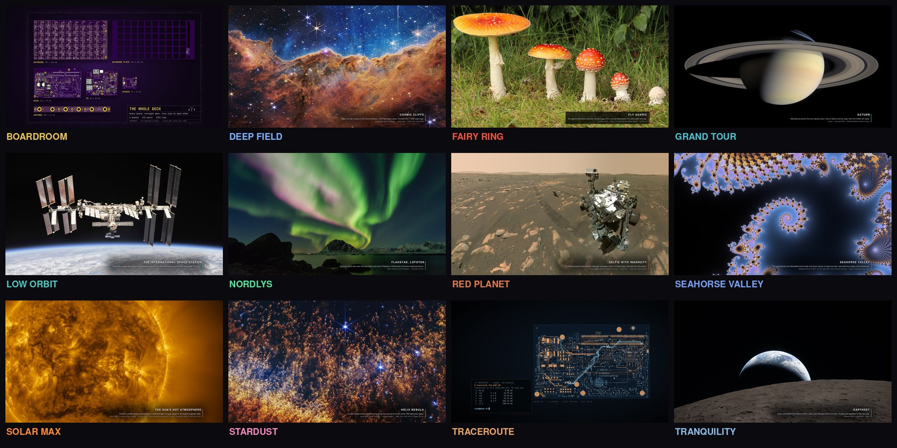
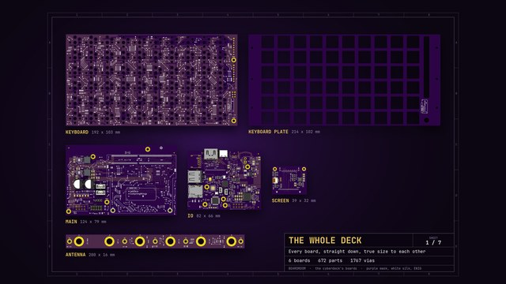
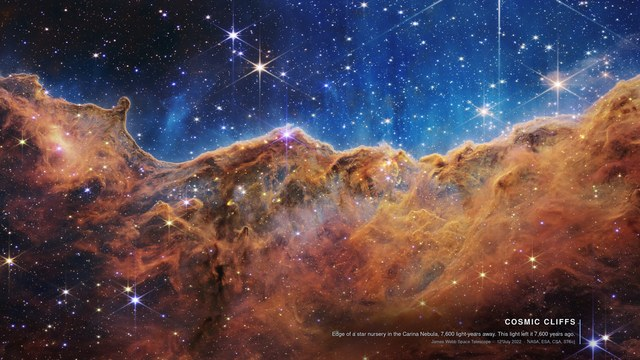
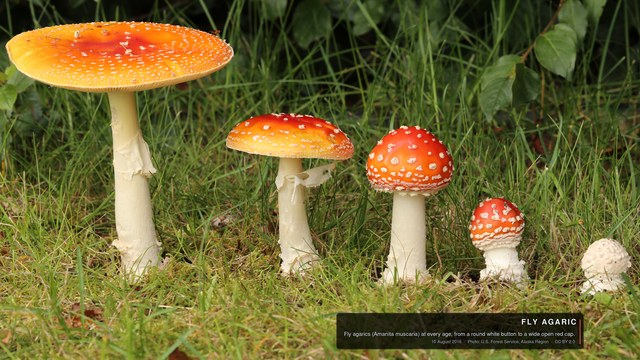
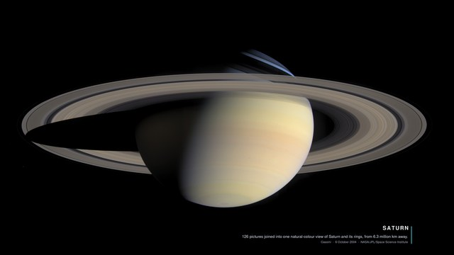
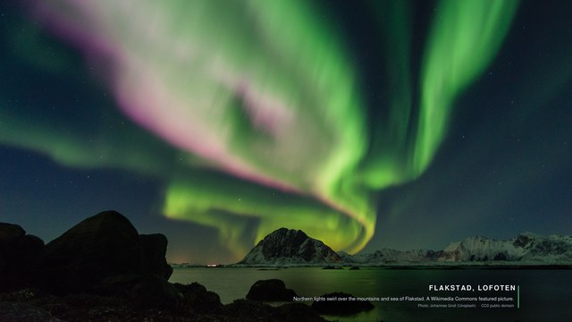
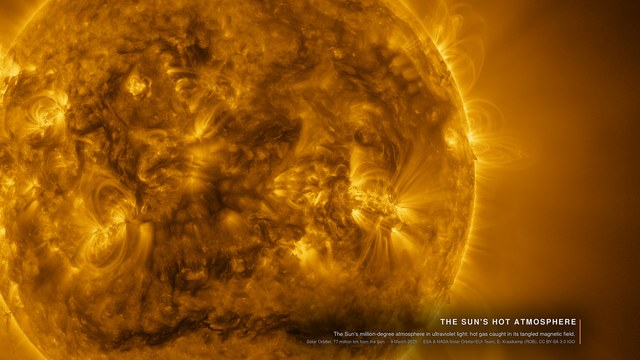
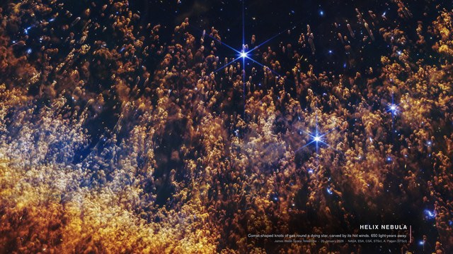
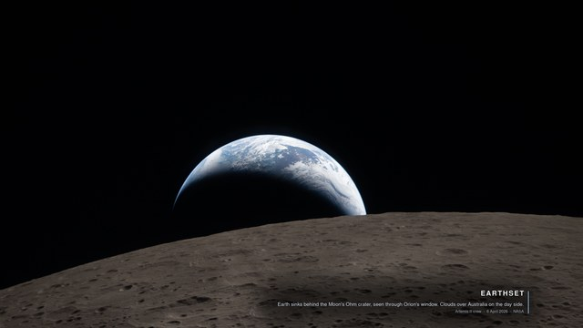

# Omarchy Themes

[](https://github.com/CompilingThings/omarchy-themes/actions/workflows/check.yml)
[](LICENSE)

**Twelve themes for [Omarchy](https://omarchy.org):** the planets, the Sun and the Moon in real spacecraft photos,
the northern lights over Norway, mushrooms from forests round the world, fractals drawn from their formulas, and the circuit boards of a homemade computer.
Every wallpaper is 4K and carries a small label saying what it shows and who made it.



| | Theme | What it is |
|---|---|---|
|  | [**Boardroom**](themes/boardroom/README.md) | KiCad 3D renders of a cyberdeck's six boards on a purple drawing sheet; purple, white and gold |
|  | [**Deep Field**](themes/deep-field/README.md) | Deep space from the James Webb telescope, Cassini and the Space Station; deep blue |
|  | [**Fairy Ring**](themes/fairy-ring/README.md) | Mushrooms from forests round the world: fly agarics, glowing fungi, amethyst deceivers; fly agaric red and amethyst |
|  | [**Grand Tour**](themes/grand-tour/README.md) | Saturn, Jupiter, Io, Europa and Pluto from Cassini, Juno and New Horizons; teal |
|  | [**Low Orbit**](themes/low-orbit/README.md) | Earth from the Space Station, plus a turning Earth as a video wallpaper; sea green |
|  | [**Nordlys**](themes/nordlys/README.md) | The northern lights seen from Norway, Lofoten to Svalbard; aurora green and violet |
|  | [**Red Planet**](themes/red-planet/README.md) | Mars from its rovers and orbiters; rust and dust |
|  | [**Seahorse Valley**](themes/seahorse-valley/README.md) | Nine fractals, each in the colours of one of Omarchy's own themes; Tokyo Night |
|  | [**Solar Max**](themes/solar-max/README.md) | The Sun at its most active, flares and eclipses; solar orange |
|  | [**Stardust**](themes/stardust/README.md) | The clearest nebula pictures of 2026 from Webb, Hubble and Euclid; rose and gold |
|  | [**Traceroute**](themes/traceroute/README.md) | A circuit board at night, one signal traced hop by hop like `traceroute`; copper and ice blue |
|  | [**Tranquility**](themes/tranquility/README.md) | The Moon from Artemis II and Apollo; greys and Earth blue |

Each theme's own page lists its wallpapers, what each one shows, and where it comes from.

## Install

You need Omarchy 4.5 or newer and git.

```sh
git clone --depth 1 https://github.com/CompilingThings/omarchy-themes.git
cd omarchy-themes
./install nordlys              # one theme; or several: ./install nordlys stardust; or every one: ./install --all
omarchy theme set nordlys
```

The whole repository is about 200 MB, almost all of it wallpapers. To download only the themes you want:

```sh
git clone --depth 1 --filter=blob:none --sparse https://github.com/CompilingThings/omarchy-themes.git
cd omarchy-themes
git sparse-checkout set themes/nordlys themes/stardust
./install nordlys stardust
```

`./install --list` shows the themes. To update, run `git pull` and `./install` again; to remove a theme, use
`omarchy theme remove <theme>`. The installer copies each theme to `~/.config/omarchy/themes/<theme>` and only ever
replaces a theme it put there itself.

> `omarchy theme install <url>` installs a repository holding a single theme, so it does not work with this one.
> Use `./install` as above.

## What every theme includes

- **Wallpapers at 3840 x 2160.** Omarchy crops a wallpaper to fill the screen, so labels and title blocks sit in the
  part a 3:2 screen shows (Framework 13, Surface); 16:9 and 16:10 screens show them whole too. On an ultrawide
  (21:9) screen the top and bottom are cropped, and the label may be cut.
- **Colours for the whole desktop:** window borders (several with a soft glow), terminal, bar, menus, launcher and
  icon colour. The terminal is slightly see-through over the wallpaper.
- **Readable colours.** Text is at least 7:1 against its background (most themes over 15:1) and every terminal
  colour at least 4.5:1, measured as in [WCAG 2.2](https://www.w3.org/TR/WCAG22/#dfn-contrast-ratio).
- **A boot screen:** the Omarchy logo in the theme's accent colour, ready for `omarchy plymouth set by theme <theme>`.
- **Credits** on every picture, and in [CREDITS.md](CREDITS.md) with each licence.

Low Orbit's first wallpaper is a 60-second video, played by owe, Omarchy's video wallpaper engine.

## Making the wallpapers

The scripts that made every wallpaper are in [src/](src/README.md): photos are downloaded from their source and
cut and labelled by `src/photowall.py`, the fractals are drawn by `src/fractal.c`, and the turning Earth by
`src/earthspin.py`. `src/build <theme>` remakes a theme from its `wallpapers.json`.

## Contributing

Fixes and new themes are welcome; [CONTRIBUTING.md](CONTRIBUTING.md) describes the rules each theme meets.
`python3 tools/check.py` checks them, and runs on GitHub for every pull request.

## Licence

Copyright 2026 CompilingThings.

- Code and theme files (`install`, `src/`, `tools/`, each theme's `colors.toml`, `hyprland.lua`, `foot.ini`,
  `shell.*.toml`): [MIT](LICENSE).
- Pictures made for this repository (Boardroom, Traceroute, Seahorse Valley's fractals, Low Orbit's turning Earth):
  [CC BY 4.0](LICENSES/CC-BY-4.0.txt). Each `preview.png` and the pictures in `docs/images/` are small copies of
  wallpapers and keep the licence of the wallpaper they show.
- Photos: each under its own licence, printed on the picture and listed in [CREDITS.md](CREDITS.md): NASA's media
  guidelines, CC BY, CC BY-SA, CC0, and CC BY-NC-SA for three of Grand Tour's Juno pictures, which may not be used
  commercially. A wallpaper made from a share-alike photo is shared under that photo's licence.
- The boot screen logo is Omarchy's (MIT, copyright David Heinemeier Hansson). Seahorse Valley uses Omarchy's Tokyo
  Night files for Neovim, VS Code and icons, unchanged (MIT).

[REUSE.toml](REUSE.toml) gives the copyright and licence of every file in the
[REUSE](https://reuse.software/) format.

This project is not made by or connected with Omarchy, NASA, ESA, CSA, DLR or any other source named in the credits,
and no endorsement by them is implied.
