# Omarchy Themes

[](https://github.com/CompilingThings/omarchy-themes/actions/workflows/check.yml)
[](LICENSE)

**Thirty-four themes for [Omarchy](https://omarchy.org), each with its own animated screensaver:** the planets, the Sun and the Moon in real spacecraft photos,
the northern lights over Norway, mushrooms from forests round the world, insects up close, and under the microscope the animals in a drop of pond water, the same animals glowing in colour on black, crystals and slices of rock in polarised light, crystals standing alone on black, bubbles and soap films, the bare silicon inside old chips, plant stems sliced thin and glowing, brains, eyes and cells lit with glowing dyes, viruses coloured in from the electron microscope, the immune cells that fight them, butterfly wings scale by scale, and insects glowing under violet light, frog and reptile eyes, glowing jellyfish, single snowflakes photographed a century ago, lightning and thunderstorms, fractals drawn from their formulas, and the circuit boards of a homemade computer.
Every wallpaper is 4K and carries a small label saying what it shows and who made it.


| | Theme | What it is |
|---|---|---|
| 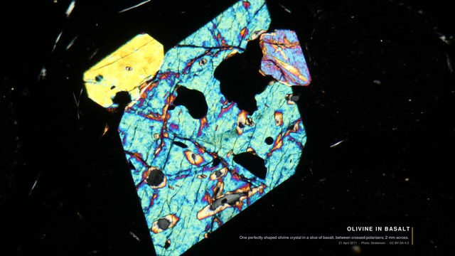 | [**Bedrock**](themes/bedrock/README.md) | Rock sliced thin and seen between crossed polarisers: olivine, kyanite, serpentine veins, myrmekite; gold and cyan |
|  | [**Boardroom**](themes/boardroom/README.md) | KiCad 3D renders of a cyberdeck's six boards on a purple drawing sheet; purple, white and gold |
| 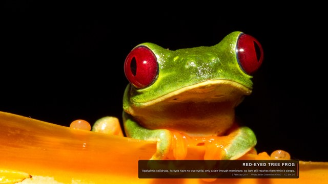 | [**Cold Blood**](themes/cold-blood/README.md) | Frogs, lizards, snakes and crocodiles up close, every scale and eye pattern sharp; tree frog red and pit viper green |
| 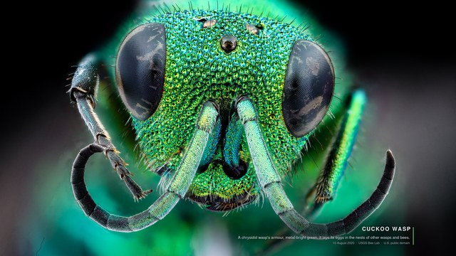 | [**Compound Eye**](themes/compound-eye/README.md) | Insect faces in extreme close-up, mostly from the USGS Bee Lab; cuckoo wasp green and iridescent blue |
|  | [**Deep Field**](themes/deep-field/README.md) | Deep space from the James Webb telescope, Cassini and the Space Station; deep blue |
| 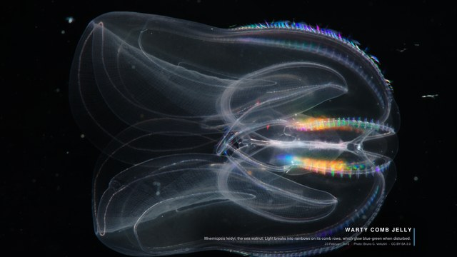 | [**Deep Sea**](themes/deep-sea/README.md) | Jellyfish and comb jellies lit in dark water, and an isopod from 900 m down; glowing blue and bluefire purple |
| 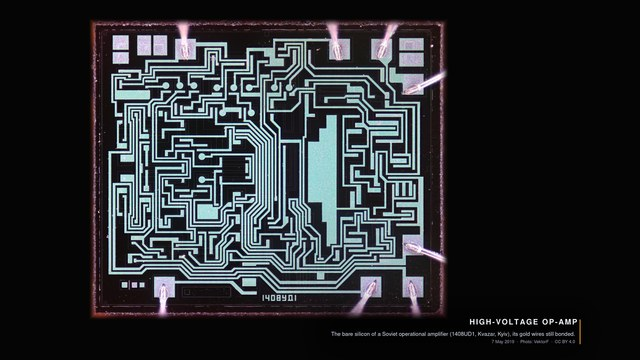 | [**Die Shot**](themes/die-shot/README.md) | The bare silicon of old chips under the microscope, whole on black: tracks, bond pads, gold wires; gold and pale cyan |
|  | [**Fairy Ring**](themes/fairy-ring/README.md) | Mushrooms from forests round the world: fly agarics, glowing fungi, amethyst deceivers; fly agaric red and amethyst |
|  | [**Grand Tour**](themes/grand-tour/README.md) | Saturn, Jupiter, Io, Europa and Pluto from Cassini, Juno and New Horizons; teal |
| 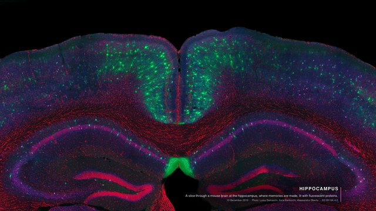 | [**Inner Space**](themes/inner-space/README.md) | Brains, eyes and cells glowing under the microscope: a mouse hippocampus, nerve fibres, a fly retina, dividing cells; pink and cyan-green |
| 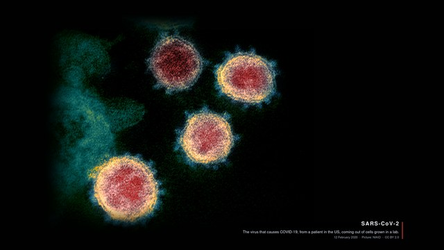 | [**Viral**](themes/viral/README.md) | Viruses under the electron microscope, coloured by NIAID: COVID-19, Omicron, Ebola, mpox, bird flu, HIV, rabies, hepatitis B; red and teal |
| 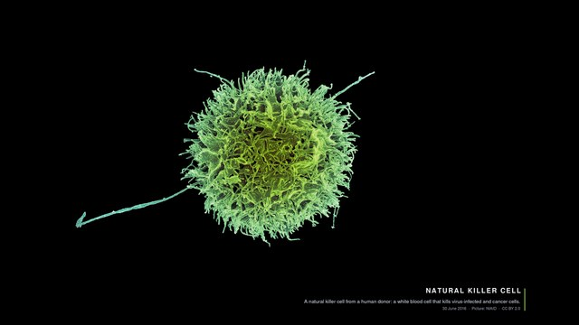 | [**Front Line**](themes/front-line/README.md) | The body's defenders under the electron microscope, coloured by NIAID: killer cells, T cells, B cells, MRSA, malaria; green and violet |
| 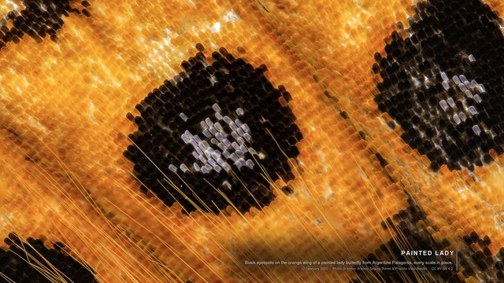 | [**Scale Wing**](themes/scale-wing/README.md) | Butterfly and moth wings up close, scale by scale: a painted lady, the large blue, the green hairstreak, pollen on a moth; blue and orange |
| 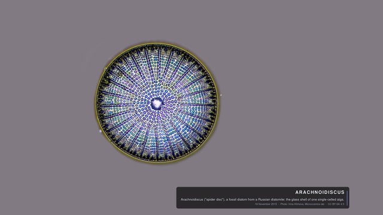 | [**Glass House**](themes/glass-house/README.md) | Diatoms, algae in shells of glass, most of them 32 to 40 million year old fossils: discs, triangles, a needle, a honeycomb; glass violet and diatom green |
| 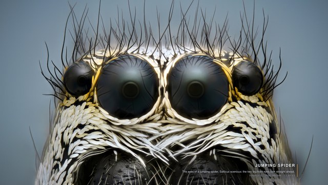 | [**Eight Eyes**](themes/eight-eyes/README.md) | Spiders and mites up close: jumping-spider eyes, tarantulas, water mites, a mite's skin under the electron microscope; tarantula gold and moult cyan |
| 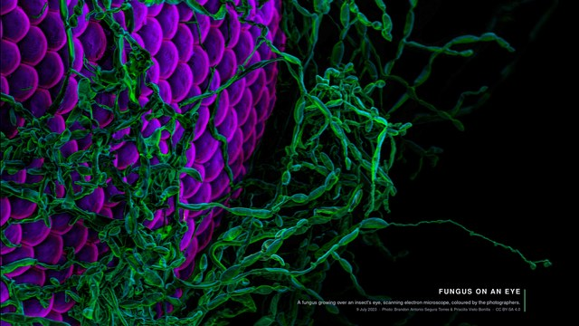 | [**Spore Garden**](themes/spore-garden/README.md) | Moulds and fungi under the microscope: threads across an insect's eye, spore rosettes, Penicillium, bread mould, a mildew's spore case; fungus green and eye magenta |
| 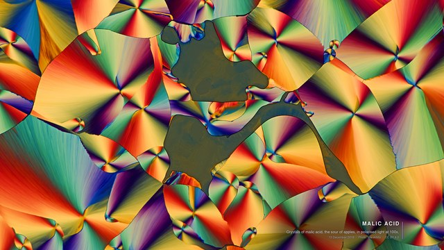 | [**Kaleidoscope**](themes/kaleidoscope/README.md) | Chemicals crystallising in polarised light, each crystal its own band of colour: malic acid, vanillin, Epsom salt, a liquid crystal in layers; violet and gold |
| 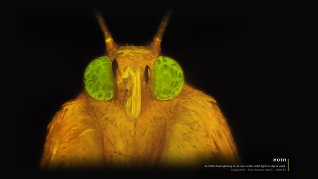 | [**Lantern**](themes/lantern/README.md) | Insect heads glowing on their own under a fluorescence microscope: ants, flies, a moth, a ladybird; eye green and shell gold |
| 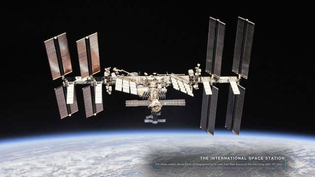 | [**Low Orbit**](themes/low-orbit/README.md) | Earth from the Space Station, plus a turning Earth as a video wallpaper; sea green |
| 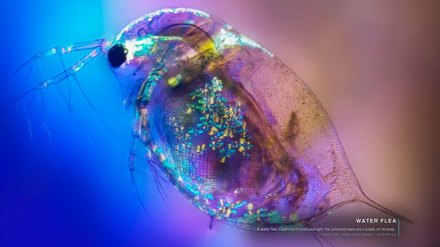 | [**Neon Pond**](themes/neon-pond/README.md) | Water fleas, copepods and midge larvae glowing in colour on black, in dark field and polarised light; cyan and yellow |
|  | [**Nordlys**](themes/nordlys/README.md) | The northern lights seen from Norway, Lofoten to Svalbard; aurora green and violet |
| 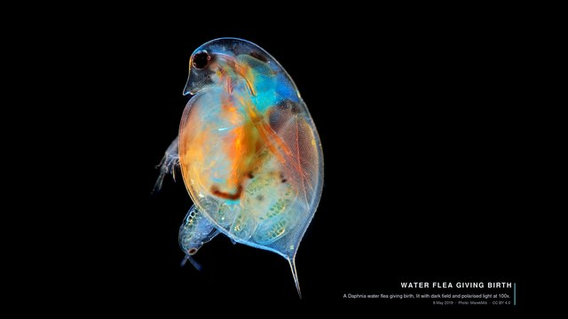 | [**Pond Drop**](themes/pond-drop/README.md) | Water fleas, copepods, seed shrimp and water mites from a drop of pond water, under the microscope; dark-field black, water-flea teal and amber |
| 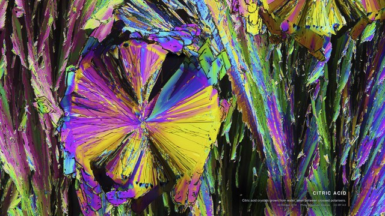 | [**Prism**](themes/prism/README.md) | Crystals of citric acid, vitamin C, aspirin and sulfur under the microscope, coloured by polarised light; sulfur magenta and citric yellow |
| 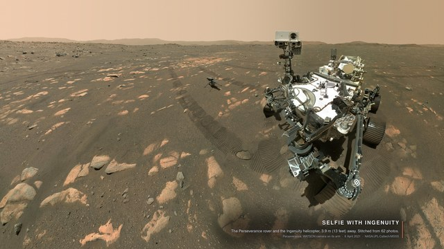 | [**Red Planet**](themes/red-planet/README.md) | Mars from its rovers and orbiters; rust and dust |
| 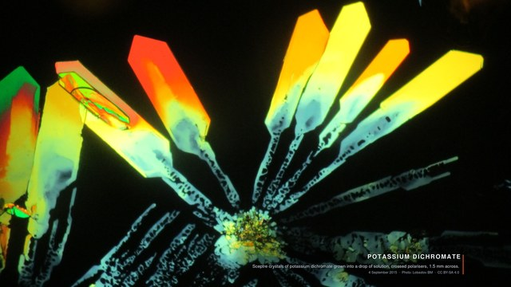 | [**Sceptre**](themes/sceptre/README.md) | Crystals standing alone on black: potassium dichromate sceptres, ammonium nitrate needles, sugar, methylene violet, potato starch, a star of sea minerals; flame orange and ice cyan |
| 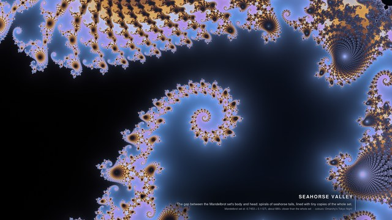 | [**Seahorse Valley**](themes/seahorse-valley/README.md) | Nine fractals, each in the colours of one of Omarchy's own themes; Tokyo Night |
| 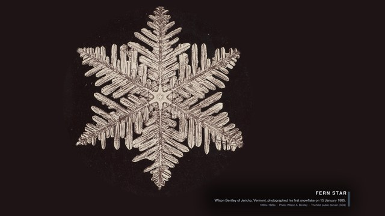 | [**Snow Crystal**](themes/snow-crystal/README.md) | Single snowflakes photographed through a microscope by Wilson Bentley, 1890s–1920s; plate black, print cream and icy blue |
|  | [**Solar Max**](themes/solar-max/README.md) | The Sun at its most active, flares and eclipses; solar orange |
|  | [**Stardust**](themes/stardust/README.md) | The clearest nebula pictures of 2026 from Webb, Hubble and Euclid; rose and gold |
| 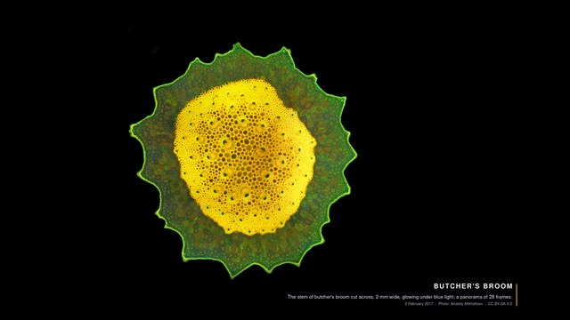 | [**Stem Glow**](themes/stem-glow/README.md) | Plant stems, stalks and a pine needle sliced thin, glowing gold and green under blue light or coloured by polarised light; gold and glow green |
| 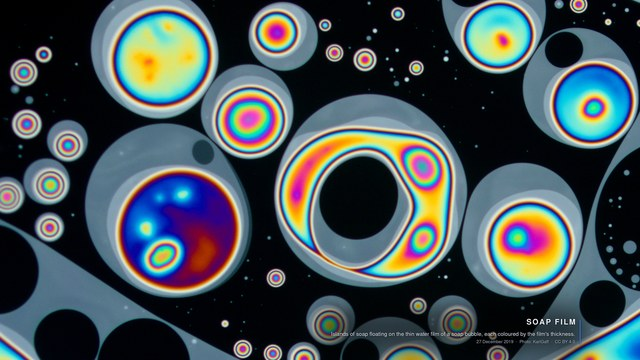 | [**Surface Tension**](themes/surface-tension/README.md) | Bubbles under the microscope: soap islands on a soap film, air bubbles in a melting and drying plastic, a foam, packed soap bubbles; foam blue and soap-film magenta |
| 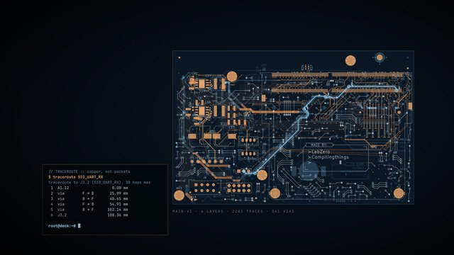 | [**Traceroute**](themes/traceroute/README.md) | A circuit board at night, one signal traced hop by hop like `traceroute`; copper and ice blue |
| 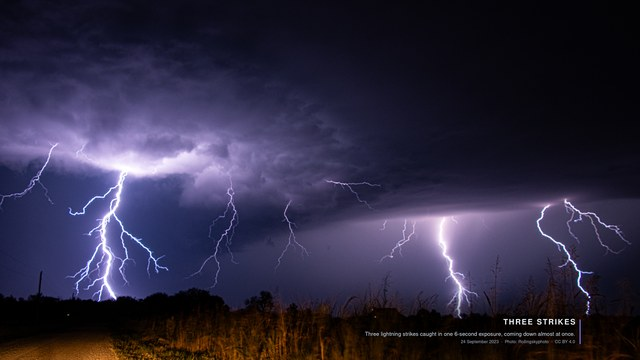 | [**Thunderhead**](themes/thunderhead/README.md) | Lightning at night and the clouds of big thunderstorms: shelf clouds, mammatus, a glowing anvil; lightning violet and electric blue |
|  | [**Tranquility**](themes/tranquility/README.md) | The Moon from Artemis II and Apollo; greys and Earth blue |

Each theme's own page lists its wallpapers, what each one shows, and where it comes from.

## Install

You need Omarchy 4.5 or newer and git.

```sh
git clone --depth 1 https://github.com/CompilingThings/omarchy-themes.git
cd omarchy-themes
./install nordlys              # one theme; or several: ./install nordlys stardust; or every one: ./install --all
omarchy theme set nordlys
```

The whole repository is about 200 MB, almost all of it wallpapers. To download only the themes you want:

```sh
git clone --depth 1 --filter=blob:none --sparse https://github.com/CompilingThings/omarchy-themes.git
cd omarchy-themes
git sparse-checkout set themes/nordlys themes/stardust
./install nordlys stardust
```

`./install --list` shows the themes. To update, run `git pull` and `./install` again; to remove a theme, use
`omarchy theme remove <theme>`. The installer copies each theme to `~/.config/omarchy/themes/<theme>` and only ever
replaces a theme it put there itself.

> `omarchy theme install <url>` installs a repository holding a single theme, so it does not work with this one.
> Use `./install` as above.

## What every theme includes

- **Wallpapers at 3840 x 2160.** Omarchy crops a wallpaper to fill the screen, so labels and title blocks sit in the
  part a 3:2 screen shows (Framework 13, Surface); 16:9 and 16:10 screens show them whole too. On an ultrawide
  (21:9) screen the top and bottom are cropped, and the label may be cut.
- **Colours for the whole desktop:** window borders (several with a soft glow), terminal, bar, menus, launcher and
  icon colour. The terminal is slightly see-through over the wallpaper.
- **Readable colours.** Text is at least 7:1 against its background (most themes over 15:1) and every terminal
  colour at least 4.5:1, measured as in [WCAG 2.2](https://www.w3.org/TR/WCAG22/#dfn-contrast-ratio).
- **A screensaver:** one of its pictures redrawn as text art in the theme's colours, played in with an animated
  effect (see [Screensavers](#screensavers) below).
- **A boot screen:** the Omarchy logo in the theme's accent colour, ready for `omarchy plymouth set by theme <theme>`.
- **Credits** on every picture, and in [CREDITS.md](CREDITS.md) with each licence.

Low Orbit's first wallpaper is a 60-second video, played by owe, Omarchy's video wallpaper engine.

## Screensavers

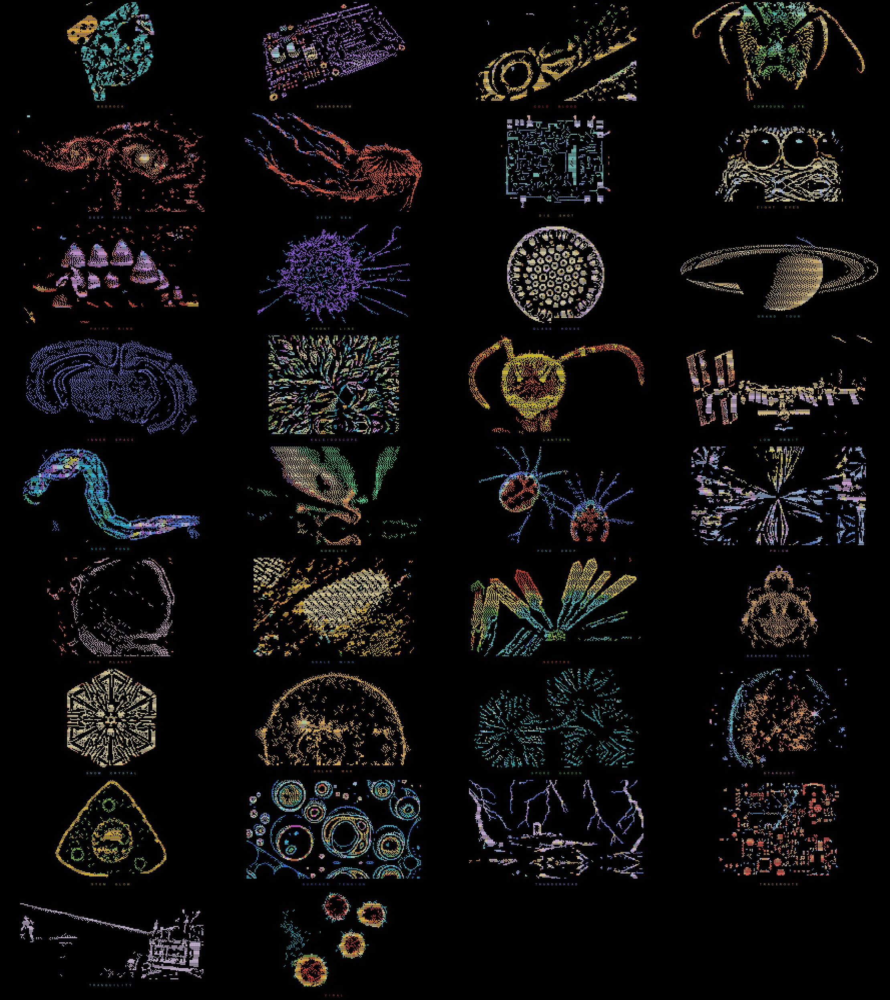

Omarchy's screensaver draws a text picture with an animated effect. Each theme here brings its own picture: one of its
wallpapers redrawn as braille text art (each character a grid of 2 x 4 dots), every dot in the theme's colours.
`./install` copies it with the theme. Two small scripts in [extras/screensaver](extras/screensaver/README.md) make
Omarchy use it: a hook that swaps in the picture when you change theme, and a stand-in for the effect program that
picks one of nine techie effects (laser etch, matrix rain, VHS glitch and others) and colours it to match.

```sh
mkdir -p ~/.config/omarchy/hooks/theme-set.d
cp extras/screensaver/theme-set ~/.config/omarchy/hooks/theme-set.d/20-omarchy-themes-screensaver
sudo install -m 755 extras/screensaver/ttfx /usr/local/bin/ttfx     # optional: the techie effects
omarchy theme set nordlys                                            # the hook runs on every theme change
```

Each theme's page shows its picture. To undo, delete the two files; the picture you had before comes back.

## Making the wallpapers

The scripts that made every wallpaper are in [src/](src/README.md): photos are downloaded from their source and
cut and labelled by `src/photowall.py`, the fractals are drawn by `src/fractal.c`, and the turning Earth by
`src/earthspin.py`. `src/build <theme>` remakes a theme from its `wallpapers.json`.

## Contributing

Fixes and new themes are welcome; [CONTRIBUTING.md](CONTRIBUTING.md) describes the rules each theme meets.
`python3 tools/check.py` checks them, and runs on GitHub for every pull request.

## Licence

Copyright 2026 CompilingThings.

- Code and theme files (`install`, `src/`, `tools/`, each theme's `colors.toml`, `hyprland.lua`, `foot.ini`,
  `shell.*.toml`): [MIT](LICENSE).
- Pictures made for this repository (Boardroom, Traceroute, Seahorse Valley's fractals, Low Orbit's turning Earth):
  [CC BY 4.0](LICENSES/CC-BY-4.0.txt). Each `preview.png` and the pictures in `docs/images/` are small copies of
  wallpapers and keep the licence of the wallpaper they show.
- Photos: each under its own licence, printed on the picture and listed in [CREDITS.md](CREDITS.md): NASA's media
  guidelines, CC BY, CC BY-SA, CC0, and CC BY-NC-SA for three of Grand Tour's Juno pictures, which may not be used
  commercially. A wallpaper made from a share-alike photo is shared under that photo's licence.
- The boot screen logo is Omarchy's (MIT, copyright David Heinemeier Hansson). Seahorse Valley uses Omarchy's Tokyo
  Night files for Neovim, VS Code and icons, unchanged (MIT).

[REUSE.toml](REUSE.toml) gives the copyright and licence of every file in the
[REUSE](https://reuse.software/) format.

This project is not made by or connected with Omarchy, NASA, ESA, CSA, DLR or any other source named in the credits,
and no endorsement by them is implied.
