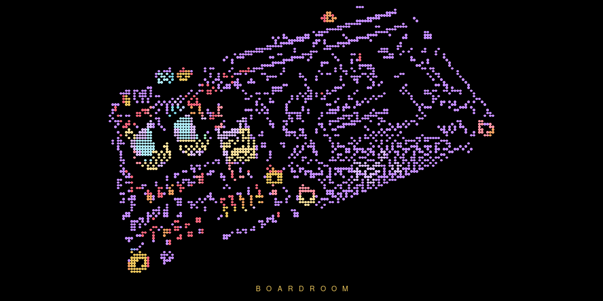

# Boardroom

An Omarchy theme made from the boards of a portable computer (a cyberdeck built on a LattePanda Mu module): purple
solder mask, white silkscreen, gold (ENIG) pads, on a dark purple drawing sheet. The name is a pun: a room full of
boards.

The wallpapers are KiCad 3D renders of the real board files:

| Wallpaper | What it shows |
|---|---|
| `1-all-boards.png` | All six boards straight down, true size to each other, each named |
| `2-main-v1.png` .. `7-screen-v1.png` | One board each, at an angle, with a title block: its job, size, layers, parts and vias |

Every wallpaper sits on a KiCad-style drawing sheet (zone marks 1-8 and A-E, a title block bottom right), drawn
inside the part a 3:2 screen shows; the dot grid and the glow run on to the edges.

## Install

```sh
./install boardroom
omarchy theme set boardroom
```

## How the wallpapers are made

- [`src/boardroom/build`](../../src/boardroom/build) renders each board twice with `kicad-cli pcb render` (straight
  down and at an angle, in the boards' own stack-up colours) and caches the renders; all twelve take about half an
  hour at low priority.
- [`src/boardroom/facts.py`](../../src/boardroom/facts.py) reads each board with KiCad's `pcbnew` (size from the
  outline, copper layers, parts in the bill of materials, vias). The keyboard plate is ordered purple and white like
  the rest, but its file keeps no colours, so it is rendered from a copy with the antenna board's stack-up added.
  The board files are only read.
- [`src/boardroom/wallpaper.py`](../../src/boardroom/wallpaper.py) lays the renders out at 3840 x 2160.
- The build needs KiCad 10 and the board files, which are not public yet, so the wallpapers ship ready-made.

Parts without a 3D model in KiCad's library show as bare pads (for example the LattePanda module's socket on the
main board).

## Screensaver



`screensaver.txt` is the `2-main-v1` wallpaper redrawn as braille text art (`src/asciiart.py`), each dot in the nearest of
the theme's colours. `./install` copies it with the theme; once [extras/screensaver](../../extras/screensaver/README.md)
is set up, Omarchy's screensaver shows it with an animated effect (laser etch, matrix rain, VHS glitch and others).

## Credits

The wallpapers and the boards they show are by CompilingThings, shared under CC BY 4.0 (see
[CREDITS.md](../../CREDITS.md)).
