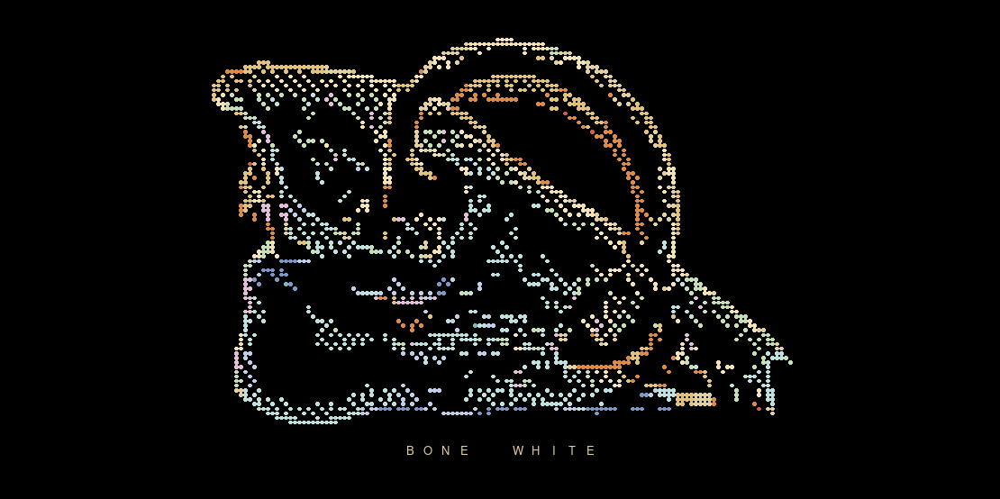

# Bone White

An Omarchy theme of animal skulls photographed on black in a museum studio by Didier Descouens: a babirusa, the wild
pig whose upper tusks grow up through its snout; a mandrill with its long canines; a young yellow baboon with its mouth
open; a warthog; a Siberian musk deer, which has no antlers but long sabre-like upper teeth; and an eastern woolly
lemur face on, its eye sockets huge. The black of the photos as the background, warm pale text, bone ivory as the
accent, and the window border turning from it into the amber of old tusk.

Each wallpaper has a small label in the bottom right corner (bottom right because terminal text keeps to the
left): what it is, one line in plain words, the date the photo's page gives, the photographer and the licence.

| Wallpaper | What it shows | Date | Photographer, licence | Source |
|---|---|---|---|---|
| `01-babirusa` | Skull of a male North Sulawesi babirusa (*Babyrousa celebensis*), 37 cm | 10 Aug 2010 | Didier Descouens, CC BY-SA 4.0 | [Commons](https://commons.wikimedia.org/wiki/File:Babyrousa_celebensis_-_Crane.jpg) |
| `02-mandrill` | Skull of a male mandrill (*Mandrillus sphynx*), three-quarter view, Guinea, 20 x 15 x 14 cm | 18 Mar 2011 | Didier Descouens, CC BY-SA 4.0 | [Commons](https://commons.wikimedia.org/wiki/File:Mandrilperspective6.jpg) |
| `03-baboon` | Skull of a young yellow baboon (*Papio hamadryas cynocephalus*), three-quarter view with the mouth open, 12.2 x 8.8 x 9.2 cm | 28 Nov 2010 | Didier Descouens, CC BY-SA 3.0 | [Commons](https://commons.wikimedia.org/wiki/File:Cynocephalus_Perspective.jpg) |
| `04-warthog` | Skull of a male warthog (*Phacochoerus africanus*), Senegal, 40 cm | 9 Jan 2011 | Didier Descouens, CC BY-SA 4.0 | [Commons](https://commons.wikimedia.org/wiki/File:Phacoch%C3%A8re9.jpg) |
| `05-musk-deer` | Skull of a Siberian musk deer (*Moschus moschiferus*) in profile, Siberia, 17.5 x 8 x 6 cm | 29 Mar 2011 | Didier Descouens, CC BY-SA 4.0 | [Commons](https://commons.wikimedia.org/wiki/File:Porte_musc_Profil_2.jpg) |
| `06-woolly-lemur` | Skull of an eastern woolly lemur (*Avahi laniger*) face on, Madagascar, 6 x 4.7 x 4.5 cm | 22 Dec 2010 | Didier Descouens, CC BY-SA 4.0 | [Commons](https://commons.wikimedia.org/wiki/File:Avahi_5_face_noir.jpg) |

Facts on the labels come from each photo's Commons page: the animal, the view, where it came from and its size (the
longest measure as "long"). Two plain-word notes are general knowledge, not from the pages: that a babirusa's upper
tusks grow up through its snout, and that the musk deer has no antlers but long upper teeth.

The photos were chosen from Wikimedia Commons' featured pictures of fossils and bones (53 files, 41 of them 4K or
larger under a free licence), all six from one photographer, all on black. Skulls are new to these themes. Grain at
screen size (`src/grain.py`, Immerkaer sigma at 2560 x 1440): 0.1 to 0.6. Left out for now: the fossils and hominin
casts from the same category (kept for a theme of their own), and photos on white. Each photo is set whole on black,
since none is 16:9 and cutting one would cut a skull.

```
src/build bone-white          # the photos (~34 MB) download once into ~/.cache/omarchy-themes/bone-white
./install bone-white
omarchy theme set bone-white
```

## Screensaver



`screensaver.txt` is the `01-babirusa` wallpaper redrawn as braille text art (`src/asciiart.py`), each dot in the nearest of
the theme's colours. `./install` copies it with the theme; once [extras/screensaver](../../extras/screensaver/README.md)
is set up, Omarchy's screensaver shows it with an animated effect (laser etch, matrix rain, VHS glitch and others).

## Credits and licences

Every wallpaper carries its photographer and licence on its label; the table above links each photo's page.

- [CC BY-SA 4.0](https://creativecommons.org/licenses/by-sa/4.0/) and
  [CC BY-SA 3.0](https://creativecommons.org/licenses/by-sa/3.0/) (`03-baboon`): free to use and change with
  credit, a link to the licence, and a note of changes; changed versions must keep the same licence. Every wallpaper
  here keeps its photo's licence.

Changes made to every photo: set whole on a black field at 3840 x 2160, and a label added in the bottom right corner.
