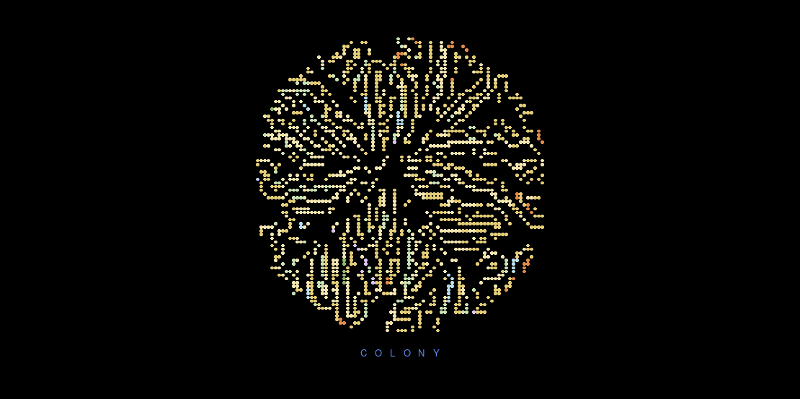

# Colony

An Omarchy theme of bacteria growing across agar, photographed through a microscope's eyepiece by Korinna:
Bacillus subtilis spreading in a branching, fractal-like pattern; the blue edge of a Bacillus colony; a colony building
tree-like structures; two colonies of different bacteria side by side, a red one in front; broad brown branches; and a
Bacillus colony folded into a swirl. Each round eyepiece view on black, cool pale text, Bacillus blue as the accent,
and the window border turning from it into the red of the colony.

Each wallpaper has a small label in the bottom right corner (bottom right because terminal text keeps to the
left): what it is, one line in plain words, the date the photo's page gives, the photographer and the licence.

| Wallpaper | What it shows | Date | Photographer, licence | Source |
|---|---|---|---|---|
| `01-fractal` | *Bacillus subtilis* growing in a branching, fractal-like pattern | 18 Feb 2020 | Korinna, CC BY 4.0 | [Commons](https://commons.wikimedia.org/wiki/File:Bacillus_subtilis_growing_in_aeautiful_fractal_pattern_20200218_145737.jpg) |
| `02-blue-front` | *Bacillus* growth under the microscope: the edge of a colony | 18 Feb 2020 | Korinna, CC BY 4.0 | [Commons](https://commons.wikimedia.org/wiki/File:Bacillus_bacteria_growth_under_the_microscope_20200406_015345.jpg) |
| `03-trees` | A bacterial colony building tree-like structures on the agar | 14 Jan 2020 | Korinna, CC BY 4.0 | [Commons](https://commons.wikimedia.org/wiki/File:Bacterial_colony_microscopy_building_interesting_structures_on_the_agar_03.jpg) |
| `04-two-colonies` | Two colonies of different bacteria | 14 Feb 2020 | Korinna, CC BY 4.0 | [Commons](https://commons.wikimedia.org/wiki/File:Bacteria_growth_under_the_microscope_-_Two_colonies_of_different_bacteria.jpg) |
| `05-brown-branches` | Bacterial growth spreading in broad branches | 18 Feb 2020 | Korinna, CC BY 4.0 | [Commons](https://commons.wikimedia.org/wiki/File:Bacterial_growth_microscope_view_02.jpg) |
| `06-swirl` | *Bacillus* growth under the microscope: a colony folded into a swirl | 18 Feb 2020 | Korinna, CC BY 4.0 | [Commons](https://commons.wikimedia.org/wiki/File:Bacillus_bacteria_growth_under_the_microscope_3.jpg) |

The Commons pages give only the bacteria and the date; the shapes and colours in the labels are what the photos show.

The photos were chosen from 169 unused photos of bacteria and moulds 4K or larger under a free licence, in
Wikimedia Commons' microscopy categories. All six are by one photographer, through the eyepiece of a light microscope.
Bacterial colonies are new to these themes. Each was checked at the size it is shown: two that were out of focus there,
and two soft ones, were left out, and so were the moulds (Spore Garden has those). Grain at screen size
(`src/grain.py`, Immerkaer sigma at 2560 x 1440): 0.1 to 0.3. Each photo is set whole on black and faded to a round
edge, like the view through the eyepiece.

```
src/build colony          # the photos (~29 MB) download once into ~/.cache/omarchy-themes/colony
./install colony
omarchy theme set colony
```

## Screensaver



`screensaver.txt` is the `01-fractal` wallpaper redrawn as braille text art (`src/asciiart.py`), each dot in the nearest of
the theme's colours. `./install` copies it with the theme; once [extras/screensaver](../../extras/screensaver/README.md)
is set up, Omarchy's screensaver shows it with an animated effect (laser etch, matrix rain, VHS glitch and others).

## Credits and licences

Every wallpaper carries its photographer and licence on its label; the table above links each photo's page.

- [CC BY 4.0](https://creativecommons.org/licenses/by/4.0/): free to use and change with credit, a link to the
  licence, and a note of changes.

Changes made to every photo: set whole on a black field at 3840 x 2160, its edge faded to a round shape, and a label
added in the bottom right corner.
