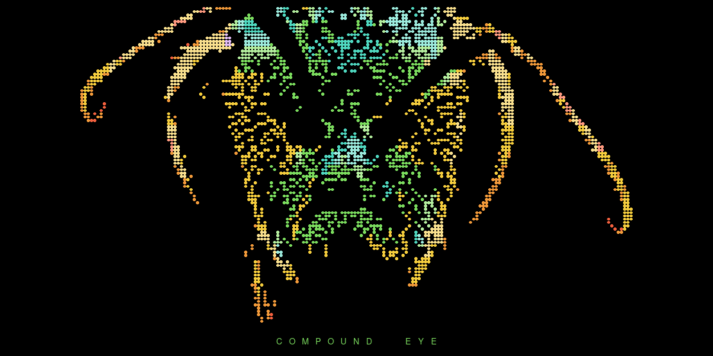

# Compound Eye

An Omarchy theme of insects photographed so close that every hair, eye facet and dimple of their armour shows:
cuckoo wasps, a hornet, a blowfly, a tiger beetle, bees from four continents, a blue-eyed cicada. Most come from the
U.S. Geological Survey's Bee Inventory and Monitoring Lab in Beltsville, Maryland, which photographs insect
specimens by stacking many shots taken at slightly different focus, so the whole head is sharp. Black like the lab's
backgrounds, pale text, the metallic green of a cuckoo wasp as the accent, and the window border shifting from that
green into the blue of the same wasp's iridescent shell. The terminal colours come from the photos too: ant red,
hornet orange and yellow, cuckoo wasp teal, tiger beetle blue and purple.

(A compound eye is made of many small eyes side by side, "each with its own lens"
([Wikipedia: Compound eye](https://en.wikipedia.org/wiki/Compound_eye)); wallpaper 03 shows them.)

Each wallpaper has a small label in the bottom right corner (bottom right because terminal text keeps to the
left): the insect, one line in plain words, when it was photographed, the photographer and the licence.
Six photos with bright hairs or legs under the label (03, 04, 10, 12, 13, 14) get a dark panel behind it.

| Wallpaper | What it shows | Photographed | Photographer, licence | Source |
|---|---|---|---|---|
| `01-cuckoo-wasp` | A chrysidid (cuckoo) wasp's face | 10 Aug 2020 | USGS Bee Lab, public domain | [Commons](https://commons.wikimedia.org/wiki/File:Chrysidid_wasp,_m,_face,_Millard_co.,_Utah_2020-08-17-14.06.19_ZS_PMax_UDR_%2851141341043%29.jpg) |
| `02-european-hornet` | *Vespa crabro* from Weingarten near Karlsruhe, Germany (Commons featured picture) | 9 Jun 2012 | H. Zell, CC BY-SA 3.0 | [Commons](https://commons.wikimedia.org/wiki/File:Vespa_crabro_head_01.jpg) |
| `03-blue-bottle-fly` | *Calliphora vicina* from Washington, D.C. (featured picture) | 24 Apr 2014 | USGS Bee Lab, public domain | [Commons](https://commons.wikimedia.org/wiki/File:Calliphora_vicina,_u,_Face,_DC_2014-04-24_-17.46.02_ZS_PMax_-_USGS_Bee_Inventory_and_Monitoring_Laboratory.jpg) |
| `04-cow-path-tiger-beetle` | *Cicindela purpurea* from Wills Mountain, Maryland | 26 Aug 2019 | Erick Hernandez, USGS Bee Lab, public domain | [Commons](https://commons.wikimedia.org/wiki/File:Cicindella_purpurea,_face,_u,_Alleghany,_MD_2019-10-21-16.42.12_ZS_PMax_UDR_%2849042834518%29.jpg) |
| `05-ant` | An ant of unknown species, Fossil Butte National Monument, Wyoming | 1 Aug 2012 | USGS Bee Lab, public domain | [Commons](https://commons.wikimedia.org/wiki/File:Ant,-face_2012-07-30-17.18.42-ZS-PMax_%287693184158%29.jpg) |
| `06-green-sweat-bee` | *Agapostemon splendens*, Anne Arundel County, Maryland | 9 Jul 2014 | USGS Bee Lab, public domain | [Commons](https://commons.wikimedia.org/wiki/File:Agapostemon_splendens,_f,_head,_anne_arundel_county,_md_2014-07-09-13.37.57_ZS_PMax_%2814432919367%29.jpg) |
| `07-blue-eyed-cicada` | A rare blue-eyed cicada | 2 Jun 2021 | USGS Bee Lab, public domain | [Commons](https://commons.wikimedia.org/wiki/File:Blue_eyed_Cicada,_face_2021-06-02-12.32.22_ZS_PMax_UDR_-_Flickr_-_Sam_Droege.jpg) |
| `08-carpenter-bee` | A male *Xylocopa virginica* (featured picture) | 18 May 2015 | USGS Bee Lab, public domain | [Commons](https://commons.wikimedia.org/wiki/File:Xylocopa_virginica_male_face.jpg) |
| `09-cuckoo-wasp-eye` | A chrysidid wasp's eye through a 20x microscope lens, Somerset County, Maryland | 15 Jul 2016 | USGS Bee Lab, public domain | [Commons](https://commons.wikimedia.org/wiki/File:Chrysidid,_20x_test,_somerset_county,_md_face_2016-07-13-14.41_%2828263332601%29.jpg) |
| `10-centris-bee` | A female *Centris flavifrons* from Costa Rica | 12 Oct 2020 | Elizabeth Panner, USGS Bee Lab, public domain | [Commons](https://commons.wikimedia.org/wiki/File:Centris_flavifrons,_f,_Costa_Rica,_face_2020-10-12-18.32.32_ZS_PMax_UDR_%2851850438091%29.jpg) |
| `11-campsomeris-wasp` | A scoliid wasp from the Sierra de Baoruco, Dominican Republic | 26 Aug 2019 | USGS Bee Lab, public domain | [Commons](https://commons.wikimedia.org/wiki/File:Cool_Wasp,_face,_u,_Sierra_De_Baoruco,_Dominican_Republic_2019-10-21-16.29.28_ZS_PMax_UDR_%2849457769986%29.jpg) |
| `12-taiwan-bumble-bee` | *Bombus eximias* from Taiwan | 5 Sep 2014 | USGS Bee Lab, public domain | [Commons](https://commons.wikimedia.org/wiki/File:Bombus_eximias,_f,_tawain,_face_2014-08-10-09.44.49_ZS_PMax_%2815155452565%29.jpg) |
| `13-great-green-bush-cricket` | *Tettigonia viridissima* (featured picture) | 1 Aug 2010 | Didier Descouens, CC BY-SA 4.0 | [Commons](https://commons.wikimedia.org/wiki/File:Grande_sauterelle_verte_-_Portrait.jpg) |
| `14-badlands-sweat-bee` | *Agapostemon coloradinus* from Badlands National Park, South Dakota | 28 Jan 2014 | Wayne Boo, USGS Bee Lab, public domain | [Commons](https://commons.wikimedia.org/wiki/File:Agapostemon_coloradinus,_F,_face,_Shannon_Co.,_S._Dakota_2014-01-09-14.31.48_ZS_PMax_%2812229924934%29.jpg) |

Facts on the labels come from each photo's Commons page (the lab's own notes: where the insect was found, who
photographed it, what it does) and: cuckoo wasps lay "their eggs in host nests"
([Wikipedia: Cuckoo wasp](https://en.wikipedia.org/wiki/Cuckoo_wasp)); scoliid wasps such as *Campsomeris* are
parasitoids of larvae, "most frequently those of the scarab beetle"
([Wikipedia: Scoliidae](https://en.wikipedia.org/wiki/Scoliidae)); *Calliphora vicina* "is known as a blue bottle
fly" ([Wikipedia](https://en.wikipedia.org/wiki/Calliphora_vicina)); *Agapostemon* are sweat bees, "generally green
or blue" ([Wikipedia](https://en.wikipedia.org/wiki/Agapostemon)). The date is the one the photo file records.

Chosen from Wikimedia Commons' featured pictures of insects (103 landscape photos at least 4000 pixels wide) and the
USGS Bee Lab's face shots on Commons (about 340 of the first 2000 of its files, narrowed to 41 of the most colourful
kinds), keeping macro photos only: a face or an eye filling the frame. Grain at screen size (`src/grain.py`,
Immerkaer sigma at 2560 x 1440): bush-cricket 0.4, Scoliid wasp 1.0, carpenter bee 1.4, hornet 1.5, ant 1.8,
Centris 2.0, sweat bee 2.0, tiger beetle 2.1, cuckoo wasp eye 2.2, cicada 4.1, bumble bee 4.2, Badlands sweat bee
5.3, cuckoo wasp 5.3, blowfly 5.9. The high numbers are real fine detail (eye facets, the dimpled shell, hairs):
the cuckoo wasp, blowfly and Badlands sweat bee were looked at in true-size crops and are sharp, with no grain.

```
src/build compound-eye           # the photos (~200 MB) download once into ~/.cache/omarchy-themes/compound-eye
./install compound-eye
omarchy theme set compound-eye
```

## Screensaver



`screensaver.txt` is the `06-green-sweat-bee` wallpaper redrawn as braille text art (`src/asciiart.py`), each dot in the nearest of
the theme's colours. `./install` copies it with the theme; once [extras/screensaver](../../extras/screensaver/README.md)
is set up, Omarchy's screensaver shows it with an animated effect (laser etch, matrix rain, VHS glitch and others).

## Credits and licences

Every wallpaper carries its photographer and licence on its label; the table above links each photo's page.

- USGS Bee Inventory and Monitoring Lab: works of the U.S. Geological Survey, "considered to be in the U.S. Public
  Domain" ([USGS: Copyrights and Credits](https://www.usgs.gov/information-policies-and-instructions/copyrights-and-credits));
  credited on each picture as the USGS asks. See [LICENSES/LicenseRef-USGS-Public-Domain.txt](../../LICENSES/LicenseRef-USGS-Public-Domain.txt).
- [CC BY-SA 3.0](https://creativecommons.org/licenses/by-sa/3.0/), [CC BY-SA 4.0](https://creativecommons.org/licenses/by-sa/4.0/):
  free to use and change with credit, a link to the licence and a note of changes, and a changed picture must be
  shared under the same licence.

Changes made to every photo: cut to 16:9 and scaled to 3840 x 2160, and a label added in the bottom right corner.
A finished wallpaper made from a CC BY-SA photo is itself shared under that photo's CC BY-SA licence.
