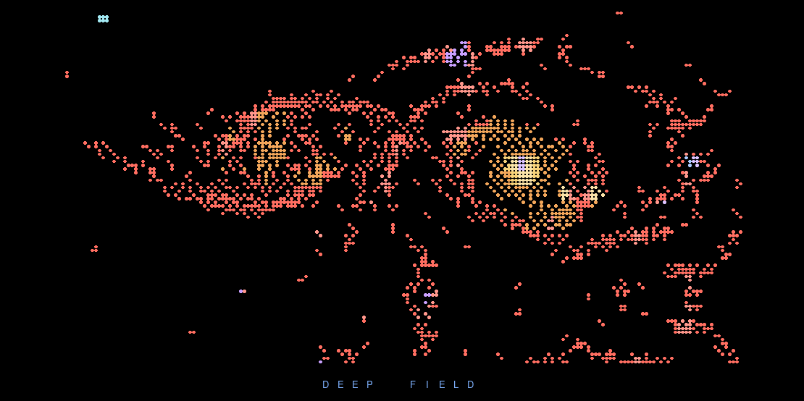

# Deep Field

An Omarchy theme made from real photos of space: the James Webb Space Telescope,
Cassini at Saturn, and the Space Station. Near-black sky, starlight text, an
Earth-limb blue accent, and the window border fading from that blue into the
amber of Webb's dust clouds.

Each wallpaper has a small label in the bottom right corner (bottom right because
terminal text keeps to the left): what it is, in plain words, how far away, who
took it, when, and the credit.

| Wallpaper | What it shows | Taken by | Source |
|---|---|---|---|
| `1-cosmic-cliffs` | Edge of a star nursery in the Carina Nebula, 7,600 light-years away | Webb, 12 July 2022 | [esawebb weic2205a](https://esawebb.org/images/weic2205a/) |
| `2-deep-field` | Webb's First Deep Field: galaxy cluster SMACS 0723, seen as it was 4.6 billion years ago | Webb, 12 July 2022 | [weic2209a](https://esawebb.org/images/weic2209a/), facts [weic2209](https://esawebb.org/news/weic2209/) |
| `3-saturn-eclipse` | The Day the Earth Smiled: Saturn backlit by the Sun, Earth marked | Cassini, 19 July 2013 | [PIA17172](https://science.nasa.gov/photojournal/the-day-the-earth-smiled/) |
| `4-moonrise-from-orbit` | A waxing gibbous Moon rising above Earth's blue air, over a cloudy Atlantic off Quebec, 423 km up | ISS Expedition 73, 3 Oct 2025 | [iss073e0819960](https://images.nasa.gov/details/iss073e0819960) |
| `5-herbig-haro-46-47` | Two newborn stars blowing jets, 1,470 light-years away | Webb, 26 July 2023 | [weic2319a](https://esawebb.org/images/weic2319a/) |
| `6-tarantula-nebula` | Tens of thousands of young stars, 161,000 light-years away | Webb, 6 Sept 2022 | [weic2212a](https://esawebb.org/images/weic2212a/), distance [weic2212](https://esawebb.org/news/weic2212/) |
| `7-horsehead-nebula` | Part of the Horsehead (Barnard 33) in Orion, 1,300 light-years away | Webb, 29 April 2024 | [weic2411a](https://esawebb.org/images/weic2411a/) |
| `8-ic2163-ngc2207` | Two spiral galaxies that grazed each other, 120 million light-years away | Webb + Hubble, 31 Oct 2024 | [weic2426a](https://esawebb.org/images/weic2426a/) |

Earth's place in the Saturn photo is taken from NASA's own labelled copy (Figure 2 on the PIA17172 page).

## Install

```sh
./install deep-field
omarchy theme set deep-field
```

## How the wallpapers are made

- `wallpapers.json` lists each photo: download link, source page, credit and licence, label text, and where to cut it.
- [`src/photowall.py`](../../src/photowall.py) cuts each photo to 16:9 at 3840 x 2160 and draws its label inside the
  part a 3:2 screen shows; the same script makes every photo theme in this repository.
- `src/build deep-field` makes them again from the photos (~180 MB, downloaded once into `~/.cache/omarchy-themes/deep-field`).

## Screensaver



`screensaver.txt` is the `8-ic2163-ngc2207` wallpaper redrawn as braille text art (`src/asciiart.py`), each dot in the nearest of
the theme's colours. `./install` copies it with the theme; once [extras/screensaver](../../extras/screensaver/README.md)
is set up, Omarchy's screensaver shows it with an animated effect (laser etch, matrix rain, VHS glitch and others).

## Credits and licences

The photos come from the agencies. [CREDITS.md](../../CREDITS.md) lists every wallpaper's author, licence and source.

- Webb pictures from esawebb.org are published under [CC BY 4.0](https://creativecommons.org/licenses/by/4.0/) with the
  credit shown on each picture (NASA, ESA, CSA, STScI and the named image processors). The credit is printed on every
  wallpaper.
- NASA pictures (Cassini, Space Station) "generally are not subject to copyright in the United States", and "NASA
  should be acknowledged as the source" ([NASA media guidelines](https://www.nasa.gov/nasa-brand-center/images-and-media/));
  the Cassini credit is NASA/JPL-Caltech/SSI.
