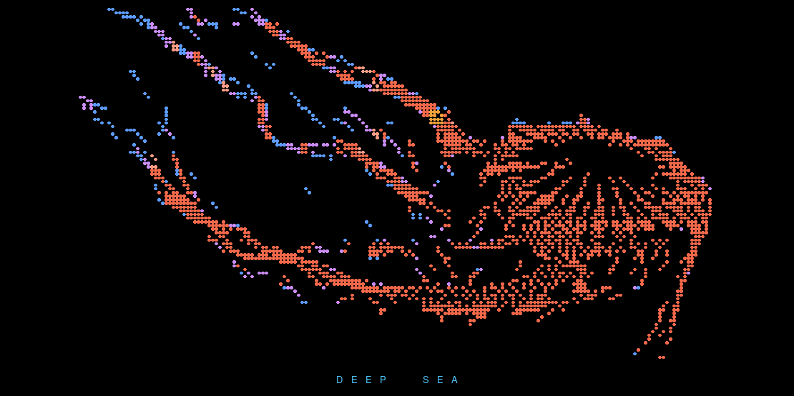

# Deep Sea

An Omarchy theme of jellyfish and comb jellies lit in dark water, close enough to see every spot, frill and comb
row: a warty comb jelly breaking light into rainbows, white-spotted jellyfish glowing blue, golden jellies on black,
a Japanese sea nettle, moon jellies, a lion's mane, a bluefire jellyfish, a harp-shaped comb jelly from the sea floor,
and one animal brought up from 900 m down off New Zealand. The blue-black of deep water, pale blue-white text, the
blue glow of the white-spotted jellyfish as the accent, and the window border fading from that blue into the purple
of the bluefire jellyfish. The terminal colours come from the photos too: sea nettle red, golden jelly orange,
lion's mane yellow, comb jelly green, moon jelly cyan, bluefire purple.

Most of the glow is light, not the animals' own: aquarium lamps on black water, and sunlight broken into colours by
the comb rows of the comb jellies (whose rows also really do "glow blue-green when disturbed"
([Wikipedia: Mnemiopsis](https://en.wikipedia.org/wiki/Mnemiopsis))). Sharp, close photos of true bioluminescence
with a free licence were too few to fill a theme.

Each wallpaper has a small label in the bottom right corner (bottom right because terminal text keeps to the
left): the animal, one line in plain words, when it was photographed, the photographer and the licence.
Four photos with a bright or busy patch under the label (03, 10, 11, 12) get a dark panel behind it.

| Wallpaper | What it shows | Photographed | Photographer, licence | Source |
|---|---|---|---|---|
| `01-warty-comb-jelly` | *Mnemiopsis leidyi*, the warty comb jelly or sea walnut | 23 Feb 2013 | Bruno C. Vellutini, CC BY-SA 3.0 | [Commons](https://commons.wikimedia.org/wiki/File:Comb_jelly.tif) |
| `02-white-spotted-jellyfish` | *Phyllorhiza punctata* under blue light | 26 Feb 2018 | Alexander Svensson (Flickr), CC BY 2.0 | [Commons](https://commons.wikimedia.org/wiki/File:White-spotted_Jellyfish_%2839878698384%29.jpg) |
| `03-golden-jellies` | Jellyfish lit gold against black water | 9 Jul 2019 | Andrey Biksaleev, CC BY 4.0 | [Commons](https://commons.wikimedia.org/wiki/File:%D0%9C%D0%BE%D1%80%D1%81%D0%BA%D0%BE%D0%B5_%D0%B7%D0%BE%D0%BB%D0%BE%D1%82%D0%BE.jpg) |
| `04-japanese-sea-nettle` | *Chrysaora pacifica* at the Vancouver Aquarium | 18 Jan 2015 | Paul Harrison, CC BY-SA 4.0 | [Commons](https://commons.wikimedia.org/wiki/File:Japanese_sea_nettle_5106.jpg) |
| `05-moon-jellyfish` | *Aurelia aurita* in Åbyfjorden, Sweden (Commons featured picture) | 5 Jun 2020 | W.carter, CC BY-SA 4.0 | [Commons](https://commons.wikimedia.org/wiki/File:Moon_jellyfish_in_R%C3%A5g%C3%A5rdsdal_4.jpg) |
| `06-deep-sea-isopod` | *Brucerolis brandtae*, from just over 900 m deep on the Hikurangi Margin, New Zealand | 6 Feb 2014 | Peter Marriott, NIWA, CC BY 4.0 | [Commons](https://commons.wikimedia.org/wiki/File:Brucerolis_brandtae_on_Hikurangi_Margin.jpg) |
| `07-lions-mane-jellyfish` | *Cyanea capillata* in Gullmarn fjord, Sweden | 13 Jul 2019 | W.carter, CC0 | [Commons](https://commons.wikimedia.org/wiki/File:Lion%27s_mane_jellyfish_in_Gullmarn_fjord_at_S%C3%A4mstad_3.jpg) |
| `08-white-spotted-bell` | *Phyllorhiza punctata* at Tiergarten Schönbrunn, Vienna | 24 Jul 2020 | Johannes Maximilian, CC BY-SA 4.0 | [Commons](https://commons.wikimedia.org/wiki/File:Phyllorhiza_punctata_in_Tiergarten_Sch%C3%B6nbrunn_24_July_2020_JM_%285%29.jpg) |
| `09-monterey-jellies` | Jellyfish at the Monterey Bay Aquarium, California | 11 Oct 2018 | Pedro Szekely (Flickr), CC BY-SA 2.0 | [Commons](https://commons.wikimedia.org/wiki/File:Jellyfish_%2844791540314%29.jpg) |
| `10-harp-comb-jelly` | *Lyrocteis imperatoris* at the Okinawa Churaumi Aquarium, Japan | 28 Apr 2024 | YockeyT, CC0 | [Commons](https://commons.wikimedia.org/wiki/File:Harp_Comb_Jelly_1.png) |
| `11-bluefire-jellyfish` | *Cyanea lamarckii* in Brofjorden, Sweden | 24 Jun 2021 | W.carter, CC BY-SA 4.0 | [Commons](https://commons.wikimedia.org/wiki/File:Sideview_of_contracted_bluefire_jellyfish_in_Brofjorden_at_Sandvik_2.jpg) |
| `12-moon-jellies-caught` | Three moon jellyfish caught by a lion's mane, Rågårdsdal, Sweden (featured picture) | 5 Jun 2020 | W.carter, CC BY-SA 4.0 | [Commons](https://commons.wikimedia.org/wiki/File:Three_moon_jellyfishes_captured_by_a_lion%27s_mane_jellyfish_1.jpg) |

Facts on the labels come from each photo's Commons page (the photographers' own notes on place, size and what
happened) and: *Mnemiopsis leidyi* is "the warty comb jelly or sea walnut" and its comb rows "glow blue-green when
disturbed" ([Wikipedia](https://en.wikipedia.org/wiki/Mnemiopsis)); *Phyllorhiza punctata* "is native to the western
Pacific from Australia to Japan" ([Wikipedia](https://en.wikipedia.org/wiki/Phyllorhiza_punctata)); *Chrysaora
pacifica* "is found across the northwest Pacific Ocean, including Japan, Korea, Taiwan, and China"
([Wikipedia](https://en.wikipedia.org/wiki/Chrysaora_pacifica)); the moon jelly's "four horseshoe-shaped gonads" are
"easily seen through the top of the bell" ([Wikipedia](https://en.wikipedia.org/wiki/Aurelia_aurita)); the lion's
mane is "one of the largest known species of jellyfish"
([Wikipedia](https://en.wikipedia.org/wiki/Lion%27s_mane_jellyfish)); the bluefire "grows to approximately 10 to 20
cm (4 to 8 in) across the bell" ([Wikipedia](https://en.wikipedia.org/wiki/Blue_jellyfish)); *Lyrocteis* are "rather
large benthic ctenophores (up to 15 cm) in the shape of a lyre" ([Wikipedia](https://en.wikipedia.org/wiki/Lyrocteis));
*Brucerolis brandtae* is filed on Commons under "Isopoda of New Zealand". "Sea gold" is the golden jellies' Russian
file name (Морское золото). The date is the one the photo file records.

Chosen from Wikimedia Commons searches for bioluminescence, jellyfish, comb jellies and deep-sea animals, its
featured pictures of jellyfish and the NOAA Ocean Exploration photos (about 130 landscape photos at least 3800 pixels
wide), then looked at one by one and checked at true screen size. Every photo was uploaded by its photographer or
imported from Flickr or NIWA with the licence checked (FlickreviewR or a Commons licence reviewer). Grain at screen
size (`src/grain.py`, Immerkaer sigma at 2560 x 1440): comb jelly 0.4, Japanese sea nettle 0.4,
bluefire 0.5, isopod 0.7, Monterey 0.7, lion's mane 0.8, moon jellyfish 1.3, harp comb jelly 1.3, golden jellies 1.8,
white-spotted bell 2.1, caught 2.2, white-spotted glow 2.5. Left out: two NOAA deep-sea pictures that Commons marks
public domain but that were taken by a private photographer (David Shale), so not cleanly free; aquarium shots that
were soft or smeared at full size (several moon jellies under coloured light, a green jelly from the Sea of Japan);
and a third and fourth white-spotted jellyfish (too close to the two already in).

```
src/build deep-sea               # the photos (~150 MB) download once into ~/.cache/omarchy-themes/deep-sea
./install deep-sea
omarchy theme set deep-sea
```

## Screensaver



`screensaver.txt` is the `04-japanese-sea-nettle` wallpaper redrawn as braille text art (`src/asciiart.py`), each dot in the nearest of
the theme's colours. `./install` copies it with the theme; once [extras/screensaver](../../extras/screensaver/README.md)
is set up, Omarchy's screensaver shows it with an animated effect (laser etch, matrix rain, VHS glitch and others).

## Credits and licences

Every wallpaper carries its photographer and licence on its label; the table above links each photo's page.

- [CC0](https://creativecommons.org/publicdomain/zero/1.0/): public domain, no conditions (credit given anyway).
- [CC BY 2.0](https://creativecommons.org/licenses/by/2.0/), [CC BY 4.0](https://creativecommons.org/licenses/by/4.0/):
  free to use and change with credit, a link to the licence, and a note of changes.
- [CC BY-SA 2.0](https://creativecommons.org/licenses/by-sa/2.0/), [CC BY-SA 3.0](https://creativecommons.org/licenses/by-sa/3.0/),
  [CC BY-SA 4.0](https://creativecommons.org/licenses/by-sa/4.0/): the same, and a changed picture must be shared
  under the same licence.

Changes made to every photo: cut to 16:9 and scaled to 3840 x 2160, and a label added in the bottom right corner.
A finished wallpaper made from a CC BY-SA photo is itself shared under that photo's CC BY-SA licence.
