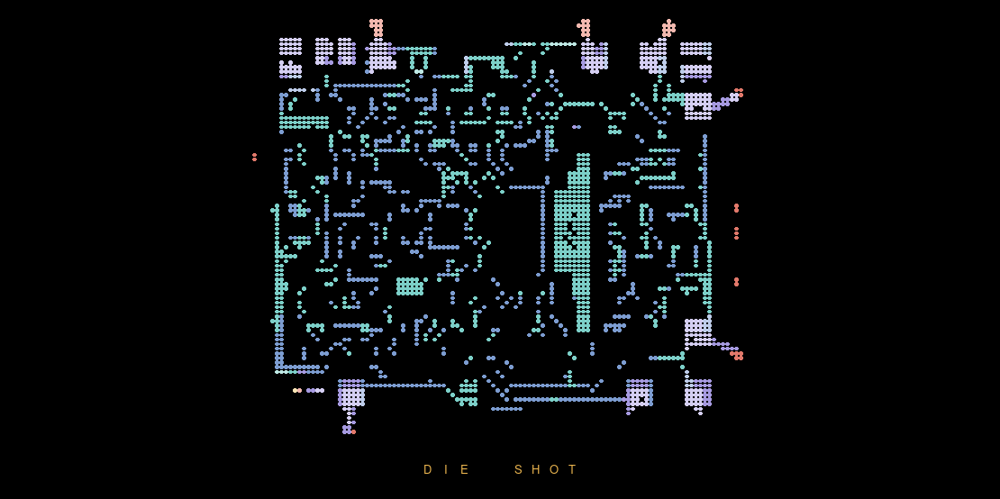

# Die Shot

An Omarchy theme of the bare silicon inside old chips, photographed from above under the microscope: a Soviet
high-voltage op-amp, a Fairchild video switch, a Holtek serial-port driver, two Winbond clock generators from 1990s
PC mainboards and a keyboard controller. Each chip (the "die") is shown whole on black, with its metal tracks, its
bond pads and, on some, the thin gold wires that once joined it to its pins. All eight are by one photographer,
VektorF, from the Russian Science Photo Competition 2019. The near-black the chips sit on is the background, the text
is cool and pale, the gold of the bond pads is the accent, and the window border turns from that gold into the pale
cyan of the op-amp's metal tracks.

Each wallpaper has a small label in the bottom right corner (bottom right because terminal text keeps to the
left): what it is, one line in plain words, when it was photographed, the photographer and the licence.

| Wallpaper | What it shows | Photographed | Photographer, licence | Source |
|---|---|---|---|---|
| `01-op-amp` | A Soviet high-voltage op-amp die (1408UD1, Kvazar, Kyiv), bond wires attached | 7 May 2019 | VektorF, CC BY 4.0 | [Commons](https://commons.wikimedia.org/wiki/File:1408%D0%A3%D0%941_2.jpg) |
| `02-video-switch` | A Fairchild 8-in, 6-out video switch die (FMS6502) | 28 May 2019 | VektorF, CC BY 4.0 | [Commons](https://commons.wikimedia.org/wiki/File:FMS6502_1_%D0%9C.jpg) |
| `03-rs-232` | A Holtek RS-232 driver and receiver die (HT6571) | 7 May 2019 | VektorF, CC BY 4.0 | [Commons](https://commons.wikimedia.org/wiki/File:HT6571_a.jpg) |
| `04-clock-chip` | A Winbond clock generator die for three memory slots (W83194R-39A) | 28 May 2019 | VektorF, CC BY 4.0 | [Commons](https://commons.wikimedia.org/wiki/File:W83194R-39A_2a_%D0%BC.jpg) |
| `05-video-switch-2` | The same Fairchild video switch, a second photo | 28 May 2019 | VektorF, CC BY 4.0 | [Commons](https://commons.wikimedia.org/wiki/File:FMS6502_2_%D0%9C.jpg) |
| `06-op-amp-2` | The same Soviet op-amp, a second photo | 7 May 2019 | VektorF, CC BY 4.0 | [Commons](https://commons.wikimedia.org/wiki/File:1408%D0%A3%D0%941_1.jpg) |
| `07-agp-clock` | A Winbond AGP clock generator die for VIA chipsets (W83194R-58) | 7 May 2019 | VektorF, CC BY 4.0 | [Commons](https://commons.wikimedia.org/wiki/File:W83194R-58.jpg) |
| `08-keyboard-controller` | A keyboard controller die (JETkey) | 7 May 2019 | VektorF, CC BY 4.0 | [Commons](https://commons.wikimedia.org/wiki/File:JETkey_a.jpg) |

Facts on the labels come from each photo's Commons page: the chip's part number and what it does (the page's own
words), the maker (the page's category: Kvazar Kyiv, Fairchild, Holtek, Winbond) and the date the page gives. The
pages do not say how the chips were lit; 05 and 06 are second photos of the same dies as 02 and 01, and look very
different. "In a 1990s PC" for the clock chips and keyboard controller is the usual use of those parts, not stated on
the pages.

The pictures were chosen from the microscope entries of the Russian Science Photo Competitions on Wikimedia Commons,
then looked at one by one at true screen size. Grain at screen size (`src/grain.py`, Immerkaer sigma at 2560 x 1440):
0.9 to 2.2, and each die was also looked at 1:1 at the size it is shown. Left out, from 18: a third and fourth
photo of chips already here (same die, duller), a pale photo of the RS-232 driver and the keyboard controller, a
whole chip in its package (sharp only in the middle, a different look), a row of Soviet parts (soft), a memory chip
(grey, speckled), close-ups of gold tracks and of an RFID chip (soft at full size, scale bars inside the picture), and
a laser-mouse chip (halos at full size, and its page names two authors).

Every wallpaper uses photowall's `fit`: the whole die, centred left of the label, on near-black (#050506) with a thin
fade at its edges.

```
src/build die-shot               # the photos (~40 MB) download once into ~/.cache/omarchy-themes/die-shot
./install die-shot
omarchy theme set die-shot
```

## Screensaver



`screensaver.txt` is the `01-op-amp` wallpaper redrawn as braille text art (`src/asciiart.py`), each dot in the nearest of
the theme's colours. `./install` copies it with the theme; once [extras/screensaver](../../extras/screensaver/README.md)
is set up, Omarchy's screensaver shows it with an animated effect (laser etch, matrix rain, VHS glitch and others).

## Credits and licences

Every wallpaper carries its photographer and licence on its label; the table above links each photo's page.

- [CC BY 4.0](https://creativecommons.org/licenses/by/4.0/): free to use and change with credit, a link to the
  licence, and a note of changes.

Changes made to every photo: set whole on a near-black 16:9 field and scaled to fit 3840 x 2160, the edges faded
into the field, and a label added in the bottom right corner.
