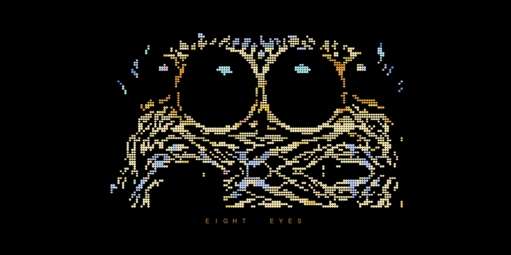

# Eight Eyes

An Omarchy theme of spiders and mites up close, through macro and microscope lenses: the big front eyes of a jumping
spider, two tarantulas (one of them only the skin it shed), a green spider among flowers, a giant house spider,
water mites, a red mite from Patagonia, and the skin of a mite under the electron microscope. A dark warm
brown-black background, warm pale text, the orange-gold of the tarantula's hair as the accent, and the window border
turning from it into the cyan light on the tarantula moult.

Each wallpaper has a small label in the bottom right corner (bottom right because terminal text keeps to the
left): what it is, one line in plain words, the date the photo's page gives, the photographer and the licence.

| Wallpaper | What it shows | Date | Photographer, licence | Source |
|---|---|---|---|---|
| `01-jumping-spider-eyes` | Eyes of the jumping spider Salticus scenicus | 14 Apr 2022 | Mikron86, CC BY 4.0 | [Commons](https://commons.wikimedia.org/wiki/File:Oczy_paj%C4%85ka_z_rodziny_skakunowatych.jpg) |
| `02-tarantula-moult` | Moulted skin of a young Lasiodora parahybana (Brazilian salmon pink tarantula), lit by three lights with hand-made filters | 26 Jan 2022 | MicrocosmicWorld, CC BY-SA 4.0 | [Commons](https://commons.wikimedia.org/wiki/File:Tarantula_exoskeleton.jpg) |
| `03-red-mite` | A Chyzeriidae mite from Puerto Blest, Bariloche, Argentine Patagonia | 9 Nov 2024 | Brandon Antonio Segura Torres & Priscilla Vieto Bonilla, CC BY-SA 4.0 | [Commons](https://commons.wikimedia.org/wiki/File:%C3%81caro_Chyzeriidae_de_Puerto_Blest,_Bariloche,_Patagonia_Argentina.jpg) |
| `04-green-spider` | The spider Micrommata virescens | 30 Apr 2022 | Stepan163s, CC BY 4.0 | [Commons](https://commons.wikimedia.org/wiki/File:2022-04-30_22-13-46_(C)_%D0%BA%D0%BE%D0%BF%D0%B8%D1%8F-DeNoiseAI-standard_(1).jpg) |
| `05-jumping-spider` | A jumping spider (Salticidae), microscope lens, focus stacking | 18 Jul 2021 | Oliver Gutiérrez Suárez, CC BY-SA 4.0 | [Commons](https://commons.wikimedia.org/wiki/File:2021-07-18_11-55-25_(C,Smoothing4).tif) |
| `06-water-mite` | A water mite (Hydracarina) | 5 Jun 2022 | Janek Lass, CC BY 4.0 | [Commons](https://commons.wikimedia.org/wiki/File:Hydracarina.jpg) |
| `07-tarantula` | The tarantula Pterinochilus murinus | 11 Jul 2018 | Sergey Antimonov, CC BY-SA 4.0 | [Commons](https://commons.wikimedia.org/wiki/File:Pterinochilus_murinus_RCF-2.jpg) |
| `08-mite-skin` | Back (dorsal cuticle) of a trombidiform mite, scanning electron micrograph | 1 Nov 2025 | Brandon Antonio Segura Torres & Priscilla Vieto Bonilla, CC BY-SA 4.0 | [Commons](https://commons.wikimedia.org/wiki/File:Cut%C3%ADcula_del_dorso_de_%C3%A1caro_trombidiforme_SEM.jpg) |
| `09-house-spider` | Face of a giant house spider (Eratigena duellica) at 5x, Somerset, UK | 26 Jul 2021 | MicrocosmicWorld, CC BY-SA 4.0 | [Commons](https://commons.wikimedia.org/wiki/File:Eratigena_duellica_Facial_Detail_(5%C3%97).jpg) |
| `10-water-mite-glow` | A freshwater water mite (Hydrachnidia) in reflected light; the white lines are its excretory (Malpighian) system | 18 May 2021 | Janek Lass, CC BY 4.0 | [Commons](https://commons.wikimedia.org/wiki/File:Vesilest.jpg) |
| `11-eight-eyes` | The eight eyes of a spider | 8 Mar 2025 | Brandon Antonio Segura Torres & Priscilla Vieto Bonilla, CC BY-SA 4.0 | [Commons](https://commons.wikimedia.org/wiki/File:Detalle_de_los_8_ojos_de_una_ara%C3%B1a.jpg) |
| `12-philisca` | The spider Philisca atrata | 23 Jan 2025 | Brandon Antonio Segura Torres & Priscilla Vieto Bonilla, CC BY-SA 4.0 | [Commons](https://commons.wikimedia.org/wiki/File:Ara%C3%B1a_Philisca_atrata.jpg) |

Facts on the labels come from each photo's Commons page: the species, where it was found, the magnification and
the lighting. "Bright green", "orange" and "small white flowers" are what the photos show, not the pages' words.

The photos were chosen from the science photo competitions on Wikimedia Commons: 44 large photos of spiders, mites
and their webs were listed, 21 downloaded whole and looked at one by one at true screen size, and 12 kept. Grain at
screen size (`src/grain.py`, Immerkaer sigma at 2560 x 1440): 0.1 to 2.7. Left out: a cellar spider (grain 11.8),
a soft mite portrait (5.6), a dark mite with specks of dirt, a second red mite from the same photographers, a
spider guarding its egg sac (the spider small in the frame), a second giant house spider photo from the same day,
a second eight-eyes photo, and two photos of dew on a web (mostly white).

The red mite is set whole on black with photowall's `fit`; the tarantula moult is cut closer to its middle to leave
out most of its white background. Seven labels sit on a neat dark panel (photowall's `panel`) where the photo
behind them is bright or busy.

```
src/build eight-eyes            # the photos (~160 MB) download once into ~/.cache/omarchy-themes/eight-eyes
./install eight-eyes
omarchy theme set eight-eyes
```

## Screensaver



`screensaver.txt` is the `01-jumping-spider-eyes` wallpaper redrawn as braille text art (`src/asciiart.py`), each dot in the nearest of
the theme's colours. `./install` copies it with the theme; once [extras/screensaver](../../extras/screensaver/README.md)
is set up, Omarchy's screensaver shows it with an animated effect (laser etch, matrix rain, VHS glitch and others).

## Credits and licences

Every wallpaper carries its photographer and licence on its label; the table above links each photo's page.

- [CC BY 4.0](https://creativecommons.org/licenses/by/4.0/): free to use and change with credit, a link to the
  licence, and a note of changes.
- [CC BY-SA 4.0](https://creativecommons.org/licenses/by-sa/4.0/): the same, and changed versions must keep the
  same licence. The wallpapers made from these photos are CC BY-SA 4.0 too.

Changes made to every photo: cut to 16:9 (the red mite set whole on black instead) at 3840 x 2160, and a label added
in the bottom right corner.
