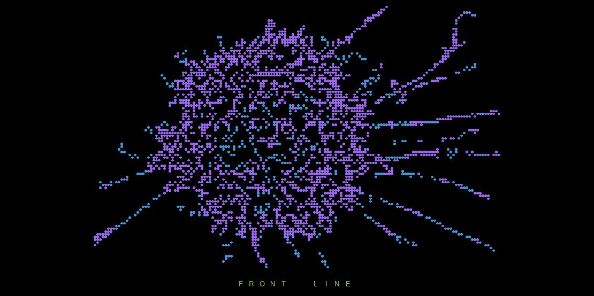

# Front Line

An Omarchy theme of the body's defenders under the electron microscope: natural killer cells, T cells and B cells
from human donors, each one alone on black, a T cell infected with HIV, white blood cells meeting MRSA and Klebsiella
bacteria, and a red blood cell infected with malaria. Electron microscopes see in black and white; every picture here
was coloured by hand at NIAID, the US National Institute of Allergy and Infectious Diseases. The black the cells were
photographed on is the background, the text is pale, the green of the first killer cell is the accent, and the window
border turns from it into the violet of the purple one. A sister theme to Viral, from the same source.

Each wallpaper has a small label in the bottom right corner (bottom right because terminal text keeps to the
left): what it is, one line in plain words, the date on the picture's page, who made it and the licence.

| Wallpaper | What it shows | Date | Made by, licence | Source |
|---|---|---|---|---|
| `01-killer-cell` | A natural killer cell from a human donor (scanning electron microscope) | 30 Jun 2016 | NIAID, CC BY 2.0 | [Commons](https://commons.wikimedia.org/wiki/File:Human_Natural_Killer_Cell_(29120480442).jpg) |
| `02-t-cell` | A T lymphocyte (scanning electron microscope) | 16 Mar 2015 | NIAID, CC BY 2.0 | [Commons](https://commons.wikimedia.org/wiki/File:T_Lymphocyte_(16760076824).jpg) |
| `03-mrsa` | Methicillin-resistant Staphylococcus aureus (MRSA) and a dead human neutrophil | 30 Jun 2006 | NIAID, CC BY 2.0 | [Commons](https://commons.wikimedia.org/wiki/File:Scanning_electron_micrograph_of_Methicillin-resistant_Staphylococcus_aureus_(MRSA)_and_a_dead_Human_neutrophil_-_NIAID.jpg) |
| `04-killer-cell-pink` | A natural killer cell from a human donor | 30 Jun 2016 | NIAID, CC BY 2.0 | [Commons](https://commons.wikimedia.org/wiki/File:Human_Natural_Killer_Cell_(29228845335).jpg) |
| `05-b-cell` | A B cell from a human donor | 30 Jun 2016 | NIAID, CC BY 2.0 | [Commons](https://commons.wikimedia.org/wiki/File:Human_B_Lymphocyte_-_NIAID.jpg) |
| `06-malaria` | A red blood cell infected with malaria parasites (blue), uninfected red cells to the left | 14 Nov 2013 | NIAID, CC BY 2.0 | [Commons](https://commons.wikimedia.org/wiki/File:Malaria-infected_Red_Blood_Cell_(10856848295).jpg) |
| `07-t-cell-orange` | A T lymphocyte, coloured for Halloween | 16 Mar 2015 | NIAID, CC BY 2.0 | [Commons](https://commons.wikimedia.org/wiki/File:T_Lymphocyte.jpg) |
| `08-hiv-t-cell` | A T cell infected with HIV | 2 Dec 2009 | NIAID, CC BY 2.0 | [Commons](https://commons.wikimedia.org/wiki/File:HIV-infected_T_cell_(6813384933).jpg) |
| `09-killer-cell-purple` | A human natural killer cell, coloured for Halloween | 26 May 2016 | NIAID, CC BY 2.0 | [Commons](https://commons.wikimedia.org/wiki/File:Human_Natural_Killer_Cell.jpg) |
| `10-klebsiella` | Carbapenem-resistant Klebsiella pneumoniae meeting a human neutrophil | 14 Feb 2014 | NIAID, CC BY 2.0 | [Commons](https://commons.wikimedia.org/wiki/File:Klebsiella_pneumoniae_Bacterium_(13383468143).jpg) |
| `11-b-cell-teal` | A B cell from a human donor | 30 Jun 2016 | NIAID, CC BY 2.0 | [Commons](https://commons.wikimedia.org/wiki/File:Human_B_Lymphocyte_(29196367446).jpg) |

Facts on the labels come from each picture's Commons page, which copies NIAID's own caption from its Flickr stream;
the date is the one the page gives (when NIAID published the picture, not when the sample was imaged). What each kind
of cell does (natural killer cells kill virus-infected and cancer cells, B cells make antibodies) is textbook
immunology, not the pages' words.

The pictures were chosen from the 1,020 files NIAID has on Wikimedia Commons, the same pool as Viral: the immune
cells, bacteria and parasites at least 2400 pixels across were looked at as small pictures, 20 downloaded whole and
looked at one by one at true screen size, and 11 kept. Grain at screen size (`src/grain.py`, Immerkaer sigma at
2560 x 1440): 0.3 to 4.7, every one also checked by eye. Left out: gonorrhoea bacteria (blocky when enlarged), a B
cell cut through on a white background with a scale bar, Klebsiella in green and an HIV-infected T cell in purple
(the same pictures in other colours), a T cell in red and a killer cell in two more colours (the same again), another HIV-infected T cell, on red (much like the one kept), Borrelia bacteria among red blood cells (soft, and the only picture under a US government public-domain notice).

Every wallpaper but the MRSA uses photowall's `fit`: the whole picture, left of the label, on the black of its own
background with a faded edge. The HIV-infected T cell fills its photo to the edge, so it is set in a round view, like
looking down a microscope (photowall's `oval`).

```
src/build front-line            # the pictures (~22 MB) download once into ~/.cache/omarchy-themes/front-line
./install front-line
omarchy theme set front-line
```

## Screensaver



`screensaver.txt` is the `09-killer-cell-purple` wallpaper redrawn as braille text art (`src/asciiart.py`), each dot in the nearest of
the theme's colours. `./install` copies it with the theme; once [extras/screensaver](../../extras/screensaver/README.md)
is set up, Omarchy's screensaver shows it with an animated effect (laser etch, matrix rain, VHS glitch and others).

## Credits and licences

Every wallpaper carries its maker and licence on its label; the table above links each picture's page.

- [CC BY 2.0](https://creativecommons.org/licenses/by/2.0/): free to use and change with credit, a link to the
  licence, and a note of changes. NIAID asks for the credit "NIAID".

Changes made to every picture: cut or scaled to 16:9 at 3840 x 2160 (all but one set whole on black with their edges
faded into it, one in a round view), and a label added in the bottom right corner.
