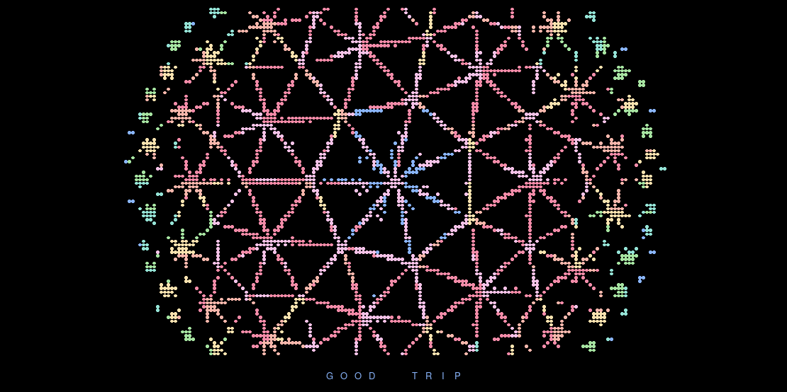

# Good Trip

An Omarchy theme of six happy, moving patterns, drawn here from their formulas: flowers that breathe and turn, a
tunnel of fractal flowers you fall down forever, a melting swirl, rings of hyperbolic tiles and a flowing liquid
kaleidoscope. Every wallpaper is a seamless video loop, painted only with the colours of Omarchy's own Catppuccin
theme, on Catppuccin's deep blue-grey base. The bar, terminal, menus and window border use Catppuccin unchanged.

| Wallpaper | What it shows | About the maths |
|---|---|---|
| `1-blooming-flower` | An eight-fold flower whose petals breathe and change shape while the whole flower slowly turns | A Julia set (z -> z^2 + c, [Wikipedia: Julia set](https://en.wikipedia.org/wiki/Julia_set)) near c = -0.727 + 0.189i, folded into eight mirrored wedges and lit where each point's orbit crosses a ring of petals; c walks a small circle, so every petal reshapes and comes back |
| `2-flower-tunnel` | Falling forever down a spiral tunnel lined with fractal flowers, toward a glowing light | The same Julia flower tiled along a log-polar spiral ([Wikipedia: Log-polar coordinates](https://en.wikipedia.org/wiki/Log-polar_coordinates)); one loop falls two rings deeper, which looks exactly like the start |
| `3-swirl` | A six-armed swirl, its glowing petals turning and melting into new shapes | A Julia set near c = 0.285 + 0.01i, folded six ways and twisted along a log spiral |
| `4-heptagon-sky` | Triangles meeting seven at a point, shrinking toward the rim, turning while the colours flow through them | The {7,3} tiling of the hyperbolic plane in the Poincaré disk ([Wikipedia: Order-3 heptagonal tiling](https://en.wikipedia.org/wiki/Order-3_heptagonal_tiling)): every tile is the same size in that geometry |
| `5-liquid-mandala` | A ten-fold kaleidoscope of flowing marbled colour | Value noise added up over six octaves (fractional Brownian motion) and fed through itself twice ("domain warping"), mirrored ten ways |
| `6-endless-band` | A ribbon of tiles running off both sides of the screen, four meeting at every corner, five round every centre | The {5,4} hyperbolic tiling ([Wikipedia: Order-4 pentagonal tiling](https://en.wikipedia.org/wiki/Order-4_pentagonal_tiling)) in the band model, the whole plane laid along one straight strip |

## Install

```sh
./install good-trip
omarchy theme set good-trip
```

Pick a pattern with Omarchy's background switcher (or `omarchy theme bg next`); all six are in the theme.

## Moving wallpapers

Each wallpaper is a 12-second video, 2560 x 1440, that loops without a seam: every motion in it (the colours flowing
once round the palette, the turn, the wandering Julia constant, the fall down the tunnel) comes back exactly to where
it started. owe, the video wallpaper engine Omarchy uses, plays them. owe moves them even behind windows by default; to
save power, set `occupied_workspace = true` under `[pause]` in `~/.config/owe/config.toml` (then `owe reload-config`),
and they only move on an empty workspace.

## How the wallpapers are made

- `wallpapers.json` lists each pattern with its `draw`: the kind of pattern and its settings (view, colours,
  symmetry, motion; every key is explained at the top of [`src/trippyvid.py`](../../src/trippyvid.py)).
- [`src/trippy.frag`](../../src/trippy.frag) is the drawing itself, a shader that runs on the graphics chip;
  [`src/trippygl.c`](../../src/trippygl.c) runs it frame after frame without a window (EGL, OpenGL ES 3.1) and hands
  the frames to ffmpeg. Four samples a pixel, averaged in linear light, and a light dither so soft glows do not band.
- `src/build good-trip` draws all six and copies them to `backgrounds/`; a video is drawn again only when its settings
  or the shader change. Measured 2026-11-26 on the GeForce MX150 of a ThinkPad T480: 52 to 186 s a
  video, 12.5 minutes for all six.
- `preview.png` is the first frame of `1-blooming-flower`.

## Colours

Every colour in the patterns comes from Omarchy's Catppuccin `colors.toml`: its darkest background, then blue, pink
(magenta), red, orange, yellow, green and cyan, and back to blue, as one looping ramp, on its `background` colour.

## Screensaver



`screensaver.txt` is the first frame of `4-heptagon-sky` redrawn as braille text art (`src/asciiart.py`), each dot in
the nearest of the theme's colours. `./install` copies it with the theme; once
[extras/screensaver](../../extras/screensaver/README.md) is set up, Omarchy's screensaver shows it with an animated
effect (laser etch, matrix rain, VHS glitch and others).

## Credits

The patterns are drawn here from their formulas; nothing is downloaded. The colours come from the Catppuccin theme
that ships with [Omarchy](https://github.com/omacom/omarchy) (MIT licence, copyright David Heinemeier Hansson);
`neovim.lua`, `vscode.json` and `icons.theme` are Omarchy's Catppuccin files, unchanged. The videos are by
CompilingThings, shared under CC BY 4.0 (see [CREDITS.md](../../CREDITS.md)).
