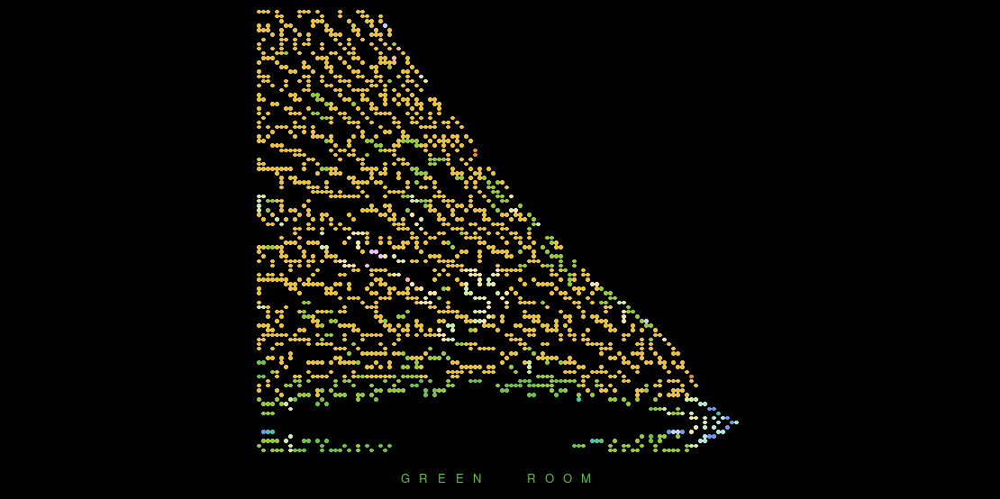

# Green Room

An Omarchy theme of the cells of leaves under the microscope (Robert Hooke named cells after small rooms): the
breathing pores in the skin of a tulip leaf, lit up in polarised light; Canadian pondweed, every cell packed with
chloroplasts, and the tip of one of its leaves; a leaf's veins and cells glowing in fluorescence, and its skin cells
glowing green; and the thick-walled cells that hold a leaf up. A dark green-black background, pale text, chlorophyll
green as the accent, and the window border turning from it into the magenta of polarised light.

Each wallpaper has a small label in the bottom right corner (bottom right because terminal text keeps to the
left): what it is, one line in plain words, the date the photo's page gives, the photographer and the licence.

| Wallpaper | What it shows | Date | Photographer, licence | Source |
|---|---|---|---|---|
| `01-tulip-stomata` | Stomata in the epidermis of a tulip leaf, polarised light, 100x | 19 Mar 2019 | MarekMiś, CC BY 4.0 | [Commons](https://commons.wikimedia.org/wiki/File:Aparaty_szparkowe.jpg) |
| `02-pondweed` | A leaf of Canadian pondweed (*Elodea canadensis*): the central vein and cells filled with chloroplasts; focus stack, compensated polarised light, 100x | 24 Oct 2021 | KarlGaff, CC BY 4.0 | [Commons](https://commons.wikimedia.org/wiki/File:Canadian_Pond_Weed.jpg) |
| `03-pondweed-tip` | The leaf tip of *Elodea canadensis*, same technique | 24 Oct 2021 | KarlGaff, CC BY 4.0 | [Commons](https://commons.wikimedia.org/wiki/File:Canadian_Pond_Weed_Leaf_Tip.jpg) |
| `04-leaf-cells` | Leaf cells, with veins | 2 Dec 2012 | Ivan Bachev, CC BY 4.0 | [Commons](https://commons.wikimedia.org/wiki/File:Leaf_cells_-_03.jpg) |
| `05-leaf-glow` | Leaf cells, their walls glowing green | 29 Nov 2013 | Ivan Bachev, CC BY 4.0 | [Commons](https://commons.wikimedia.org/wiki/File:Leaf_cells_-_02.jpg) |
| `06-leaf-skeleton` | Structural cells in a leaf, with the xylem and phloem | 6 Dec 2017 | Pyre42, CC BY 4.0 | [Commons](https://commons.wikimedia.org/wiki/File:Cells_in_Leaf.jpg) |

Facts on the labels come from each photo's Commons page. Two plain-word notes are general knowledge, not from the
pages: that stomata are the leaf's breathing pores, and that xylem and phloem are the plant's pipes. The pages of
`04` and `05` say only "Leaf cells"; how they look (veins, glowing walls) is what the photos show.

The photos were chosen from 63 unused photos of plants 4K or larger under a free licence, in Wikimedia Commons'
microscopy categories. Leaf cells are new to these themes (Stem Glow has stems, stalks and a pine needle). Each was
checked at the size it is shown: four soft or out-of-focus photos were left out, and a pale photo of sphagnum moss
cells that looked flat beside the others. Grain at screen size (`src/grain.py`, Immerkaer sigma at 2560 x 1440): 0.6
to 3.8, the highest the pondweed's packed chloroplasts. `01` to `04` fill the screen; `05` and `06` are round
microscope views, set on black and faded to a round edge.

```
src/build green-room          # the photos (~74 MB) download once into ~/.cache/omarchy-themes/green-room
./install green-room
omarchy theme set green-room
```

## Screensaver



`screensaver.txt` is the `03-pondweed-tip` wallpaper redrawn as braille text art (`src/asciiart.py`), each dot in the nearest of
the theme's colours. `./install` copies it with the theme; once [extras/screensaver](../../extras/screensaver/README.md)
is set up, Omarchy's screensaver shows it with an animated effect (laser etch, matrix rain, VHS glitch and others).

## Credits and licences

Every wallpaper carries its photographer and licence on its label; the table above links each photo's page.

- [CC BY 4.0](https://creativecommons.org/licenses/by/4.0/): free to use and change with credit, a link to the
  licence, and a note of changes.

Changes made to every photo: cropped to 16:9 and scaled to 3840 x 2160 (`05` and `06`: set whole on a black field
and faded to a round edge), and a label added in the bottom right corner.
