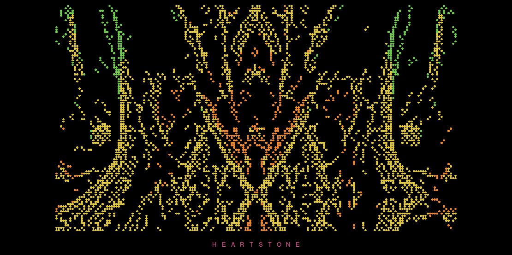

# Heartstone

An Omarchy theme of mineral growing where it should not, inside the human body, seen with the electron microscope by
Sergio Bertazzo: round mineral grains in heart tissue, one grain caught in a web of tissue fibres, the crystals of
kidney stones, and two pictures of calcified heart tissue mirrored into one symmetric picture. The colours are not
paint: in density-dependent colour scanning electron micrographs (DDC-SEM), the colour of each part shows how dense
it is, so the hard mineral and the soft tissue around it come out in different colours. A near-black background, pale
text, the hot pink of the fibre web as the accent, and the window border turning from it into kidney-stone orange.

Each wallpaper has a small label in the bottom right corner (bottom right because terminal text keeps to the
left): what it is, one line in plain words, the date the photo's page gives, the photographer and the licence.

| Wallpaper | What it shows | Date | Photographer, licence | Source |
|---|---|---|---|---|
| `01-calcified-particles` | Density-dependent colour scanning electron micrograph of calcified particles in cardiac tissue | 11 Nov 2013 | Sergio Bertazzo, CC BY-SA 4.0 | [Commons](https://commons.wikimedia.org/wiki/File:DDC-SEM_of_cardiac_tissue_-_blue.jpg) |
| `02-particle-web` | Density-dependent colour scanning electron micrograph of a calcified particle in cardiac tissue | 9 May 2013 | the same, CC BY-SA 4.0 | [Commons](https://commons.wikimedia.org/wiki/File:DDC-SEM_of_cardiac_tissue_-7.jpg) |
| `03-kidney-stone` | Density-dependent colour scanning electron micrograph of a kidney stone | 16 Feb 2014 | the same, CC BY-SA 4.0 | [Commons](https://commons.wikimedia.org/wiki/File:DDC-SEM_of_kidney_stone_-_1.jpg) |
| `04-stone-surface` | Density-dependent colour scanning electron micrograph of a kidney stone, another field | 16 Feb 2014 | the same, CC BY-SA 4.0 | [Commons](https://commons.wikimedia.org/wiki/File:DDC-SEM_of_kidney_stone_-_orange.jpg) |
| `05-mirrored-heart` | Cardiac tissue with calcification in red and the organic part of the tissue in blue; the page says the image was mirrored for aesthetic purposes | 2 Aug 2011 | the same, CC BY-SA 4.0 | [Commons](https://commons.wikimedia.org/wiki/File:DDC-SEM_of_cardiac_tissue_in_red_-1.jpg) |
| `06-heart-panorama` | Calcified cardiac tissue, mirrored by the photographer; the middle of his wide picture | 12 May 2013 | the same, CC BY-SA 4.0 | [Commons](https://commons.wikimedia.org/wiki/File:Mirrored_DDC-SEM_of_cardiac_tissue_-2.jpg) |

Facts on the labels come from each photo's Commons page; "how dense each part is" is the plain meaning of
"density-dependent colour". The photos were entered in the European Science Photo Competition 2015 (United Kingdom).

The photos were chosen from 31 unused DDC-SEM pictures by Sergio Bertazzo 4K or larger on Wikimedia Commons. They
show six different fields, most of them in several colour versions; one version of each field was kept, picked so
the six together cover red, pink, orange, blue, cyan and green. Calcification of the heart and kidney stones are new
to these themes. All six were looked at as true-size crops: an electron micrograph this close is soft by nature, but
none shows grain. Grain at screen size (`src/grain.py`, Immerkaer sigma at 2560 x 1440): 0.3 to 1.4.

```
src/build heartstone        # the photos (~44 MB) download once into ~/.cache/omarchy-themes/heartstone
./install heartstone
omarchy theme set heartstone
```

## Screensaver



`screensaver.txt` is the `06-heart-panorama` wallpaper redrawn as braille text art (`src/asciiart.py`), each dot in the nearest of
the theme's colours. `./install` copies it with the theme; once [extras/screensaver](../../extras/screensaver/README.md)
is set up, Omarchy's screensaver shows it with an animated effect (laser etch, matrix rain, VHS glitch and others).

## Credits and licences

Every wallpaper carries its photographer and licence on its label; the table above links each photo's page.

- [CC BY-SA 4.0](https://creativecommons.org/licenses/by-sa/4.0/): free to use and change with credit, a link to the
  licence, and a note of changes; changed versions must keep the same licence. Every wallpaper here keeps it.

Changes made to every photo: cropped to 16:9 round its middle, scaled to 3840 x 2160, and a label added in the bottom
right corner.
