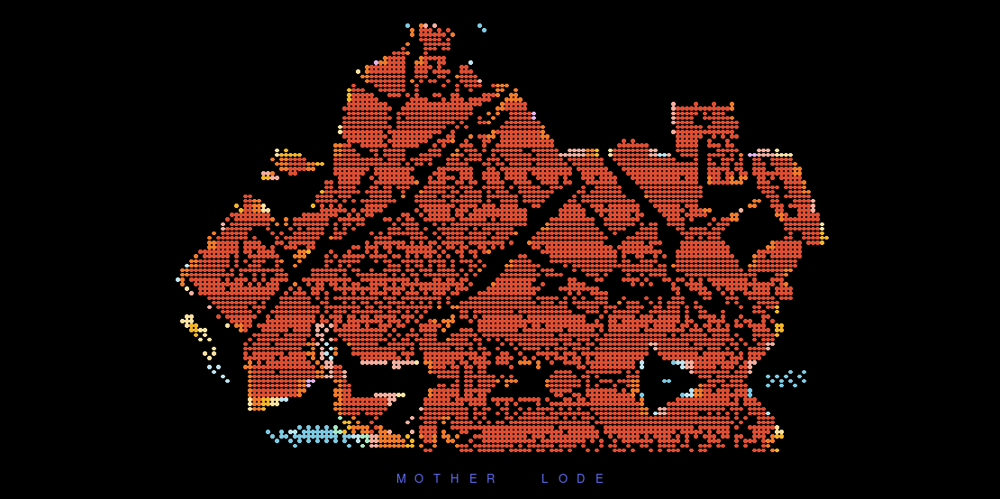

# Mother Lode

An Omarchy theme of mineral specimens, each a few centimetres across, photographed in the studio by Ivar Leidus:
ultramarine azurite, orange plates of wulfenite, clear gypsum with green herbertsmithite inside it, sky-blue celestine,
golden mimetite and red-brown vanadinite. Graphite as the background, pale neutral text, the ultramarine of azurite
as the accent, and the window border turning from it into the orange of wulfenite.

Each wallpaper has a small label in the bottom right corner (bottom right because terminal text keeps to the
left): what it is, one line in plain words, the date the photo's page gives, the photographer and the licence.

| Wallpaper | What it shows | Date | Photographer, licence | Source |
|---|---|---|---|---|
| `01-azurite` | Blue crystals of azurite covering their rock, with a little malachite, 4.0 x 3.0 x 2.0 cm; New Nevada Lode, La Sal, Utah, USA | 2023 | Ivar Leidus, CC BY-SA 4.0 | [Commons](https://commons.wikimedia.org/wiki/File:Azurite_-_New_Nevada_Lode,_La_Sal,_Utah,_USA.jpg) |
| `02-wulfenite` | Orange-red tabular crystals of wulfenite on a little rock, 2.2 x 1.7 x 0.3 cm; Red Cloud mine, La Paz County, Arizona, USA | 2023 | Ivar Leidus, CC BY-SA 4.0 | [Commons](https://commons.wikimedia.org/wiki/File:Wulfenite_-_Red_Cloud_mine,_La_Paz_Co.,_Arizona,_USA.jpg) |
| `03-gypsum` | Partly transparent gypsum crystals with green herbertsmithite inclusions, 5.3 x 3.5 x 3.5 cm; Sieroszowice mine, Lower Silesia, Poland | 22 Apr 2021 | Ivar Leidus, CC BY-SA 4.0 | [Commons](https://commons.wikimedia.org/wiki/File:Gypsum_-_Sieroszowice_mine,_Lubin,_Lower_Silesia,_Poland.jpg) |
| `04-celestine` | Celestine crystals, field of view 3.5 x 2.6 cm; Sakoany deposit, Boeny, Madagascar | 18 Mar 2021 | Ivar Leidus, CC BY-SA 4.0 | [Commons](https://commons.wikimedia.org/wiki/File:Celestine_-_Sakoany_deposit,_Katsepy,_Mitsinjo,_Boeny,_Madagascar.jpg) |
| `05-mimetite` | Golden yellow rounded (botryoidal) mimetite on rock, collected in 1969 or 1970, 3.0 x 1.7 x 1.0 cm; Congreso-León mines, Chihuahua, Mexico | 2023 | Ivar Leidus, CC BY-SA 4.0 | [Commons](https://commons.wikimedia.org/wiki/File:Mimetite_-_Congreso-Le%C3%B3n_mines,_San_Pedro_Corralitos,_Chihuahua,_Mexico.jpg) |
| `06-vanadinite` | A cluster of reddish brown tabular vanadinite crystals up to 1.8 cm, 4.0 x 2.5 x 2.3 cm; ACF mine, Mibladen, Morocco | 8 Feb 2021 | Ivar Leidus, CC BY-SA 4.0 | [Commons](https://commons.wikimedia.org/wiki/File:Vanadinite_-_ACF_mine,_Mibladen,_Morocco.jpg) |

Facts on the labels come from each photo's Commons page: the mineral, its size and where it was found. "A copper
mineral" and "a lead mineral" are the everyday words for azurite (a copper carbonate) and wulfenite (lead molybdate).
Three pages give the date as 1 January 2023, which on Commons usually stands for the year alone, so those labels say
only 2023.

The photos were chosen from Wikimedia Commons' featured pictures of minerals (72 files, 40 of them 4K or larger under
a free licence), all six from one photographer so the theme has one studio look. Every mineral here is new to these
themes; quartz, in Bedrock already, was left out. Grain at screen size (`src/grain.py`, Immerkaer sigma at 2560 x
1440): 0.6 to 2.5. Left out: tall photos (an elbaite crystal and an aragonite star) whose studio gradient showed as a
lit box round them on a plain field, and specimens on black (kept for a theme of their own).

```
src/build mother-lode          # the photos (~110 MB) download once into ~/.cache/omarchy-themes/mother-lode
./install mother-lode
omarchy theme set mother-lode
```

## Screensaver



`screensaver.txt` is the `06-vanadinite` wallpaper redrawn as braille text art (`src/asciiart.py`), each dot in the nearest of
the theme's colours. `./install` copies it with the theme; once [extras/screensaver](../../extras/screensaver/README.md)
is set up, Omarchy's screensaver shows it with an animated effect (laser etch, matrix rain, VHS glitch and others).

## Credits and licences

Every wallpaper carries its photographer and licence on its label; the table above links each photo's page.

- [CC BY-SA 4.0](https://creativecommons.org/licenses/by-sa/4.0/): free to use and change with credit, a link to the
  licence, and a note of changes; changed versions must keep the same licence. Every wallpaper here is CC BY-SA 4.0
  too.

Changes made to every photo: cut to 16:9 at 3840 x 2160, and a label added in the bottom right corner.
