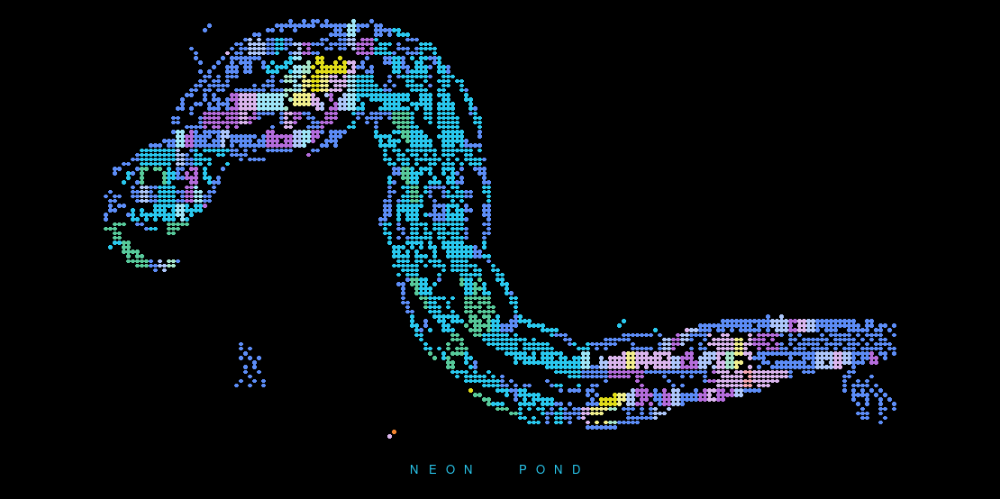

# Neon Pond

An Omarchy theme of the small animals of a pond, glowing in colour on black: water fleas, a copepod carrying its
eggs, phantom midge and mosquito larvae, and the suction-cup foot of a diving beetle. All eleven are by one
photographer, Andrei Savitsky, taken in 2019 and 2020. Most are lit from the side on a black field (dark field),
so the see-through animal shines against the dark; many are also seen in polarised light, which turns muscle,
and the tiny crystals some water fleas carry, into bands of colour. The black of the dark field is the background,
the text is cool and pale, the cyan of polarised muscle is the accent, and the window border turns from that cyan into
the yellow of a glowing larva.

Each wallpaper has a small label in the bottom right corner (bottom right because terminal text keeps to the
left): what it is, one line in plain words, when it was photographed, the photographer and the licence.

| Wallpaper | What it shows | Photographed | Photographer, licence | Source |
|---|---|---|---|---|
| `01-daphnia-crystals` | A water flea (Daphnia) in polarised light, crystals on its body | 31 Mar 2020 | Andrei Savitsky, CC BY-SA 4.0 | [Commons](https://commons.wikimedia.org/wiki/File:%D0%94%D0%B0%D1%84%D0%BD%D1%96%D1%8F_%D0%B7_%D0%BA%D1%80%D0%B8%D1%81%D1%82%D0%B0%D0%BB%D0%B0%D0%BC%D0%B8.jpg) |
| `02-blue-eggs` | A water flea (Megafenestra) with blue eggs, dark field | 24 May 2019 | Andrei Savitsky, CC BY-SA 4.0 | [Commons](https://commons.wikimedia.org/wiki/File:%D0%A0%D0%B0%D0%BA%D0%BE%D0%BF%D0%BE%D0%B4%D1%96%D0%B1%D0%BD%D0%B5_Megafenestra.jpg) |
| `03-phantom-midge` | A phantom midge larva (Chaoborus), dark field and polarised light | 11 Aug 2019 | Andrei Savitsky, CC BY-SA 4.0 | [Commons](https://commons.wikimedia.org/wiki/File:%D0%9B%D0%B8%D1%87%D0%B8%D0%BD%D0%BA%D0%B0_%D0%BA%D0%BE%D0%BC%D0%B0%D1%80%D0%B0_%D0%9A%D0%BE%D1%80%D0%B5%D1%82%D1%80%D0%B0._%D0%A2%D0%B5%D0%BC%D0%BD%D0%BE%D0%B5_%D0%BF%D0%BE%D0%BB%D0%B5_%2B_%D0%BF%D0%BE%D0%BB%D1%8F%D1%80%D0%B8%D0%B7%D0%B0%D1%86%D0%B8%D1%8F.jpg) |
| `04-simocephalus` | A water flea (Simocephalus) with crystals on its body, dark field and polarised light | 12 May 2019 | Andrei Savitsky, CC BY-SA 4.0 | [Commons](https://commons.wikimedia.org/wiki/File:%D0%A0%D0%B0%D0%BA%D0%BE%D0%BF%D0%BE%D0%B4%D1%96%D0%B1%D0%BD%D0%B5_Simocephalus_%D0%B7_%D0%BA%D1%80%D0%B8%D1%81%D1%82%D0%B0%D0%BB%D0%BB%D0%B0%D0%BC%D0%B8_%D0%BD%D0%B0_%D1%82%D1%96%D0%BB%D1%96.jpg) |
| `05-copepod-eggs` | A copepod (Megacyclops) with two egg sacs, dark field and polarised light | 16 Apr 2019 | Andrei Savitsky, CC BY-SA 4.0 | [Commons](https://commons.wikimedia.org/wiki/File:%D0%92%D0%B5%D1%81%D0%BB%D0%BE%D0%BD%D0%BE%D0%B3%D0%B5_%D1%80%D0%B0%D0%BA%D0%BE%D0%BF%D0%BE%D0%B4%D1%96%D0%B1%D0%BD%D0%B5_Megacyclops.jpg) |
| `06-daphnia-muscles` | A water flea (Daphnia) in polarised light, muscles glowing | 28 Oct 2019 | Andrei Savitsky, CC BY 4.0 | [Commons](https://commons.wikimedia.org/wiki/File:%D0%94%D0%B0%D1%84%D0%BD%D0%B8%D1%8F_%D0%B2_%D0%BF%D0%BE%D0%BB%D1%8F%D1%80%D0%B8%D0%B7%D0%BE%D0%B2%D0%B0%D0%BD%D0%BD%D0%BE%D0%BC_%D1%81%D0%B2%D0%B5%D1%82%D0%B5.jpg) |
| `07-diving-beetle-foot` | Suction cups on the front foot of a diving beetle | 2 Oct 2020 | Andrei Savitsky, CC BY-SA 4.0 | [Commons](https://commons.wikimedia.org/wiki/File:%D0%9F%D1%80%D0%B8%D1%81%D0%BE%D1%81%D0%BA%D0%B0_%D0%BD%D0%B0_%D0%BB%D0%B0%D0%BF%D1%96_%D0%B6%D1%83%D0%BA%D0%B0_%D0%BF%D0%BB%D0%B0%D0%B2%D1%83%D0%BD%D1%86%D1%8F.jpg) |
| `08-mosquito-larva` | A mosquito larva, dark field and polarised light | 18 Aug 2019 | Andrei Savitsky, CC BY 4.0 | [Commons](https://commons.wikimedia.org/wiki/File:%D0%9B%D0%B8%D1%87%D0%B8%D0%BD%D0%BA%D0%B0_%D0%BA%D1%80%D0%BE%D0%B2%D0%BE%D1%81%D0%BE%D1%81%D1%83%D1%89%D0%B5%D0%B3%D0%BE_%D0%BA%D0%BE%D0%BC%D0%B0%D1%80%D0%B0._%D0%A2%D0%B5%D0%BC%D0%BD%D0%BE%D0%B5_%D0%BF%D0%BE%D0%BB%D0%B5_%2B_%D0%BF%D0%BE%D0%BB%D1%8F%D1%80%D0%B8%D0%B7%D0%B0%D1%86%D0%B8%D1%8F.jpg) |
| `09-phantom-midge-blue` | A phantom midge larva in oblique polarised light | 12 Aug 2019 | Andrei Savitsky, CC BY-SA 4.0 | [Commons](https://commons.wikimedia.org/wiki/File:%D0%9B%D0%B8%D1%87%D0%B8%D0%BD%D0%BA%D0%B0_%D0%BA%D0%BE%D0%BC%D0%B0%D1%80%D0%B0_%D0%9A%D0%BE%D1%80%D0%B5%D1%82%D1%80%D0%B0._%D0%9A%D0%BE%D1%81%D0%BE%D0%B9_%D0%BF%D0%BE%D0%BB%D1%8F%D1%80%D0%B8%D0%B7%D0%BE%D0%B2%D0%B0%D0%BD%D0%BD%D1%8B%D0%B9_%D1%81%D0%B2%D0%B5%D1%82.jpg) |
| `10-daphnia` | A water flea (Daphnia), dark field | 21 May 2019 | Andrei Savitsky, CC BY-SA 4.0 | [Commons](https://commons.wikimedia.org/wiki/File:%D0%94%D0%B0%D1%84%D0%BD%D1%96%D1%8F_%D0%BF%D1%96%D0%B4_%D0%BC%D1%96%D0%BA%D1%80%D0%BE%D1%81%D0%BA%D0%BE%D0%BF%D0%BE%D0%BC,_%D1%82%D0%B5%D0%BC%D0%BD%D0%B5_%D0%BF%D0%BE%D0%BB%D0%B5.jpg) |
| `11-phantom-midge-head` | The head of a phantom midge larva, dark field and polarised light | 21 Aug 2019 | Andrei Savitsky, CC BY-SA 4.0 | [Commons](https://commons.wikimedia.org/wiki/File:%D0%9B%D0%B8%D1%87%D0%B8%D0%BD%D0%BA%D0%B0_%D0%BA%D0%BE%D0%BC%D0%B0%D1%80%D0%B0_Chaoborus._%D0%A2%D0%B5%D0%BC%D0%BD%D0%BE%D0%B5_%D0%BF%D0%BE%D0%BB%D0%B5_%2B_%D0%BF%D0%BE%D0%BB%D1%8F%D1%80%D0%B8%D0%B7%D0%B0%D1%86%D0%B8%D1%8F.jpg) |

Facts on the labels come from each photo's Commons page: the animal, and the lighting (dark field, polarised light,
oblique light). The page of 06 says the muscles glow yellow and blue in polarised light; the page of 07 says the
male diving beetle holds the female with these suction cups during mating; the page of 09 says the larva's muscles
split light in two (birefringence), which is why polarised light can colour them. The spotted sacs
inside a phantom midge larva are its air sacs (the page of a left-out photo names them its hydrostatic apparatus).
The date is the one the photo file records.

The pictures were chosen from the microscope entries of the Wiki Science Competition in Ukraine 2020 and the Russian
Science Photo Competition 2020 on Wikimedia Commons, then looked at one by one at true screen size. Grain at screen
size (`src/grain.py`, Immerkaer sigma at 2560 x 1440): 0.0 to 0.7. Left out after the full-size look, from 31
candidates: most for soft focus at full size (several water fleas and copepods, a gammarus shrimp, a mosquito pupa,
two more mosquito larvae, a damselfly larva, a diving beetle larva, and a close-up of a phantom midge larva's air
sacs), two very sharp water fleas on a plain grey background (no colour), and a housefly's mouthparts (not a pond
animal).

Every wallpaper but 01 and 06 uses photowall's `fit`: the whole animal, set left of centre on its own black (09: its
own lavender grey), its edges faded into it, so no leg or bristle is cut off. Five photos (02, 04, 05, 07, 10)
carry a small scale bar on the black in a corner; `fit`'s `hide` paints it over in the black before the photo is
placed.

```
src/build neon-pond              # the photos (~130 MB) download once into ~/.cache/omarchy-themes/neon-pond
./install neon-pond
omarchy theme set neon-pond
```

## Screensaver



`screensaver.txt` is the `03-phantom-midge` wallpaper redrawn as braille text art (`src/asciiart.py`), each dot in the nearest of
the theme's colours. `./install` copies it with the theme; once [extras/screensaver](../../extras/screensaver/README.md)
is set up, Omarchy's screensaver shows it with an animated effect (laser etch, matrix rain, VHS glitch and others).

## Credits and licences

Every wallpaper carries its photographer and licence on its label; the table above links each photo's page.

- [CC BY 4.0](https://creativecommons.org/licenses/by/4.0/): free to use and change with credit, a link to the
  licence, and a note of changes.
- [CC BY-SA 4.0](https://creativecommons.org/licenses/by-sa/4.0/): the same, and a changed picture must be shared
  under the same licence.

Changes made to every photo: cut or set on a field to 16:9 and scaled to 3840 x 2160, a scale bar painted over on
five, and a label added in the bottom right corner. A finished wallpaper made from a CC BY-SA photo is itself shared
under that photo's CC BY-SA licence.
