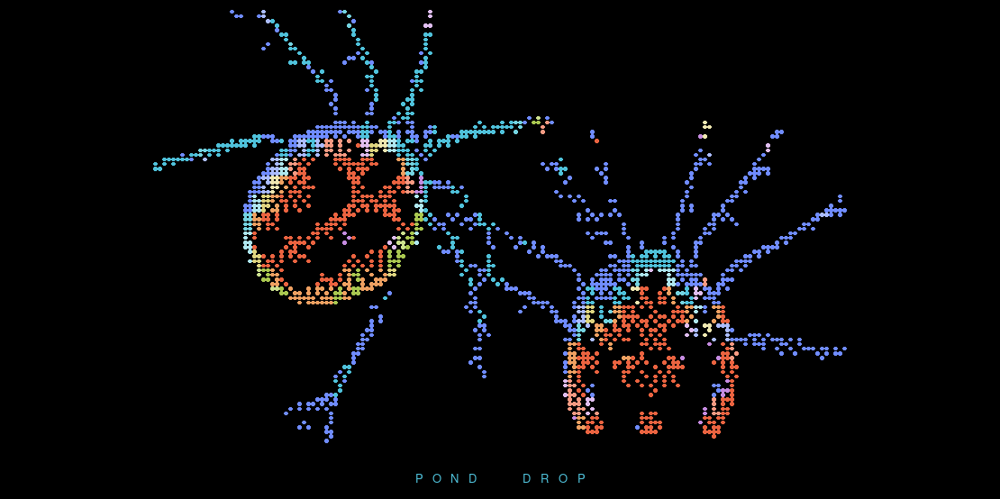

# Pond Drop

An Omarchy theme of the small animals in a drop of pond water, seen under the microscope: water fleas, copepods,
seed shrimp, water mites, midge larvae and the winter capsule of a moss animal. Ten of the thirteen were collected
from ponds in and near Rakvere, Estonia, and photographed by Janek Lass. The black of a dark-field microscope, warm
pale text like a lit shell, the teal a water flea shows in dark-field light as the accent, and the window border
fading from that teal into the amber of a water flea's brood. The terminal colours come from the photos too: the red
water mite, the copepod's yellow, the midge larva's green and violet, the deep blue water behind the red mite.

Each wallpaper has a small label in the bottom right corner (bottom right because terminal text keeps to the
left): what it is, one line in plain words, when it was photographed, the photographer and the licence. Most of the
animals were photographed whole on black; those are set on the screen whole, left of centre, on a field of their own
background colour, so no leg or bristle is cut off (on a 3:2 screen too).

| Wallpaper | What it shows | Photographed | Photographer, licence | Source |
|---|---|---|---|---|
| `01-water-flea-birth` | A Daphnia water flea giving birth; dark field and polarised light, 100x | 8 May 2019 | MarekMiś, CC BY 4.0 | [Commons](https://commons.wikimedia.org/wiki/File:Rodz%C4%85ca_dafnia.jpg) |
| `02-copepod` | A copepod about 4 mm long, town pond, Rakvere | 25 Nov 2024 | Janek Lass, CC BY 4.0 | [Commons](https://commons.wikimedia.org/wiki/File:Copepod2.jpg) |
| `03-two-water-mites` | Two water mites, 0.6 mm, one from above and one from below, town pond, Rakvere | 1 Jun 2026 | Janek Lass, CC BY 4.0 | [Commons](https://commons.wikimedia.org/wiki/File:Two_water_mites_dorsal_and_ventral_view.jpg) |
| `04-red-water-mite` | A water mite 1.1 mm long from a shallow freshwater pond, incident light | 30 Aug 2014 | Anatoly Mikhaltsov, CC BY-SA 4.0 | [Commons](https://commons.wikimedia.org/wiki/File:%D0%92%D0%BE%D0%B4%D1%8F%D0%BD%D0%BE%D0%B9_%D0%BA%D0%BB%D0%B5%D1%89.jpg) |
| `05-seed-shrimp` | Four ostracods round a water bubble, from an old mine near Rakvere | 9 May 2026 | Janek Lass, CC BY 4.0 | [Commons](https://commons.wikimedia.org/wiki/File:A_micrograph_showing_four_ostracods.jpg) |
| `06-phantom-midge-larva` | A glassworm, the larva of a phantom midge (Chaoboridae), pond, Rakvere | 29 Apr 2022 | Janek Lass, CC BY 4.0 | [Commons](https://commons.wikimedia.org/wiki/File:Tiigi_klaasiks%C3%A4%C3%A4sevastne.jpg) |
| `07-simocephalus` | A Simocephalus water flea from the side, town pond, Rakvere | 30 Aug 2026 | Janek Lass, CC BY 4.0 | [Commons](https://commons.wikimedia.org/wiki/File:Micrograph_of_a_Simocephalus_water_flea_in_lateral_view.jpg) |
| `08-midge-larva` | A midge larva in dark field and polarised light, a stacked panorama | 1 Nov 2021 | KarlGaff Art of Science Photography, CC BY 4.0 | [Commons](https://commons.wikimedia.org/wiki/File:Non-Biting_Diptera_Midge_Larva.jpg) |
| `09-copepod-dark-field` | A copepod 1.5 mm long from above, dark field, town pond, Rakvere | 22 Apr 2024 | Janek Lass, CC BY 4.0 | [Commons](https://commons.wikimedia.org/wiki/File:Freshwater_copepod_(Copepoda)_under_darkfield_microscopy.jpg) |
| `10-statoblast` | The survival capsule (statoblast) of the moss animal Cristatella mucedo, pond, Rakvere | 24 Nov 2024 | Janek Lass, CC BY 4.0 | [Commons](https://commons.wikimedia.org/wiki/File:Sammallooma_elluj%C3%A4%C3%A4miskapsel_(Cristatella_mucedo).jpg) |
| `11-two-seed-shrimp` | Two ostracods side by side in reflected light, town pond, Rakvere | 1 Jun 2025 | Janek Lass, CC BY 4.0 | [Commons](https://commons.wikimedia.org/wiki/File:Mikrofotol_on_k%C3%B5rvuti_kaks_karpv%C3%A4hilist_ehk_ostrakoodi_(Ostracoda).jpg) |
| `12-water-mite` | A water mite from above, its two red eyes at the front, pond, Rakvere | 1 Jun 2026 | Janek Lass, CC BY 4.0 | [Commons](https://commons.wikimedia.org/wiki/File:Water_mite_(Hydrachnidia)_dorsal_view_under_microscope.jpg) |
| `13-copepod` | A copepod, Estonia | 24 May 2022 | Janek Lass, CC BY 4.0 | [Commons](https://commons.wikimedia.org/wiki/File:Aerjalgne.jpg) |

Facts on the labels come from each photo's Commons page (what it shows, where it was collected, size, lighting,
date). A statoblast, its page says, is a survival structure that helps a moss animal (bryozoan) through freezing and
drying: a gas-filled ring keeps it afloat, and a ring of spines lets it catch on water plants or bird feathers.
Copepods, says the page of 13, live in seas, fresh water and puddles, eat microscopic organisms and are food for
larger water animals. The date is the one the photo file records.

All thirteen are Wikimedia Commons featured pictures, chosen from its microscope pictures and then looked at one by
one at true screen size. Every photo was uploaded by its photographer; none is non-commercial or no-changes. Grain at
screen size (`src/grain.py`, Immerkaer sigma at 2560 x 1440): 0.2 to 2.3 (midge larva 0.2, Simocephalus 2.3).
Left out: a third mite photo with stacking halos along its bristles (three better mites were already in), and
a water flea on white, desmids and algae on grey, which looked washed out next to the dark-field pictures.

Wallpapers 01 to 03, 05 to 09 and 11 to 13 use photowall's `fit` (the whole photo on a field of its own edge colour,
its edges faded into it). The scale bar in the bottom right corner of 08 is painted over with its black background
(`fit.hide`), and 08 is kept inside the width a 3:2 screen shows. 04 and 10 fill the screen.

```
src/build pond-drop              # the photos (~95 MB) download once into ~/.cache/omarchy-themes/pond-drop
./install pond-drop
omarchy theme set pond-drop
```

## Screensaver



`screensaver.txt` is the `03-two-water-mites` wallpaper redrawn as braille text art (`src/asciiart.py`), each dot in the nearest of
the theme's colours. `./install` copies it with the theme; once [extras/screensaver](../../extras/screensaver/README.md)
is set up, Omarchy's screensaver shows it with an animated effect (laser etch, matrix rain, VHS glitch and others).

## Credits and licences

Every wallpaper carries its photographer and licence on its label; the table above links each photo's page.

- [CC BY 4.0](https://creativecommons.org/licenses/by/4.0/): free to use and change with credit, a link to the
  licence, and a note of changes.
- [CC BY-SA 4.0](https://creativecommons.org/licenses/by-sa/4.0/): the same, and a changed picture must be shared
  under the same licence.

Changes made to every photo: cut or set on a field to 16:9 and scaled to 3840 x 2160, and a label added in the bottom
right corner; 08's scale bar painted over. A finished wallpaper made from a CC BY-SA photo is itself shared under
that photo's CC BY-SA licence.
