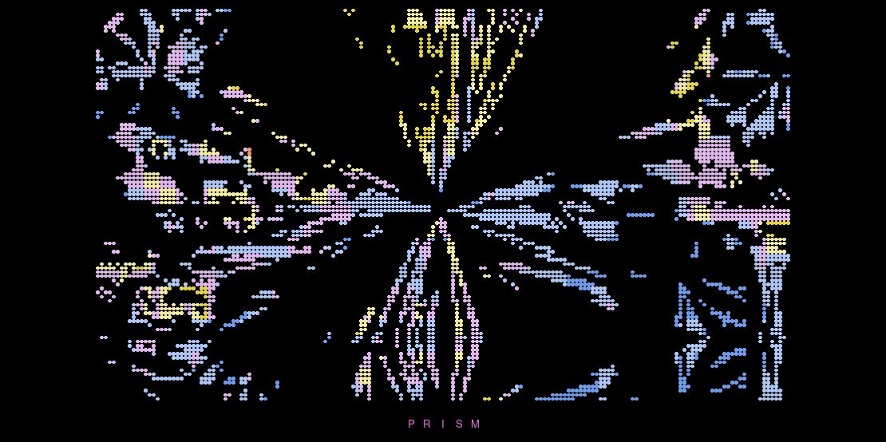

# Prism

An Omarchy theme of crystals under the microscope in polarised light: citric acid, vitamin C, aspirin, sulfur,
amino acids, a salt and a film of glycerol. The crystals themselves are clear; the colours come from the light, split
as it passes through them between two crossed polarising filters. The black between crossed polarisers is the
background, the text is pale, the magenta of growing sulfur is the accent, and the window border turns from that
magenta into the yellow of citric acid. The terminal colours come from the photos too: the red rings of the glycerol
films, the orange, cyan, blue and violet bands of the vitamin C rosettes, citric acid's yellow, the green of growing
sulfur and the warm brown of caesium chloride.

Each wallpaper has a small label in the bottom right corner (bottom right because terminal text keeps to the
left): what it is, one line in plain words, when it was photographed, the photographer and the licence.

| Wallpaper | What it shows | Photographed | Photographer, licence | Source |
|---|---|---|---|---|
| `01-citric-acid` | Citric acid crystals grown from water, between crossed polarisers | 30 Oct 2018 | Alexander Klepnev, CC BY 4.0 | [Commons](https://commons.wikimedia.org/wiki/File:%D0%9B%D0%B8%D0%BC%D0%BE%D0%BD%D0%BD%D0%B0%D1%8F_%D0%BA%D0%B8%D1%81%D0%BB%D0%BE%D1%82%D0%B0_5.jpg) |
| `02-caesium-chloride` | A thin crystal film of caesium chloride in compensated polarised light, 100x | 1 Mar 2021 | KarlGaff, CC BY 4.0 | [Commons](https://commons.wikimedia.org/wiki/File:Caesium_Chloride.jpg) |
| `03-vitamin-c-tiles` | Microcrystals of ascorbic acid (vitamin C) in polarised light | 23 Oct 2014 | Veronika Kirillova, CC BY-SA 4.0 | [Commons](https://commons.wikimedia.org/wiki/File:%D0%90%D1%81%D0%BA%D0%BE%D1%80%D0%B1%D0%B8%D0%BD%D0%BE%D0%B2%D0%B0%D1%8F_%D0%BA%D0%B8%D1%81%D0%BB%D0%BE%D1%82%D0%B0.JPG) |
| `04-sulfur` | Crystals growing from melted sulfur, polarised light, 10x | 12 Jul 2018 | AlexmarPhAHoto, CC BY 4.0 | [Commons](https://commons.wikimedia.org/wiki/File:Crystals_growing_from_melted_sulfur.jpg) |
| `05-aspirin` | Aspirin crystals between crossed polarisers with a compensator | 31 May 2015 | Alexander Klepnev, CC BY-SA 4.0 | [Commons](https://commons.wikimedia.org/wiki/File:%D0%9A%D1%80%D0%B8%D1%81%D1%82%D0%B0%D0%BB%D0%BB%D1%8B_%D0%B0%D1%81%D0%BF%D0%B8%D1%80%D0%B8%D0%BD%D0%B0_%D0%BF%D0%BE%D0%B4_%D0%BC%D0%B8%D0%BA%D1%80%D0%BE%D1%81%D0%BA%D0%BE%D0%BF%D0%BE%D0%BC.jpg) |
| `06-succinic-acid` | Succinic acid dried from alcohol and water; polarised light with quartz and mica plates, 250x | 3 Feb 2023 | Kirill Mikhailyuk, CC BY 4.0 | [Commons](https://commons.wikimedia.org/wiki/File:%D0%9A%D1%80%D0%B8%D1%81%D1%82%D0%B0%D0%BB%D0%BB%D1%8B_%D1%8F%D0%BD%D1%82%D0%B0%D1%80%D0%BD%D0%BE%D0%B9_%D0%BA%D0%B8%D1%81%D0%BB%D0%BE%D1%82%D1%8B.jpg) |
| `07-thin-films` | Thin films of glycerol and water in reflected light, 50x; the rings are Newton's rings | 10 May 2013 | Anatoly Mikhaltsov, CC BY-SA 4.0 | [Commons](https://commons.wikimedia.org/wiki/File:%D0%98%D0%BD%D1%82%D0%B5%D1%80%D1%84%D0%B5%D1%80%D0%B5%D0%BD%D1%86%D0%B8%D1%8F_%D0%B2_%D1%82%D0%BE%D0%BD%D0%BA%D0%B8%D1%85_%D0%BF%D0%BB%D1%91%D0%BD%D0%BA%D0%B0%D1%85.jpg) |
| `08-citric-acid-star` | A star of citric acid crystals grown from water, between crossed polarisers | 31 Oct 2018 | Alexander Klepnev, CC BY 4.0 | [Commons](https://commons.wikimedia.org/wiki/File:%D0%9B%D0%B8%D0%BC%D0%BE%D0%BD%D0%BD%D0%B0%D1%8F_%D0%BA%D0%B8%D1%81%D0%BB%D0%BE%D1%82%D0%B0_8.jpg) |
| `09-beta-alanine` | Beta-alanine crystals in polarised light, 10x objective | 3 Feb 2023 | Janek Lass, CC BY 4.0 | [Commons](https://commons.wikimedia.org/wiki/File:Beta-alaniini_kristallid_polariseeritud_valguses.jpg) |
| `10-aspirin-rosettes` | Rosettes of aspirin crystals in polarised light | 21 Jan 2020 | Andrei Savitsky, CC BY-SA 4.0 | [Commons](https://commons.wikimedia.org/wiki/File:%D0%9A%D1%80%D0%B8%D1%81%D1%82%D0%B0%D0%BB%D0%BB%D1%8B_%D0%B0%D1%81%D0%BF%D0%B8%D1%80%D0%B8%D0%BD%D0%B0_%D0%B2_%D0%BF%D0%BE%D0%BB%D1%8F%D1%80%D0%B8%D0%B7%D0%BE%D0%B2%D0%B0%D0%BD%D0%BD%D0%BE%D0%BC_%D1%81%D0%B2%D0%B5%D1%82%D0%B5.jpg) |
| `11-vitamin-c` | Vitamin C microcrystals grown on a slide, cross-polarised light, 125x | 26 Jan 2015 | Anatoly Mikhaltsov, CC BY-SA 4.0 | [Commons](https://commons.wikimedia.org/wiki/File:%D0%9C%D0%B8%D0%BA%D1%80%D0%BE%D0%BA%D1%80%D0%B8%D1%81%D1%82%D0%B0%D0%BB%D0%BB%D1%8B_%D0%B0%D1%81%D0%BA%D0%BE%D1%80%D0%B1%D0%B8%D0%BD%D0%BE%D0%B2%D0%BE%D0%B9_%D0%BA%D0%B8%D1%81%D0%BB%D0%BE%D1%82%D1%8B.jpg) |
| `12-citric-acid-film` | Smooth sheets of citric acid crystal between crossed polarisers | 14 Nov 2018 | Alexander Klepnev, CC BY 4.0 | [Commons](https://commons.wikimedia.org/wiki/File:%D0%9B%D0%B8%D0%BC%D0%BE%D0%BD%D0%BD%D0%B0%D1%8F_%D0%BA%D0%B8%D1%81%D0%BB%D0%BE%D1%82%D0%B0_7.tif) |
| `13-aspirin-2` | More aspirin crystals, crossed polarisers with a compensator | 31 May 2015 | Alexander Klepnev, CC BY-SA 4.0 | [Commons](https://commons.wikimedia.org/wiki/File:%D0%9A%D1%80%D0%B8%D1%81%D1%82%D0%B0%D0%BB%D0%BB%D1%8B_%D0%B0%D1%81%D0%BF%D0%B8%D1%80%D0%B8%D0%BD%D0%B0_%D0%BF%D0%BE%D0%B4_%D0%BC%D0%B8%D0%BA%D1%80%D0%BE%D1%81%D0%BA%D0%BE%D0%BF%D0%BE%D0%BC-2.jpg) |
| `14-blue-flame` | Amino acid crystals in polarised light ("Blue flame" is the photo's own title) | 11 Mar 2021 | SergRussu, CC BY 4.0 | [Commons](https://commons.wikimedia.org/wiki/File:%D0%A1%D0%B8%D0%BD%D0%B8%D0%B5_%D0%BF%D0%BB%D0%B0%D0%BC%D1%8F.jpg) |

Facts on the labels come from each photo's Commons page (what it is, how it was lit, the magnification, the date the
photo file records). The page of 09 says the colours are not the amino acid's own but come from the polarised
light. 03 was taken by Veronika Kirillova, a student of the research laboratory "Microcosmos" (Anatoly Mikhaltsov,
adviser), and uploaded by the laboratory. The photographer of 06 is named in Cyrillic on the page
(Михайлюк Кирилл Александрович); the label gives the name in Latin letters.

The pictures were chosen from Commons featured pictures, Commons' category of microscope pictures of crystals, and
the microscope entries of the European Science Photo Competition 2015 and the Russian Science Photo Competitions 2019
and 2020, then looked at one by one at true screen size. Grain at screen size (`src/grain.py`, Immerkaer sigma at 2560 x 1440):
0.5 to 1.9 for most; succinic acid 2.9, citric acid star 2.8, citric acid 2.6 and beta-alanine 3.3 are the fine
ridges and needles of the crystals, sharp at full size, not grain.
Left out after the full-size look: three more photos of sulfur crystals and one called "micro-sunflowers"
(colour speckle all over), salt from saline, Essentuki mineral water and the crystals left by champagne and white
wine (speckle or soft focus), vanillin and paracetamol (soft or blotchy in large parts), and three more photos of
vitamin C and other crystals (smeared or soft at full size).

11 uses photowall's `fit` (the whole photo, centred, on its own black): the photo is smaller than the screen, so it
is set on the screen whole instead of being enlarged. The others fill the screen.

```
src/build prism                  # the photos (~360 MB) download once into ~/.cache/omarchy-themes/prism
./install prism
omarchy theme set prism
```

## Screensaver



`screensaver.txt` is the `08-citric-acid-star` wallpaper redrawn as braille text art (`src/asciiart.py`), each dot in the nearest of
the theme's colours. `./install` copies it with the theme; once [extras/screensaver](../../extras/screensaver/README.md)
is set up, Omarchy's screensaver shows it with an animated effect (laser etch, matrix rain, VHS glitch and others).

## Credits and licences

Every wallpaper carries its photographer and licence on its label; the table above links each photo's page.

- [CC BY 4.0](https://creativecommons.org/licenses/by/4.0/): free to use and change with credit, a link to the
  licence, and a note of changes.
- [CC BY-SA 4.0](https://creativecommons.org/licenses/by-sa/4.0/): the same, and a changed picture must be shared
  under the same licence.

Changes made to every photo: cut or set on a field to 16:9 and scaled to 3840 x 2160, and a label added in the bottom
right corner. A finished wallpaper made from a CC BY-SA photo is itself shared under that photo's CC BY-SA licence.
