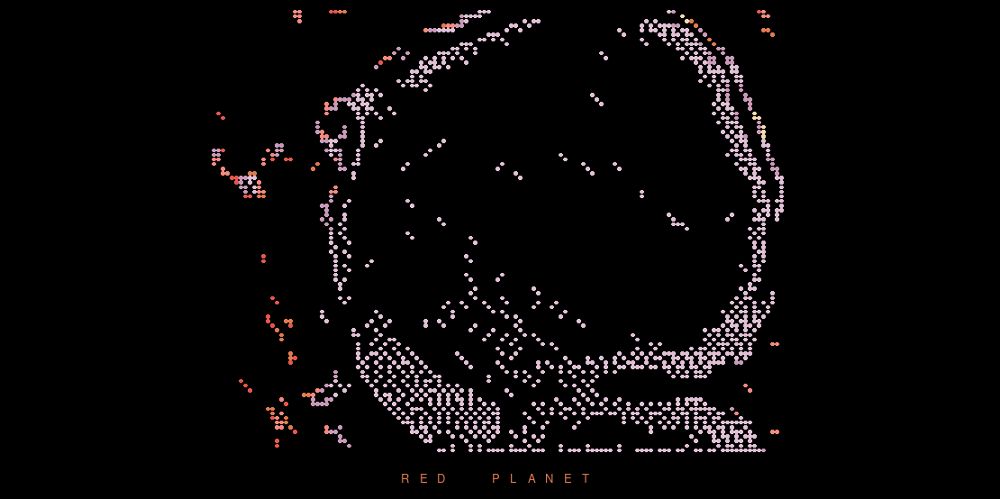

# Red Planet

An Omarchy theme made from real photos of Mars, taken by rovers on the ground (Perseverance, Curiosity, Spirit) and by
orbiters above it (Mars Reconnaissance Orbiter's HiRISE camera, ESA's Mars Express, Viking). Rust-black background,
dusty cream text, a rust accent, and the window border fading from rust into the blue that glows around the Sun at a
Martian sunset.

Each wallpaper has a small label in the bottom right corner (bottom right because terminal text keeps to the left):
what it is, in plain words, who took it, when, and the credit. The order swaps between ground and orbit.

| Wallpaper | What it shows | Taken by | Source |
|---|---|---|---|
| `1-selfie-with-ingenuity` | Perseverance and the Ingenuity helicopter, 3.9 m (13 feet) apart; 62 photos stitched | Perseverance (WATSON camera on its arm), 6 April 2021 | [PIA24542](https://science.nasa.gov/photojournal/perseverances-selfie-with-ingenuity/) |
| `2-korolev-crater` | Korolev crater, 82 km wide, in Mars' northern lowlands, holding ice about 1.8 km thick all year | Mars Express (HRSC camera), mosaic of five passes, published 20 Dec 2018 | [DLR image page](https://www.dlr.de/en/images/2018/4/image-mosaic-korolev-crater-mars), facts [ESA](https://www.esa.int/articles/about-us/directorates/science/mars-express/mars-express-gets-festive-a-winter-wonderland-on-mars) |
| `3-greenheugh-pediment` | Sandstone cap of the Greenheugh Pediment, with the floor of Gale crater (154 km wide) behind | Curiosity (Mastcam), 9 April 2020 | [PIA23974](https://science.nasa.gov/photojournal/curiositys-view-from-the-top-of-the-greenheugh-pediment/) |
| `4-nili-patera-dunes` | Nili Patera, one of the most active dune fields on Mars, from 271 km up | Mars Reconnaissance Orbiter (HiRISE), 1 March 2014 | [PIA18244](https://science.nasa.gov/photojournal/the-active-dunes-of-nili-patera/), date and height [ESP_035603_1890](https://www.uahirise.org/ESP_035603_1890) |
| `5-mount-sharp` | Mount Sharp, 5 km (3 miles) tall, in morning light | Curiosity (Mastcam telephoto), 13 Oct 2019 | [PIA23898](https://science.nasa.gov/photojournal/a-dramatic-view-of-mars-mount-sharp/), height from PIA23974 |
| `6-butterfly-crater` | An oval crater (20 x 15 km) in Idaeus Fossae, true colour, from about 350 km up; probably made by an impact at 5 to 10 degrees | Mars Express (HRSC), 8 Nov 2024 | [DLR image](https://www.dlr.de/en/latest/news/2025/the-butterfly-crater-of-idaeus-fossae-on-mars/true-colour-bird-s-eye-view-of-the-idaeus-fossae-region), facts [DLR release](https://www.dlr.de/en/latest/news/2025/the-butterfly-crater-of-idaeus-fossae-on-mars) |
| `7-husband-hill` | Husband Hill from "Larry's Lookout"; the top is about 200 m away and 45 m higher | Spirit (Pancam), 27 Feb to 2 March 2005 | [PIA07882](https://science.nasa.gov/photojournal/lookout-panorama-from-spirit/) |
| `8-valles-marineris` | The Valles Marineris canyon system, over 3,000 km long and up to 8 km deep; 102 photos | Viking Orbiter 1, 1980 | [PIA00003](https://science.nasa.gov/photojournal/valles-marineris-hemisphere/) |

About the colours, from each source page:
- Mount Sharp is white-balanced and brightened, so the rocks look as they would in daylight on Earth; the Greenheugh
  view is white-balanced too.
- The Spirit panorama is "an approximately true-color rendering".
- The Viking mosaic's colour differences are boosted by a factor of about two, which the label says.

The rover panoramas and the Viking mosaic have black, jagged edges where the photos were stitched; each cut in
`wallpapers.json` sits inside the picture, so no black edge shows.

Not used: Curiosity's famous blue sunset ([PIA19400](https://science.nasa.gov/photojournal/sunset-in-mars-gale-crater/))
is only 1344 x 1080 pixels, too small for a 4K wallpaper. For ESA's angled "perspective view" of Korolev crater the
largest copy found was 1660 pixels wide, so the theme uses the top-down mosaic (3476 x 4000).

## Install

```sh
./install red-planet
omarchy theme set red-planet
```

## How the wallpapers are made

- `wallpapers.json` lists each photo: download link, source page, credit and licence, label text, and where to cut it.
- [`src/photowall.py`](../../src/photowall.py) cuts each photo to 16:9 at 3840 x 2160 and draws its label inside the
  part a 3:2 screen shows; the same script makes every photo theme in this repository.
- `src/build red-planet` makes them again from the photos (~140 MB, downloaded once into `~/.cache/omarchy-themes/red-planet`).

## Screensaver



`screensaver.txt` is the `2-korolev-crater` wallpaper redrawn as braille text art (`src/asciiart.py`), each dot in the nearest of
the theme's colours. `./install` copies it with the theme; once [extras/screensaver](../../extras/screensaver/README.md)
is set up, Omarchy's screensaver shows it with an animated effect (laser etch, matrix rain, VHS glitch and others).

## Credits and licences

The photos come from NASA and DLR. [CREDITS.md](../../CREDITS.md) lists every wallpaper's author, licence and source.

- NASA pictures "generally are not subject to copyright in the United States", and "NASA should be acknowledged as the
  source" ([NASA media guidelines](https://www.nasa.gov/nasa-brand-center/images-and-media/)). Each wallpaper carries
  the credit line from its source page: NASA/JPL-Caltech/MSSS (Perseverance's WATSON camera, Curiosity's Mastcam),
  NASA/JPL-Caltech/Univ. of Arizona (HiRISE), NASA/JPL/Cornell (Spirit), NASA/JPL/USGS (Viking).
- The Korolev crater mosaic and the butterfly crater view are credited "ESA/DLR/FU Berlin" and published under
  [CC BY-SA 3.0 IGO](https://creativecommons.org/licenses/by-sa/3.0/igo/) (as stated on the DLR image pages). The
  credit and licence are printed on both wallpapers. Because it is "share-alike", a shared copy of either wallpaper (each is
  cropped and labelled, so it counts as an adaptation) must keep the credit and stay under the same licence.
