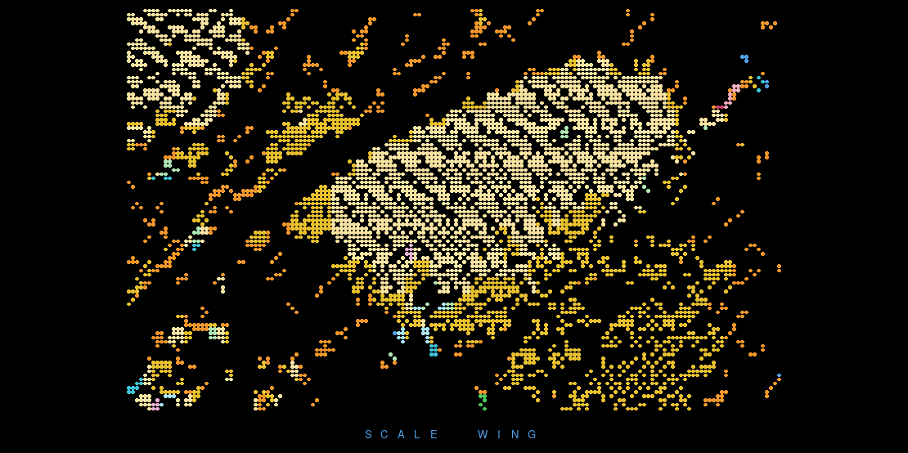

# Scale Wing

An Omarchy theme of butterfly and moth wings up close, under the microscope and the macro lens. Lepidoptera, the
name of their order, means "scale wing": the colour of a wing is thousands of tiny scales overlapping like roof
tiles, some coloured by pigment and some, like the large blue's, by their own fine structure bending the light. A
painted lady's eyespots, the large blue and the green hairstreak, rust-red ribbed scales at 200x, and a moth from
Argentine Patagonia with sunflower pollen caught on its wings. The dark of the black scales is the background, the
text is warm and pale, the large blue's blue is the accent, and the window border turns from it into the orange of
the painted lady.

Each wallpaper has a small label in the bottom right corner (bottom right because terminal text keeps to the
left): what it is, one line in plain words, the date the photo's page gives, the photographer and the licence.

| Wallpaper | What it shows | Date | Photographer, licence | Source |
|---|---|---|---|---|
| `01-painted-lady` | Eyespots on the wing of a painted lady butterfly, Argentine Patagonia | 12 Feb 2025 | Brandon Antonio Segura Torres & Priscilla Vieto Bonilla, CC BY-SA 4.0 | [Commons](https://commons.wikimedia.org/wiki/File:Detalle_de_alas_de_la_mariposa_Dama_Pintada_de_la_Patagonia_Argentina.jpg) |
| `02-large-blue` | Wing scales of the large blue, Phengaris (Maculinea) arion, at 5x | 7 Aug 2022 | MicrocosmicWorld, CC BY-SA 4.0 | [Commons](https://commons.wikimedia.org/wiki/File:Large_Blue_Butterfly_Wing_at_5%C3%97_Magnification.jpg) |
| `03-moth-pollen` | Moth wing scales with sunflower pollen | 25 Feb 2025 | Brandon Antonio Segura Torres & Priscilla Vieto Bonilla, CC BY-SA 4.0 | [Commons](https://commons.wikimedia.org/wiki/File:Detalle_de_escamas_de_ala_de_polilla_con_polen_de_girasol.jpg) |
| `04-green-hairstreak` | Wing scales of the green hairstreak, Callophrys rubi; 50x objective, focus stacking | 19 Aug 2020 | Mikron86, CC BY 4.0 | [Commons](https://commons.wikimedia.org/wiki/File:%C5%81uski_na_skrzydle_motyla.jpg) |
| `05-wing-scales` | A butterfly wing, Nikon Eclipse microscope at 200x | 7 Jan 2011 | Massimo Brizzi, CC BY 4.0 | [Commons](https://commons.wikimedia.org/wiki/File:Ala_farfalla_copiaxxx.jpg) |
| `06-owlet-yellow` | Yellow wing scales of the Southern Owlet moth, Argentine Patagonia | 12 Feb 2025 | Brandon Antonio Segura Torres & Priscilla Vieto Bonilla, CC BY-SA 4.0 | [Commons](https://commons.wikimedia.org/wiki/File:Escamas_amarillas_de_ala_polilla_patag%C3%B3nica_ojitos_del_sur.jpg) |
| `07-orange-wing` | A butterfly wing | 4 Jul 2020 | Kirill Mikhaylyuk, CC BY 4.0 | [Commons](https://commons.wikimedia.org/wiki/File:MKA0004.jpg) |
| `08-blue-shimmer` | Structural blue colour in butterfly wing scales | 12 Feb 2025 | Brandon Antonio Segura Torres & Priscilla Vieto Bonilla, CC BY-SA 4.0 | [Commons](https://commons.wikimedia.org/wiki/File:Coloraci%C3%B3n_estructural_azul_en_alas_de_mariposa.jpg) |
| `09-owlet-pollen` | Pollen on the yellow spot scales of a Southern Owlet moth's wing | 25 Feb 2025 | Brandon Antonio Segura Torres & Priscilla Vieto Bonilla, CC BY-SA 4.0 | [Commons](https://commons.wikimedia.org/wiki/File:Polen_sobre_escamas_de_mancha_amarilla_del_ala_de_la_polilla_oitos_del_sur.jpg) |
| `10-owlet-pink` | Pink wing scales of the Southern Owlet moth, Argentine Patagonia | 12 Feb 2025 | Brandon Antonio Segura Torres & Priscilla Vieto Bonilla, CC BY-SA 4.0 | [Commons](https://commons.wikimedia.org/wiki/File:Escamas_rosadas_de_ala_de_mariposa_de_polilla_Ojitos_del_Sur_de_la_Patagonia_Argentina.jpg) |
| `11-wing-edge` | A butterfly wing | 4 Jul 2020 | Kirill Mikhaylyuk, CC BY 4.0 | [Commons](https://commons.wikimedia.org/wiki/File:MKA0003.jpg) |

Facts on the labels come from each photo's Commons page: the species, the magnification and how the colour is made,
where the page says so. "Southern Owlet" is the English name the photographers' pages give for the moth they call
Ojitos del Sur. Six of the eleven photos (01, 03, 06, 08, 09 and 10) are by the same two
photographers, Brandon Antonio Segura Torres and Priscilla Vieto Bonilla.

The photos were chosen from the science photo competitions on Wikimedia Commons (about 5,000 microscopy photos
searched): 48 matched butterflies, moths or wings and had at least 2000 pixels on the short side, 16 close-ups of
wing scales were downloaded whole and looked at one by one at true screen size, and 11 kept. Grain at screen size
(`src/grain.py`, Immerkaer sigma at 2560 x 1440): 1.8 to 4.7, and 8.0 for the ribbed scales at 200x, where the
ribs themselves are the fine detail (checked by eye). Left out: a pale green wing of the clouded yellow and a grey-gold
butterfly wing (soft and flat at full size), a white streak on the large blue (blurred), and two more photos of
pollen on wing scales (close to 03). Most of the photos are focus-stacked macros with a shallow sharp zone; parts of a few
(the white patch in 08) are soft by design, and they were kept for the sharp scales elsewhere.

Every wallpaper fills the screen.

```
src/build scale-wing            # the photos (~200 MB) download once into ~/.cache/omarchy-themes/scale-wing
./install scale-wing
omarchy theme set scale-wing
```

## Screensaver



`screensaver.txt` is the `08-blue-shimmer` wallpaper redrawn as braille text art (`src/asciiart.py`), each dot in the nearest of
the theme's colours. `./install` copies it with the theme; once [extras/screensaver](../../extras/screensaver/README.md)
is set up, Omarchy's screensaver shows it with an animated effect (laser etch, matrix rain, VHS glitch and others).

## Credits and licences

Every wallpaper carries its photographer and licence on its label; the table above links each photo's page.

- [CC BY 4.0](https://creativecommons.org/licenses/by/4.0/): free to use and change with credit, a link to the
  licence, and a note of changes.
- [CC BY-SA 4.0](https://creativecommons.org/licenses/by-sa/4.0/): the same, and changed versions must keep the
  same licence. The wallpapers made from these photos are CC BY-SA 4.0 too.

Changes made to every photo: cut and scaled to 16:9 at 3840 x 2160, and a label added in the bottom right corner.
