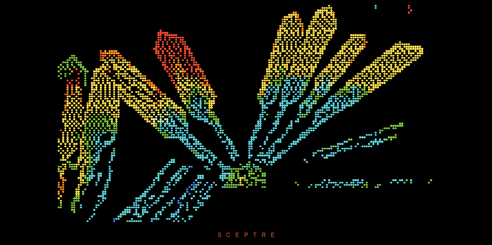

# Sceptre

An Omarchy theme of crystals grown in a drop on a microscope slide, each one standing alone on black: the sceptres of
potassium dichromate, needles of ammonium nitrate caught while growing, sugar, a ring of the dye methylene violet left
by a drying drop, grains of potato starch, and a star of minerals from the sea. Near-black as the background, warm
pale text, the flame orange of the dichromate sceptres as the accent, and the window border turning from it into the
ice cyan of their stems.

Each wallpaper has a small label in the bottom right corner (bottom right because terminal text keeps to the
left): what it is, one line in plain words, the date the photo's page gives, the photographer and the licence.

| Wallpaper | What it shows | Date | Photographer, licence | Source |
|---|---|---|---|---|
| `01-potassium-dichromate` | Sceptre crystals of potassium dichromate grown into a drop of solution, crossed polarisers, field 1.5 mm wide | 4 Sep 2015 | Lobastov BM, CC BY-SA 4.0 | [Commons](https://commons.wikimedia.org/wiki/File:Scepter_crystals_of_potassium_dichromate.JPG) |
| `02-ammonium-nitrate` | Needle crystals of ammonium nitrate photographed while growing into a drop, crossed polarisers, field 1.5 mm wide | 4 Sep 2015 | Lobastov BM, CC BY-SA 4.0 | [Commons](https://commons.wikimedia.org/wiki/File:Ammonium_nitrate.JPG) |
| `03-sugar` | Sugar crystals in polarised light; the photographer's title is "Butterfly and Cross" | 17 May 2015 | Alexander Klepnev, CC BY-SA 4.0 | [Commons](https://commons.wikimedia.org/wiki/File:%D0%91%D0%B0%D0%B1%D0%BE%D1%87%D0%BA%D0%B0_%D0%B8_%D0%BA%D1%80%D0%B5%D1%81%D1%82.jpg) |
| `04-methylene-violet` | Crystals of alkaline methylene violet, a dye, polarised light | 26 Jun 2025 | Brandon Antonio Segura Torres & Priscilla Vieto Bonilla, CC BY-SA 4.0 | [Commons](https://commons.wikimedia.org/wiki/File:Cristales_de_violeta_de_metileno_alcalino.jpg) |
| `05-potato-starch` | Potato starch grains at 200x, dark field and polarised light | 22 Mar 2019 | MarekMiś, CC BY 4.0 | [Commons](https://commons.wikimedia.org/wiki/File:Skrobia.jpg) |
| `06-sea-minerals` | Star-shaped marine minerals, polarised microscope at 200x | 10 Nov 2021 | Massimo Brizzi, CC BY 4.0 | [Commons](https://commons.wikimedia.org/wiki/File:Multiple_star-shaped_marine_minerals_,_200x_polarized_microscope._Massimo_Brizzi_2021.jpg) |

Facts on the labels come from each photo's Commons page: the chemical, the light, the magnification or the width of
the field. "A ring left by a drying drop" describes what the methylene violet photo shows; "each one a tiny crystal
shell" is the everyday picture of a starch grain, which is partly crystalline and so lights up in polarised light.

The photos were chosen from the science photo competitions and the crystal categories on Wikimedia Commons, from the
same search as Kaleidoscope (243 photos of crystals listed and looked at small, 42 downloaded whole and looked at one by
one at true screen size); this theme is the ones that stand as shapes on black. Every chemical here is new to these
themes: nothing from Prism or Kaleidoscope. Grain at screen size (`src/grain.py`, Immerkaer sigma at 2560 x 1440):
0.04 to 1.4. Left out: a glowing cyanine dye photo that is soft at screen size, a chiastolite slice with grain 6.8,
a second dichromate photo (one chemical once), and the noisy photos. The dichromate is cut from lower down, to leave
out a blurred crystal at the top; the methylene violet and the sea minerals are tall photos set whole on black (the sea
minerals cut out of their grey background).

```
src/build sceptre          # the photos (~26 MB) download once into ~/.cache/omarchy-themes/sceptre
./install sceptre
omarchy theme set sceptre
```

## Screensaver



`screensaver.txt` is the `01-potassium-dichromate` wallpaper redrawn as braille text art (`src/asciiart.py`), each dot in the nearest of
the theme's colours. `./install` copies it with the theme; once [extras/screensaver](../../extras/screensaver/README.md)
is set up, Omarchy's screensaver shows it with an animated effect (laser etch, matrix rain, VHS glitch and others).

## Credits and licences

Every wallpaper carries its photographer and licence on its label; the table above links each photo's page.

- [CC BY 4.0](https://creativecommons.org/licenses/by/4.0/): free to use and change with credit, a link to the
  licence, and a note of changes.
- [CC BY-SA 4.0](https://creativecommons.org/licenses/by-sa/4.0/): the same, and changed versions must keep the
  same licence. The wallpapers made from those photos (`01` to `04`) are CC BY-SA 4.0 too.

Changes made to every photo: cut to 16:9 at 3840 x 2160 or set whole on a black field, and a label added in the bottom
right corner; the sea minerals photo's grey background turned black.
