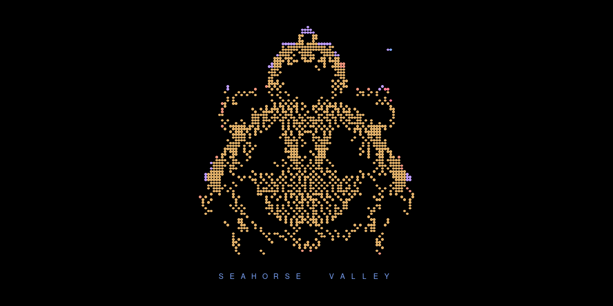

# Seahorse Valley

An Omarchy theme of nine fractals, drawn here from their formulas, each painted in the colours of one of Omarchy's
own themes: Tokyo Night, Catppuccin, Everforest, Nord, Matte Black, Kanagawa, Gruvbox, Ethereal and Ristretto.
The bar, terminal, menus and window border use Tokyo Night unchanged, the colours of the first picture.
It is named after Seahorse Valley, one famous corner of the Mandelbrot set, the way Tranquility is named after one sea
on the Moon.

Each wallpaper has a small label in the bottom right corner: what it is in plain words, who found it, where in the
picture's own plane it was drawn, and which Omarchy theme gave the colours. The label's thin bar is that theme's accent.

| Wallpaper | What it shows | Colours | About the maths |
|---|---|---|---|
| `1-seahorse-valley` | Spirals of "seahorse tails" in the gap between the Mandelbrot set's body and head, at -0.7453 + 0.1127i, about 680x closer than the whole set | Tokyo Night | [Wikipedia: Mandelbrot set](https://en.wikipedia.org/wiki/Mandelbrot_set) ("seahorse valley ... centred on the point -0.75 + 0.1i") |
| `2-the-mandelbrot-set` | The whole set: every c where z -> z^2 + c from 0 stays bounded | Catppuccin | Same page: first defined and drawn by Robert Brooks and Peter Matelski in 1978; Benoit Mandelbrot's pictures from 1980 |
| `3-elephant-valley` | Rows of "elephant trunks" by the cusp on the right of the main body, at 0.2925 + 0.0149i, about 370x | Everforest | [Mu-Ency: cardioid cusp](https://www.mrob.com/pub/muency/cardioidcusp.html) ("elephant valley", the main cusp at 1/4), [MathWorld: Elephant Valley](https://mathworld.wolfram.com/ElephantValley.html) |
| `4-douady-rabbit` | The Julia set of c = -0.1226 + 0.7449i, ears meeting in threes | Nord | [Wikipedia: Douady rabbit](https://en.wikipedia.org/wiki/Douady_rabbit) (named after Adrien Douady) |
| `5-burning-ship` | One of the small ships of the Burning Ship fractal, near -1.76 | Matte Black | [Wikipedia: Burning Ship fractal](https://en.wikipedia.org/wiki/Burning_Ship_fractal) (Michelitsch and Rössler, 1992; "virtually all images ... are reflected vertically") |
| `6-newtons-method` | Newton's method for z^3 = 1: each point coloured by the root it slides to, the borders braided | Kanagawa | Cayley's 1879 note on the Newton-Fourier imaginary problem ([Wikibooks: history](https://en.wikibooks.org/wiki/Pictures_of_Julia_and_Mandelbrot_Sets/History)) |
| `7-zircon-city` | The Lyapunov fractal "Zircon Zity": sequence BBBBBBAAAAAA, a 3.4 to 4.0, b 2.5 to 3.4 (turned on its side to fit the screen) | Gruvbox | [Wikipedia: Lyapunov fractal](https://en.wikipedia.org/wiki/Lyapunov_fractal) (Mario Markus, late 1980s) |
| `8-buddhabrot` | Where the escaping paths of the Mandelbrot set go: layers of paths under 50, 500 and 5,000 steps | Ethereal | [Wikipedia: Buddhabrot](https://en.wikipedia.org/wiki/Buddhabrot) (Melinda Green, 1993; the 5,000/500/50 "Nebulabrot") |
| `9-mandelbulb` | The power-8 Mandelbulb in 3D, lit from the upper left | Ristretto | [Wikipedia: Mandelbulb](https://en.wikipedia.org/wiki/Mandelbulb) (Daniel White and Paul Nylander, 2009) |

## Install

```sh
./install seahorse-valley
omarchy theme set seahorse-valley
```

## How the wallpapers are made

- `wallpapers.json` lists each picture: its label, its Omarchy colours (a looping ramp of colour stops) and how it is
  drawn (the kind of fractal and its settings).
- [`src/fractal.c`](../../src/fractal.c) draws them: 16 samples a pixel (9 for Zircon City and the Mandelbulb), each
  one coloured and then averaged in linear light, so threads stay sharp with no stair steps; a light dither keeps the
  dark skies free of bands. The Buddhabrot is 3 billion random paths. Needs gcc with OpenMP, which Omarchy has.
- [`src/fractalwall.py`](../../src/fractalwall.py) compiles and runs it, and draws a picture again only when its
  settings change; [`src/photowall.py`](../../src/photowall.py) (shared with the photo themes) adds the labels.
- `src/build seahorse-valley` draws all nine: 24.5 minutes on a ThinkPad T480 (6 of its 8 threads, lowest priority,
  measured 2026-11-17: Zircon City 474 s, Mandelbulb 424 s, Buddhabrot 391 s, the rest 9 to 55 s each), kept in
  `~/.cache/omarchy-themes/seahorse-valley`; after that it only labels them, in about 10 s.
- `src/termfractal.py <name>` draws one of the pictures inside the terminal (two pixels per character, the same
  formula and colours), e.g. `src/termfractal.py mandelbrot`.
- The theme's colours are Tokyo Night's, and `neovim.lua`, `vscode.json` and `icons.theme` are Omarchy's own Tokyo
  Night files.

## Colours

Each picture's colour ramp uses only colours from that Omarchy theme's `colors.toml`: its darkest background, its
cool colours (blue, cyan or green), its light text colour, its warm colours (yellow, orange, red) and its brown, in
that order, back to dark. Where a ramp needed a step between the darkest background and the blue, it uses a 35 % mix of
the two. The sky is dark and only the edges of each fractal light up, so terminal text stays easy to read.

## Screensaver



`screensaver.txt` is the `8-buddhabrot` wallpaper redrawn as braille text art (`src/asciiart.py`), each dot in the nearest of
the theme's colours. `./install` copies it with the theme; once [extras/screensaver](../../extras/screensaver/README.md)
is set up, Omarchy's screensaver shows it with an animated effect (laser etch, matrix rain, VHS glitch and others).

## Credits

The fractals are drawn here from their formulas; nothing is downloaded. The colours come from the themes that ship
with [Omarchy](https://github.com/omacom/omarchy) (MIT licence, copyright David Heinemeier Hansson); `neovim.lua`,
`vscode.json` and `icons.theme` are Omarchy's Tokyo Night files, unchanged. The pictures are by CompilingThings,
shared under CC BY 4.0 (see [CREDITS.md](../../CREDITS.md)).
