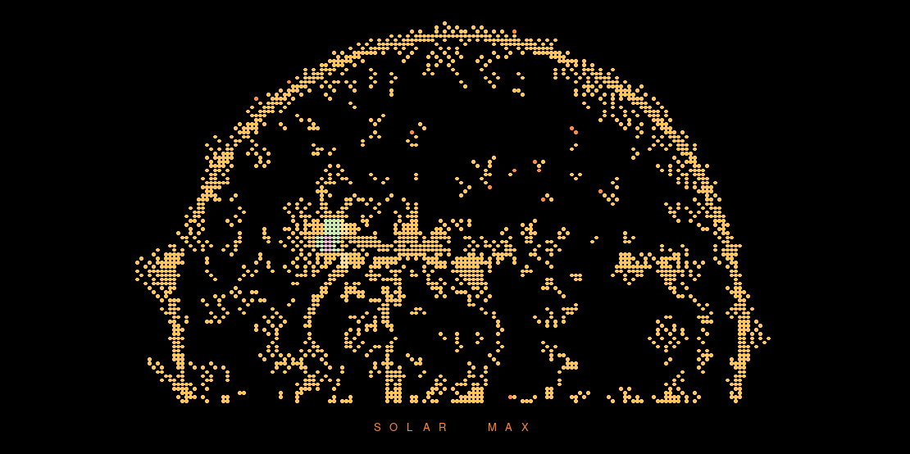

# Solar Max

An Omarchy theme made from real photos of our Sun: NASA's Solar Dynamics Observatory (SDO) in ultraviolet light,
ESA's Solar Orbiter, total eclipses photographed by NASA in 2017 and 2024, and the eclipse the Artemis II crew saw
from behind the Moon in 2026. Near-black space, corona-white text, a hot flare-orange accent, and the window border
fading from ultraviolet gold into flare red.

Each wallpaper has a small label in the bottom right corner: what it is, in plain words, when, and the credit.

| Wallpaper | What it shows | Taken by | Source |
|---|---|---|---|
| `1-solar-orbiter-corona` | The Sun's million-degree atmosphere (the corona) in ultraviolet light, 200 pictures combined, from 77 million km | Solar Orbiter (EUI), 9 March 2025 | [ESA](https://www.esa.int/media/solar-orbiter-s-widest-high-res-view-of-the-sun) |
| `2-totality-dallas` | Total eclipse over Dallas, Texas: the Moon hides the Sun's face, so the corona shows | NASA/Keegan Barber, 8 April 2024 | [NHQ202404080101](https://images.nasa.gov/details/NHQ202404080101), corona fact [NASA eclipse types](https://science.nasa.gov/eclipses/types/) |
| `3-flare-and-moon` | A mid-level flare flashing on the left; on the right the Moon, just after passing between SDO and the Sun | SDO, 30 Jan 2014 | [GSFC_20171208_Archive_e001245](https://images.nasa.gov/details/GSFC_20171208_Archive_e001245) |
| `4-eclipse-from-orion` | The Sun hidden behind the Moon for nearly an hour, seen from Orion; Venus and Saturn marked | Artemis II, camera on an Orion solar array wing, 6 April 2026 | [art002e016324](https://images.nasa.gov/details/art002e016324) |
| `5-giant-sunspot-erupts` | Region AR 12192, the largest in 24 years, fires an X3.1 flare (extreme ultraviolet) | SDO, 24 Oct 2014 | [GSFC_20171208_Archive_e000920](https://images.nasa.gov/details/GSFC_20171208_Archive_e000920) |
| `6-diamond-ring` | The diamond ring as the Moon makes its final move over the Sun, above Madras, Oregon | NASA/Aubrey Gemignani, 21 Aug 2017 | [NHQ201708210102](https://images.nasa.gov/details/NHQ201708210102) |
| `7-transit-of-venus` | Venus crossing the face of the Sun; the next transit is in 2117 | SDO (AIA, 171 Ångström), 5 June 2012 | [GSFC_20171208_Archive_e001734](https://images.nasa.gov/details/GSFC_20171208_Archive_e001734) |
| `8-space-station-transit` | The Space Station (six people aboard) crossing the Sun at roughly 5 miles (8 km) per second during a partial eclipse | NASA/Joel Kowsky, near Banner, Wyoming, 21 Aug 2017 | [NHQ201708210201](https://images.nasa.gov/details/NHQ201708210201) |

Venus and Saturn in `4-eclipse-from-orion`: NASA's caption says "Venus can be spotted on the left, and Saturn on the
right of the Moon". Venus is the only bright point on the left. For Saturn, the caption of the sister frame
[art002e009571](https://images.nasa.gov/details/art002e009571) says "The bright spot visible just below the Moon's
bottom right edge is Saturn"; the mark is on that spot. NASA does not yet say whether the glow around the Moon is the
corona, sunlit dust (zodiacal light) or both, so the label does not call it the corona.

Not in the set: Parker Solar Probe and SOHO. Their published stills are too small for a 4K wallpaper (the WISPR
still on NASA's [closest-ever images page](https://science.nasa.gov/science-research/heliophysics/nasas-parker-solar-probe-snaps-closest-ever-images-to-sun/)
is 956x1019; SOHO's best-known still, the handle-shaped prominence PIA03149, is 2100x2034). The SVS copies of SDO
movies (for example the 31 August 2012 filament eruption) fail the download's certificate check, so they are left out too.

## Install

```sh
./install solar-max
omarchy theme set solar-max
```

## How the wallpapers are made

- `wallpapers.json` lists each photo: download link, source page, credit and licence, label text, and where to cut it.
- [`src/photowall.py`](../../src/photowall.py) cuts each photo to 16:9 at 3840 x 2160 and draws its label inside the
  part a 3:2 screen shows; the same script makes every photo theme in this repository.
- `src/build solar-max` makes them again from the photos (~26 MB, downloaded once into `~/.cache/omarchy-themes/solar-max`).

## Screensaver



`screensaver.txt` is the `7-transit-of-venus` wallpaper redrawn as braille text art (`src/asciiart.py`), each dot in the nearest of
the theme's colours. `./install` copies it with the theme; once [extras/screensaver](../../extras/screensaver/README.md)
is set up, Omarchy's screensaver shows it with an animated effect (laser etch, matrix rain, VHS glitch and others).

## Credits and licences

The photos come from NASA and ESA. [CREDITS.md](../../CREDITS.md) lists every wallpaper's author, licence and source.

- NASA pictures (SDO, eclipses, Artemis II, the Space Station transit) "generally are not subject to copyright in the
  United States", and "NASA should be acknowledged as the source"
  ([NASA media guidelines](https://www.nasa.gov/nasa-brand-center/images-and-media/)). Each wallpaper carries the
  credit from its NASA page (NASA/SDO, NASA/GSFC/SDO, NASA/SDO, AIA, NASA/Keegan Barber, NASA/Aubrey Gemignani,
  NASA/Joel Kowsky, NASA).
- The Solar Orbiter picture is credited "ESA & NASA/Solar Orbiter/EUI Team, E. Kraaikamp (ROB)" and its ESA page offers
  it under [CC BY-SA 3.0 IGO](https://creativecommons.org/licenses/by-sa/3.0/igo/) (or the ESA Standard Licence). This
  theme uses it under CC BY-SA 3.0 IGO: the credit and licence are printed on the wallpaper, and the cut-and-labelled
  wallpaper made from it is shared under the same licence. `install` uses ESA's 6272 px copy; the full original is
  12544 px.
