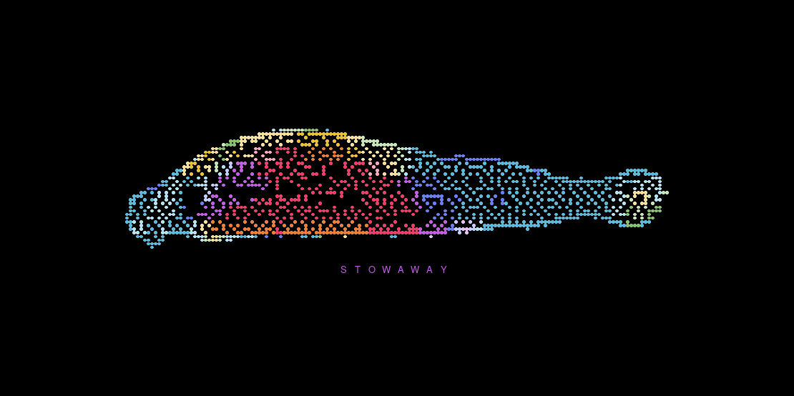

# Stowaway

An Omarchy theme of parasites of fish under the microscope, photographed in dark-field light by Brandon Antonio
Segura Torres and Priscilla Vieto Bonilla: flukes from the gut of perch and of the small puyen, one stained red, one
with pink glands and its testes stained, one with its yellow eggs, one with its womb packed gold, and gill worms in
blue and in blue and red. Each is laid on its side on black, like a slide. A near-black background, pale text, the
fluke's magenta as the accent, and the window border turning from it into the gold of the packed womb.

Each wallpaper has a small label in the bottom right corner (bottom right because terminal text keeps to the
left): what it is, one line in plain words, the date the photo's page gives, the photographers and the licence.

| Wallpaper | What it shows | Date | Photographers, licence | Source |
|---|---|---|---|---|
| `01-acanthostomoides` | *Acanthostomoides apophalliformis*, a trematode (fluke) from the intestine of perch, adult; dark field, focus stacking | 17 Nov 2023 | B. A. Segura Torres and P. Vieto Bonilla, CC BY-SA 4.0 | [Commons](https://commons.wikimedia.org/wiki/File:Par%C3%A1sito_trematodes_Acanthostomoides_apophalliformis.jpg) |
| `02-allocreadium` | *Allocreadium patagonicum*, a digenean (fluke) from the perch's intestine, a hermaphroditic adult; the two stained ovals at the back are the testes | 17 Nov 2023 | the same, CC BY-SA 4.0 | [Commons](https://commons.wikimedia.org/wiki/File:Par%C3%A1sito_digeneo_Allocreadium_patagonicum.jpg) |
| `03-dactylogyrus` | *Dactylogyrus extensus*, a monogenean (gill worm) of perch gills | 17 Nov 2023 | the same, CC BY-SA 4.0 | [Commons](https://commons.wikimedia.org/wiki/File:Par%C3%A1sito_monogeneo_Dactylogyrus_extensus.jpg) |
| `04-gyrodactylus` | *Gyrodactylus* sp., an adult monogenean from the gills of the small puyen (*Galaxias maculatus*), inverted | 17 Nov 2023 | the same, CC BY-SA 4.0 | [Commons](https://commons.wikimedia.org/wiki/File:Par%C3%A1sito_monogeneo_Gyrodactylus_sp.jpg) |
| `05-homalometron` | *Homalometron papilliferum*, a digenean from the perch intestine, its yellow eggs in the middle of the body | 17 Nov 2023 | the same, CC BY-SA 4.0 | [Commons](https://commons.wikimedia.org/wiki/File:Par%C3%A1sito_digeneo_Homalometron_papilliferum.jpg) |
| `06-steganoderma` | *Steganoderma szidati*, a digenean from the intestine of the small puyen, named after the parasitologist Lothar Szidat; the yellow is the uterus | 17 Nov 2023 | the same, CC BY-SA 4.0 | [Commons](https://commons.wikimedia.org/wiki/File:Par%C3%A1sito_Steganoderma_szidati.jpg) |

Facts on the labels come from each photo's Commons page; "fluke" and "gill worm" are the plain names for digenean
trematodes and monogeneans. The labels shorten the photographers' names to fit; the full names are above.

The photos were chosen from 36 unused photos of parasites 4K or larger under a free licence, in Wikimedia Commons'
microscopy categories. Parasitic worms are new to these themes (Front Line has the malaria parasite, a single cell).
All eight of the series that were looked at were sharp at the size shown; the six with the most different colours
were kept, and a second photo of the first fluke left out. Grain at screen size (`src/grain.py`, Immerkaer sigma at
2560 x 1440): 0.0 to 1.2. Each photo is cropped close round the worm, turned a quarter turn so it lies across the
wide screen, and set on black.

```
src/build stowaway          # the photos (~15 MB) download once into ~/.cache/omarchy-themes/stowaway
./install stowaway
omarchy theme set stowaway
```

## Screensaver



`screensaver.txt` is the `03-dactylogyrus` wallpaper redrawn as braille text art (`src/asciiart.py`), each dot in the nearest of
the theme's colours. `./install` copies it with the theme; once [extras/screensaver](../../extras/screensaver/README.md)
is set up, Omarchy's screensaver shows it with an animated effect (laser etch, matrix rain, VHS glitch and others).

## Credits and licences

Every wallpaper carries its photographers and licence on its label; the table above links each photo's page.

- [CC BY-SA 4.0](https://creativecommons.org/licenses/by-sa/4.0/): free to use and change with credit, a link to the
  licence, and a note of changes; changed versions must keep the same licence. Every wallpaper here keeps it.

Changes made to every photo: cropped close round the worm, turned a quarter turn clockwise, set on a black field at
3840 x 2160, and a label added in the bottom right corner.
