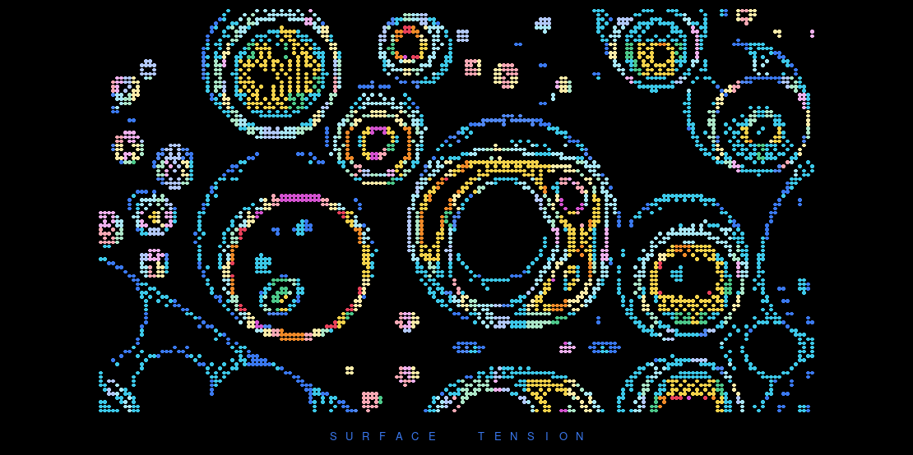

# Surface Tension

An Omarchy theme of bubbles under the microscope: islands of soap floating on the thin film of a soap bubble, each
ringed in the colours of the film's thickness; air bubbles caught in a water-soluble plastic as it melts, dries and
squeezes them; the walls of a foam where three bubbles meet; and soap bubbles packed together like cells. Deep
blue-black as the background, pale cool text, the blue of the foam as the accent, and the window border turning from it
into the magenta of the soap film.

Each wallpaper has a small label in the bottom right corner (bottom right because terminal text keeps to the
left): what it is, one line in plain words, the date the photo's page gives, the photographer and the licence.

| Wallpaper | What it shows | Date | Photographer, licence | Source |
|---|---|---|---|---|
| `01-soap-film` | "Lipid islands" of soap floating on the very thin water film of a soap bubble | 27 Dec 2019 | KarlGaff, CC BY 4.0 | [Commons](https://commons.wikimedia.org/wiki/File:Lipid_Islands_on_Soap_Bubble.jpg) |
| `02-bubbles-in-plastic` | Air bubbles trapped in melted polyvinyl alcohol, dark field and polarised light at 100x | 4 Jan 2019 | MarekMiś, CC BY 4.0 | [Commons](https://commons.wikimedia.org/wiki/File:P%C4%99cherzyki_powietrza.jpg) |
| `03-foam` | Bubble boundaries and the cavities between them in a foam, focus stack, differential interference contrast at 100x | 23 Oct 2021 | KarlGaff, CC BY 4.0 | [Commons](https://commons.wikimedia.org/wiki/File:Bubbles_in_a_Foam.jpg) |
| `04-dried-bubbles` | Air bubbles in polyvinyl alcohol that was melted and then dried, dark field and polarised light at 100x | 6 Jan 2019 | MarekMiś, CC BY 4.0 | [Commons](https://commons.wikimedia.org/wiki/File:P%C4%99cherzyki_powietrza_w_alkoholu_poliwinylowym.jpg) |
| `05-soap-bubbles` | Air bubbles in a water solution of liquid soap, polarised light at 100x | 1 Dec 2013 | MarekMiś, CC BY 4.0 | [Commons](https://commons.wikimedia.org/wiki/File:P%C4%99cherzyki_powietrza_w_roztworze_myd%C5%82a.jpg) |
| `06-squeezed-bubbles` | Deformed air bubbles in polyvinyl alcohol that was melted and then dried, polarised light at 100x | 8 Jan 2019 | MarekMiś, CC BY 4.0 | [Commons](https://commons.wikimedia.org/wiki/File:Zdeformowane_p%C4%99cherzyki_powietrza.jpg) |

Facts on the labels come from each photo's Commons page. "A water-soluble plastic" is the everyday description of
polyvinyl alcohol; "pressed out of shape as it dried round them" is how the label words the photographer's "deformed
air bubbles created in melted and then dried polyvinyl alcohol"; "each coloured by the film's thickness" is the
reason the photographer gives for the colours of the soap film.

The photos were chosen from the science photo competitions on Wikimedia Commons: the crystal search behind Kaleidoscope
and Sceptre set the four MarekMiś bubble photos aside for their own theme, and a search of 5,350 listed microscope
photos for bubbles, foam, soap and droplets found the two KarlGaff photos (most of the rest were under 2,000 pixels
wide). Bubbles are new to these themes. Grain at screen size (`src/grain.py`, Immerkaer sigma at 2560 x 1440): 0.4 to
1.9. Left out: two liquid crystal photos from the same search (Kaleidoscope already shows a liquid crystal). The soap
film and the foam are tall photos; each wallpaper is the 16:9 band across them, from just below the middle (the soap
film) and from just above it (the foam).

```
src/build surface-tension          # the photos (~80 MB) download once into ~/.cache/omarchy-themes/surface-tension
./install surface-tension
omarchy theme set surface-tension
```

## Screensaver



`screensaver.txt` is the `01-soap-film` wallpaper redrawn as braille text art (`src/asciiart.py`), each dot in the nearest of
the theme's colours. `./install` copies it with the theme; once [extras/screensaver](../../extras/screensaver/README.md)
is set up, Omarchy's screensaver shows it with an animated effect (laser etch, matrix rain, VHS glitch and others).

## Credits and licences

Every wallpaper carries its photographer and licence on its label; the table above links each photo's page.

- [CC BY 4.0](https://creativecommons.org/licenses/by/4.0/): free to use and change with credit, a link to the
  licence, and a note of changes.

Changes made to every photo: cut to 16:9 at 3840 x 2160, and a label added in the bottom right corner.
