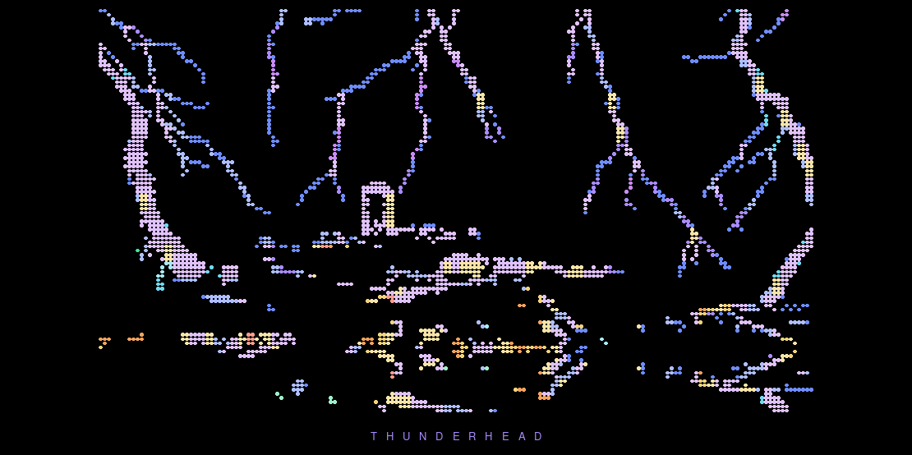

# Thunderhead

An Omarchy theme of thunderstorms: lightning at night over a pier, a city, a radio tower and two mountaintop
observatories, and the great clouds storms build: shelf clouds rolling in over the sea and the fields, mammatus
hanging under an anvil at sunset, and a thunderhead glowing above the Baltic. The near-black of a night storm, pale
violet-white text, the violet of a lightning-lit sky as the accent, and the window border fading from that violet
into the electric blue of the 1972 storm at Kitt Peak. The terminal colours come from the photos too: red and
orange mammatus, the glowing anvil off Gotland, the green-lit radio tower in Vienna, the Kitt Peak sky.

(A thunderhead is a cumulonimbus cloud that has grown up to where the air stops rising and spread into a flat,
anvil-shaped top ([Wikipedia: Cumulonimbus incus](https://en.wikipedia.org/wiki/Cumulonimbus_incus)). Lightning heats
the air around it to about 30,000 °C, and strikes somewhere on Earth about 44 times a second
([Wikipedia: Lightning](https://en.wikipedia.org/wiki/Lightning)).)

Each wallpaper has a small label in the bottom right corner (bottom right because terminal text keeps to the
left): the place or the kind of storm, one line in plain words, when it was photographed, the photographer and the
licence. Eight photos with city lights, water or bright sky under the label (02, 04, 06, 07, 08, 09, 11, 12) get a
dark panel behind it.

| Wallpaper | What it shows | Photographed | Photographer, licence | Source |
|---|---|---|---|---|
| `01-three-strikes` | Three lightning strikes in one 6-second exposure | 24 Sep 2023 | Rollingskyphoto, CC BY 4.0 | [Commons](https://commons.wikimedia.org/wiki/File:3_Near-Simultaneous_Lightning_Strikes_on_One_Exposure.jpg) |
| `02-kitt-peak-1972` | A summer storm over Kitt Peak National Observatory, Arizona (film) | 4 Jun 1972 | Gary Ladd / KPNO / NOIRLab / NSF / AURA, CC BY 4.0 | [Commons](https://commons.wikimedia.org/wiki/File:A_Vintage_Lightning_Storm_at_Kitt_Peak.jpg) |
| `03-port-la-nouvelle` | The port and lighthouses of Port-la-Nouvelle, Aude, France, in an overnight storm | 28 Nov 2014 | Maxime Raynal (Flickr), CC BY 2.0 | [Commons](https://commons.wikimedia.org/wiki/File:Port_and_lighthouse_overnight_storm_with_lightning_in_Port-la-Nouvelle.jpg) |
| `04-cloud-to-cloud` | Cloud-to-cloud lightning, Albury, New South Wales | 9 Sep 2014 | Thennicke, CC BY-SA 4.0 | [Commons](https://commons.wikimedia.org/wiki/File:CC_lightning,_Albury_NSW.JPG) |
| `05-maunakea` | Lightning in the clouds below the stars over Maunakea, Hawaii | published 14 Aug 2024 | International Gemini Observatory / NOIRLab / NSF / AURA / J. Chu, CC BY 4.0 | [Commons](https://commons.wikimedia.org/wiki/File:Lightning_Above_the_Mountaintop_(iotw2433a).jpg) |
| `06-budapest` | A strike over the Danube, Budapest | 24 Aug 2018 | Jules Verne Times Two, CC BY-SA 4.0 | [Commons](https://commons.wikimedia.org/wiki/File:Lightning_strike_over_the_Danube_(Budapest,_Hungary).jpg) |
| `07-arsenal-tower` | Lightning by the Arsenal radio tower, Vienna (Commons featured picture) | 10 Aug 2017 | Linie29, CC BY-SA 4.0 | [Commons](https://commons.wikimedia.org/wiki/File:Funkturm_Arsenal_Blitze.jpg) |
| `08-goldendale` | Cloud-to-ground lightning near Goldendale, Washington | 9 Jul 2023 | The Modern Polymath, CC BY 4.0 | [Commons](https://commons.wikimedia.org/wiki/File:Cloud-to-ground_lightning_strike.jpg) |
| `09-shelf-cloud-croatia` | A shelf cloud over the sea, Croatia | 25 Sep 2020 | Šime Barešić (Flickr), CC0 | [Commons](https://commons.wikimedia.org/wiki/File:Shelf_cloud_-_Flickr_-_otrow_photography.jpg) |
| `10-shelf-cloud-poland` | A shelf cloud lit by lightning, central Poland | 27 Aug 2023 | Ikethecatto, CC BY-SA 4.0 | [Commons](https://commons.wikimedia.org/wiki/File:Shelf_cloud_in_central_poland_on_27-8-23.jpg) |
| `11-varbla` | A shelf cloud over Varbla, Estonia | 12 Aug 2017 | Kristian Pikner, CC BY-SA 4.0 | [Commons](https://commons.wikimedia.org/wiki/File:Riiulpilv_-_Shelf_cloud_(2)_copy.jpg) |
| `12-red-mammatus` | Mammatus clouds lit red at sunset after a summer storm | 19 Jul 2013 | David Zhang (Flickr), CC BY-SA 2.0 | [Commons](https://commons.wikimedia.org/wiki/File:2013_07_19_Mammatus_clouds_(22526668374).jpg) |
| `13-mammatus` | Mammatus clouds at sunset, Austin, Texas | 27 May 2023 | Caglaror, CC BY-SA 4.0 | [Commons](https://commons.wikimedia.org/wiki/File:Mammatus_Clouds_from_Austin,_TX,_USA.jpg) |
| `14-thunderhead-gotland` | A cumulonimbus with its anvil top glowing at sunset, off Östergarn, Gotland, Sweden | 18 Jun 2020 | Bene Riobó, CC BY-SA 4.0 | [Commons](https://commons.wikimedia.org/wiki/File:Cumulonimbus_en_Gotland.jpg) |

Facts on the labels come from each photo's Commons page (place, date, description; NOIRLab's own text for 02 and 05)
and Wikipedia: cloud-to-cloud lightning runs "between two clouds" rather than to the ground
([Lightning](https://en.wikipedia.org/wiki/Lightning)); shelf clouds are arcus clouds, which "most frequently form
along the leading edge or gust fronts of thunderstorms" ([Arcus cloud](https://en.wikipedia.org/wiki/Arcus_cloud));
mammatus are "a cellular pattern of pouches hanging underneath the base of a cloud", "most often associated with
anvil clouds and also severe thunderstorms" ([Mammatus cloud](https://en.wikipedia.org/wiki/Mammatus_cloud)); the
Arsenal's radio tower is 150 metres high ([Vienna Arsenal](https://en.wikipedia.org/wiki/Vienna_Arsenal)); Goldendale
lies "near the Columbia River Gorge" ([Goldendale, Washington](https://en.wikipedia.org/wiki/Goldendale,_Washington)).
Kitt Peak, 1972: NOIRLab writes that Gary Ladd, then a technical assistant at Kitt Peak, had the night off, shot the
storm on film from the building of the 84-inch telescope, and only saw what he had when the film came back. The date
is the one the photo file records, except 02 (the night NOIRLab gives) and 05 (no date given, so the date NOIRLab
published it).

Chosen from Wikimedia Commons' featured pictures of lightning and of clouds and searches for lightning, supercells,
shelf clouds, mammatus and thunderstorm clouds (440 landscape photos at least 3500 pixels wide), then looked at one
by one. Every photo was uploaded by its photographer, published by the observatory (NOIRLab, CC BY 4.0) or imported
from Flickr with the licence checked (FlickreviewR); none is non-commercial or no-changes. Grain at screen size
(`src/grain.py`, Immerkaer sigma at 2560 x 1440): Budapest 0.4, Arsenal 0.5, cloud-to-cloud 0.8, Croatia 0.8,
Kitt Peak 0.8, Varbla 0.9, Goldendale 1.0, Maunakea 1.0, Austin 1.1, Port-la-Nouvelle 1.1, Gotland 1.3, Poland 1.4,
red mammatus 1.5, three strikes 2.5; the three strikes, Poland, red mammatus, Maunakea, Kitt Peak, Budapest and the
Arsenal were also looked at in true-size crops. Kitt Peak is a 1972 film scan and shows faint colour fringes along
the bolts at full size. Left out: a National Park Service storm over the Great Sand Dunes (smeared by noise
reduction at full size), a strike over palm trees (grainy sky), photos whose licence trail was not clean
(a NOAA picture actually taken by a storm spotter, Flickr copies without a licence review, a website's reposts), and
a TIFF copy of the same Kitt Peak picture.

```
src/build thunderhead            # the photos (~100 MB) download once into ~/.cache/omarchy-themes/thunderhead
./install thunderhead
omarchy theme set thunderhead
```

## Screensaver



`screensaver.txt` is the `02-kitt-peak-1972` wallpaper redrawn as braille text art (`src/asciiart.py`), each dot in the nearest of
the theme's colours. `./install` copies it with the theme; once [extras/screensaver](../../extras/screensaver/README.md)
is set up, Omarchy's screensaver shows it with an animated effect (laser etch, matrix rain, VHS glitch and others).

## Credits and licences

Every wallpaper carries its photographer and licence on its label; the table above links each photo's page.

- [CC0](https://creativecommons.org/publicdomain/zero/1.0/): public domain, no conditions (credit given anyway).
- [CC BY 2.0](https://creativecommons.org/licenses/by/2.0/), [CC BY 4.0](https://creativecommons.org/licenses/by/4.0/):
  free to use and change with credit, a link to the licence, and a note of changes.
- [CC BY-SA 2.0](https://creativecommons.org/licenses/by-sa/2.0/), [CC BY-SA 4.0](https://creativecommons.org/licenses/by-sa/4.0/):
  the same, and a changed picture must be shared under the same licence.

Changes made to every photo: cut to 16:9 and scaled to 3840 x 2160, and a label added in the bottom right corner.
A finished wallpaper made from a CC BY-SA photo is itself shared under that photo's CC BY-SA licence.
