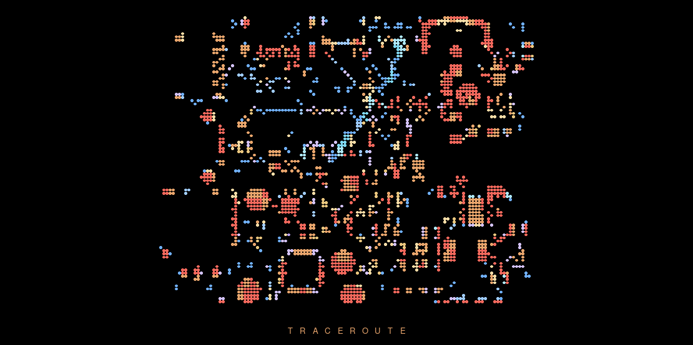

# Traceroute

An Omarchy theme: a circuit board at night. Blue-black solder mask, light-blue silkscreen, copper traces, and a
bright yellow window border. The name is a pun on routing traces on a board and the `traceroute` network command.

The wallpapers are drawn from two real boards of a portable computer (a cyberdeck) built on a LattePanda Mu module:
copper on top, the other layers in faint blue underneath, and one net lit up light blue. The terminal box lists that
net's path pad by pad and via by via, in millimetres instead of milliseconds.

| Wallpaper | What it shows |
|---|---|
| `1-main-v1.png` | The main board (124 x 79 mm, 4 layers): net `SIO_UART_RX`, 6 hops, 108.4 mm |
| `2-io-v1.png` | The port board: net `USB2_P2_P`, one half of a USB 2 pair, 8 hops, 39.9 mm |

## Install

```sh
./install traceroute
omarchy theme set traceroute
```

## How the wallpapers are made

- [`src/traceroute/wallpaper.py`](../../src/traceroute/wallpaper.py) reads a board with KiCad's `pcbnew` Python
  module (read only), finds the net's path from pad to pad (a shortest path over its tracks and vias), and writes an
  SVG; `rsvg-convert` turns it into a 3840 x 2160 PNG. Everything stays inside the part a 3:2 screen shows.
- [`src/traceroute/build`](../../src/traceroute/build) draws both. It needs KiCad 10 and the board files, which are
  not public yet, so these two wallpapers ship ready-made.

## Screensaver



`screensaver.txt` is the `2-io-v1` wallpaper redrawn as braille text art (`src/asciiart.py`), each dot in the nearest of
the theme's colours. `./install` copies it with the theme; once [extras/screensaver](../../extras/screensaver/README.md)
is set up, Omarchy's screensaver shows it with an animated effect (laser etch, matrix rain, VHS glitch and others).

## Credits

The wallpapers and the boards they show are by CompilingThings, shared under CC BY 4.0 (see
[CREDITS.md](../../CREDITS.md)).
