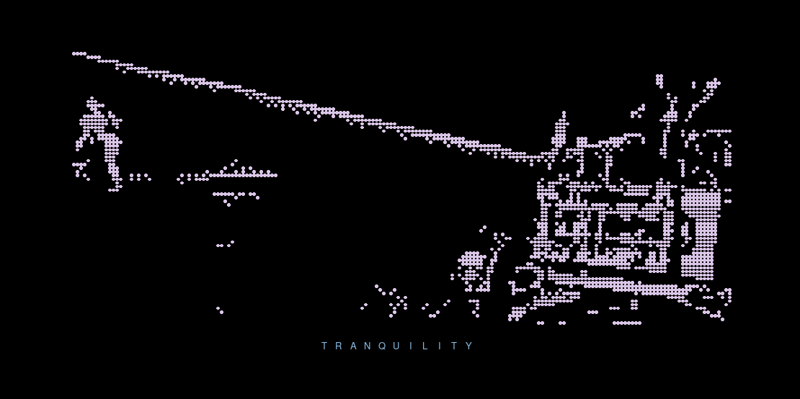

# Tranquility

An Omarchy theme made from real photos of the Moon: the Artemis II crew's flyby in April 2026, and Apollo. Named after
Apollo 11's landing site, Tranquility Base. Moon-dust greys on black, with one colour: Earth blue, the only colour in
the Moon's sky. The window border fades from moonlight white into that blue.

Each wallpaper has a small label in the bottom right corner: what it is, in plain words, who took it, when, and the credit.

| Wallpaper | What it shows | Taken by | Source |
|---|---|---|---|
| `1-earthset` | Earth sinking behind Ohm crater, through Orion's window | Artemis II crew, 6 April 2026 | [art002e009288](https://images.nasa.gov/details/art002e009288) |
| `2-earthrise` | Earth rising over the Moon's horizon on Christmas Eve | Apollo 8 crew, 24 Dec 1968 | [as08-14-2383](https://images.nasa.gov/details/as08-14-2383) |
| `3-crescent-moon` | The Moon behind them on the way home | Artemis II crew, 7 April 2026 | [art002e019570](https://images.nasa.gov/details/art002e019570) |
| `4-edge-of-two-worlds` | A crescent Earth six minutes before Earthset | Artemis II crew, 6 April 2026 | [art002e009285](https://images.nasa.gov/details/art002e009285) |
| `5-terminator` | Craters along the line between lunar day and night | Artemis II crew, 6 April 2026 | [art002e014055](https://images.nasa.gov/details/art002e014055) |
| `6-hadley-delta` | Dave Scott at a boulder on Hadley Delta, the rover at right (photo by Jim Irwin) | Apollo 15, 31 July 1971 | [as15-85-11437](https://images.nasa.gov/details/as15-85-11437) |
| `7-the-moon-from-orion` | More than two-thirds of the Moon, Grimaldi crater and Orientale basin | Artemis II crew, 6 April 2026 | [art002e012183](https://images.nasa.gov/details/art002e012183) |
| `8-orientale-basin` | The rings of Orientale basin, about 965 km (600 miles) wide | Artemis II crew, 6 April 2026 | [art002e012090](https://images.nasa.gov/details/art002e012090), width from art002e012183 |

The crosses on the Apollo 15 photo are in the original: the surface Hasselblad had a glass "réseau" plate with a 5 x 5
grid of crosses, used to correct the photos for film distortion
([Apollo Lunar Surface Journal](https://www.nasa.gov/wp-content/uploads/static/history/alsj/alsj-reseau.html)).

## Install

```sh
./install tranquility
omarchy theme set tranquility
```

## How the wallpapers are made

- `wallpapers.json` lists each photo: download link, source page, credit and licence, label text, and where to cut it.
- [`src/photowall.py`](../../src/photowall.py) cuts each photo to 16:9 at 3840 x 2160 and draws its label inside the
  part a 3:2 screen shows; the same script makes every photo theme in this repository.
- `src/build tranquility` makes them again from the photos (~15 MB, downloaded once into `~/.cache/omarchy-themes/tranquility`).

## Screensaver



`screensaver.txt` is the `6-hadley-delta` wallpaper redrawn as braille text art (`src/asciiart.py`), each dot in the nearest of
the theme's colours. `./install` copies it with the theme; once [extras/screensaver](../../extras/screensaver/README.md)
is set up, Omarchy's screensaver shows it with an animated effect (laser etch, matrix rain, VHS glitch and others).

## Credits

The photos come from NASA. [CREDITS.md](../../CREDITS.md) lists every wallpaper's author, licence and source. NASA material "generally [is] not
subject to copyright in the United States", and "NASA should be acknowledged as the source"
([NASA media guidelines](https://www.nasa.gov/nasa-brand-center/images-and-media/)). Every wallpaper says NASA.
