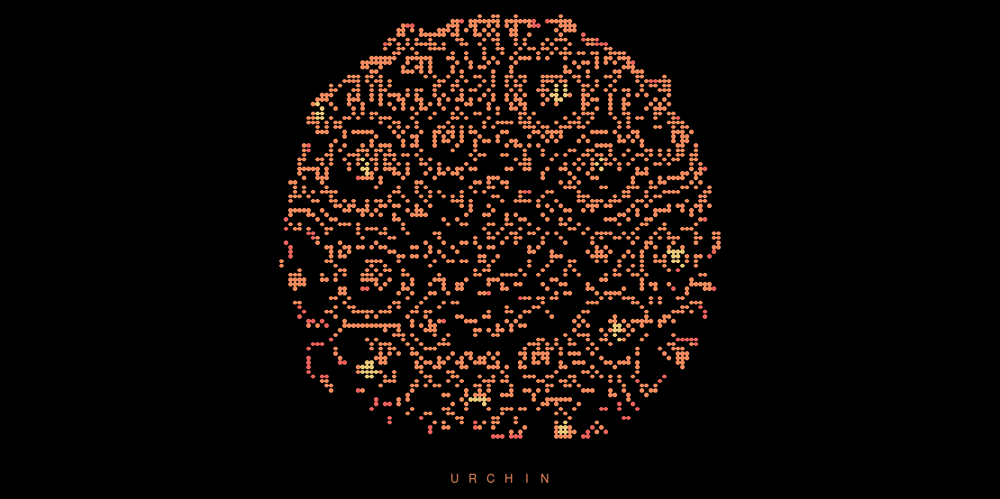

# Urchin

An Omarchy theme of a sea urchin up close, photographed by Brandon Antonio Segura Torres and Priscilla Vieto Bonilla:
the five teeth of its jaw (Aristotle's lantern) seen from inside and from below, the whole cream shell from above with
its spines gone, the knobs its spines sit on (tubercles) in coral and in cream, and the plates at the top of its shell.
A near-black background, warm pale text, the coral of the spine bases as the accent, and the window border turning
from it into the cream of the teeth.

Each wallpaper has a small label in the bottom right corner (bottom right because terminal text keeps to the
left): what it is, one line in plain words, the date the photo's page gives, the photographers and the licence.

| Wallpaper | What it shows | Date | Photographers, licence | Source |
|---|---|---|---|---|
| `01-lantern-teeth` | Aristotle's lantern, the teeth of a sea urchin | 23 Nov 2025 | Brandon Antonio Segura Torres & Priscilla Vieto Bonilla, CC BY-SA 4.0 | [Commons](https://commons.wikimedia.org/wiki/File:Linterna_de_arist%C3%B3teles,_dientes_de_erizo_de_mar.jpg) |
| `02-urchin-shell` | A cream-coloured sea urchin in aboral view (from the top, the side away from the mouth) | 21 Oct 2025 | the same, CC BY-SA 4.0 | [Commons](https://commons.wikimedia.org/wiki/File:Erizo_de_mar_color_crema_en_vista_aboral.jpg) |
| `03-five-teeth` | Sea urchin teeth, Aristotle's lantern, from below | 23 Nov 2025 | the same, CC BY-SA 4.0 | [Commons](https://commons.wikimedia.org/wiki/File:Dientes_de_erizo_de_mar,_linterna_de_Arist%C3%B3teles.jpg) |
| `04-tubercles` | Detail of sea urchin tubercles | 23 Nov 2025 | the same, CC BY-SA 4.0 | [Commons](https://commons.wikimedia.org/wiki/File:Detalle_de_mamelones_de_erizo_de_mar.jpg) |
| `05-tubercle` | Sea urchin tubercles | 21 Oct 2025 | the same, CC BY-SA 4.0 | [Commons](https://commons.wikimedia.org/wiki/File:Mamelones_de_erizo_de_mar.jpg) |
| `06-genital-plates` | Sea urchin genital plates | 27 Nov 2025 | the same, CC BY-SA 4.0 | [Commons](https://commons.wikimedia.org/wiki/File:Placas_genitales_de_erizo_de_mar.jpg) |

Facts on the labels come from each photo's Commons page; "the knobs its spines sit on" is the plain meaning of
tubercle, and the genital plates are the plates round the top of the shell that carry the pores eggs or sperm leave
by. The photos were entered in the Wiki Science Competition 2025 in Argentina (microscopy).

The photos were chosen from the eight unused sea urchin photos 4K or larger by the same photographers in Wikimedia
Commons' microscopy categories; one 1800-pixel-wide photo was too small, and a second close-up of a
single tubercle left out. Sea urchins are new to these themes. Grain at screen size (`src/grain.py`, Immerkaer sigma at
2560 x 1440): 0.4 to 2.7; the 2.7 is the fine mesh of the genital plates, sharp at true size, not noise. Parts of
04 and 05 lie outside the focus on purpose (a macro photo's shallow depth).

```
src/build urchin            # the photos (~99 MB) download once into ~/.cache/omarchy-themes/urchin
./install urchin
omarchy theme set urchin
```

## Screensaver



`screensaver.txt` is the `02-urchin-shell` wallpaper redrawn as braille text art (`src/asciiart.py`), each dot in the nearest of
the theme's colours. `./install` copies it with the theme; once [extras/screensaver](../../extras/screensaver/README.md)
is set up, Omarchy's screensaver shows it with an animated effect (laser etch, matrix rain, VHS glitch and others).

## Credits and licences

Every wallpaper carries its photographers and licence on its label; the table above links each photo's page.

- [CC BY-SA 4.0](https://creativecommons.org/licenses/by-sa/4.0/): free to use and change with credit, a link to the
  licence, and a note of changes; changed versions must keep the same licence. Every wallpaper here keeps it.

Changes made to every photo: cropped to 16:9 round its middle and scaled to 3840 x 2160 (the whole shell, 02, set
on black instead), and a label added in the bottom right corner.
